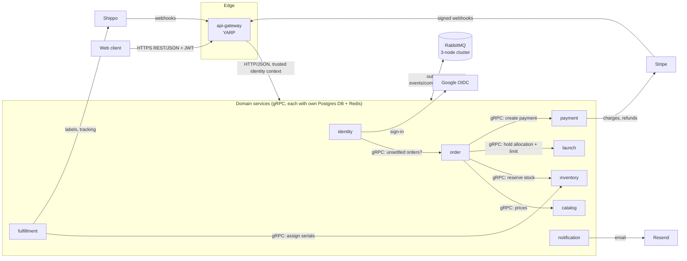
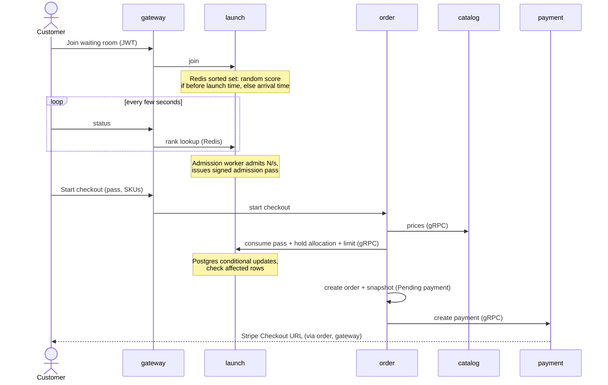

# Bloom — High-Level Design

[Docs](../README.md) › High-level design

| | |
|---|---|
| **Status** | Approved (2026-10-31) |
| **Last updated** | 2026-10-31 |
| **Product design** | [doc/product-design](../product-design/00-overview.md) |
| **Decision records** | [adr/](adr/README.md) (HLD-ADR-001 … 018) |

## Summary

Bloom's backend is **8 domain microservices behind a YARP API gateway**, written in **.NET**, each owning its **PostgreSQL database** and **Redis**, deployed on **Kubernetes**. Services call each other with **gRPC** when the caller needs an answer now, and exchange **events and commands through RabbitMQ** for everything else. Every message goes through a **transactional outbox** and is consumed through an **inbox** in the same transaction as its effect, so messages are never lost or applied twice.

Normal traffic is small (about 150 req/s at peak). The architecture is shaped by the **launch spike**: 100k customers in a waiting room, 5k units, about 20k status reads/s and about 200 checkouts/s. The launch path (gateway + `launch`) scales independently. A **Redis waiting room** caps checkout traffic, so **conditional updates in Postgres** can enforce allocation and purchase limits durably. Payments are protected against double charges by four layers of idempotency.

---

## 1. Context and goals

Bloom is a single-vendor US store selling Apple devices ([product overview](../product-design/00-overview.md)). This document defines the backend's structure. Business rules live in `doc/product-design/` and are referenced by ID (`LCH-R07`, `BI-01`, …).

| ID | Goal | Serves |
|---|---|---|
| HG-1 | Business invariants BI-01 … BI-07 hold under launch-peak load. | BI-01 … BI-07 |
| HG-2 | The launch path scales independently of the rest of the system. | LCH-R04 … R10 |
| HG-3 | No message is lost, no message is applied twice, no customer is charged twice. | BI-05, BI-06 |
| HG-4 | Each service builds, deploys and scales independently. | Portfolio goal |

**Success criteria:** the quality targets in §3.2 are met in a load test at launch peak, and concurrency tests show zero invariant violations.

## 2. Non-goals

- Multi-region deployment or cross-region failover.
- Capabilities that are out of scope in the product design ([overview §5](../product-design/00-overview.md#5-out-of-scope-future)), including recommendations.
- Change-data-capture pipelines (Debezium, Kafka Connect).
- A dedicated search engine (see [HLD-ADR-017](adr/HLD-ADR-017-postgres-full-text-search.md)).

## 3. Requirements

### 3.1 Load profile

| Profile | Figure | Source |
|---|---|---|
| Registered users | 1M | Owner estimate |
| Daily active users | 50k – 100k | Owner estimate |
| Normal API traffic | ~35 req/s average, ~150 req/s peak | 100k DAU × ~30 calls/day, peak ≈ 4× average |
| Launch: waiting room | 100k customers queued | Owner target (~10% of registered users) |
| Launch: units | 5k pre-order units | Owner target |
| Launch: status reads | ~20k req/s | 100k clients polling about every 5 s |
| Launch: checkouts | ~200 checkouts/s admitted | Owner target (admission ceiling) |

### 3.2 Quality attributes

| ID | Attribute | Target |
|---|---|---|
| QA-01 | Availability | 99.9% monthly for checkout and catalog (≤ 43 min downtime/month) |
| QA-02 | Latency: catalog reads | p95 < 150 ms at launch peak |
| QA-03 | Latency: checkout start | p95 < 300 ms at launch peak |
| QA-04 | Latency: waiting-room status | p95 < 50 ms at launch peak |
| QA-05 | Throughput | 200 checkouts/s and 20k status reads/s sustained during a launch |
| QA-06 | Consistency | Zero violations of BI-01 … BI-07 |
| QA-07 | Message durability | No lost messages (at-least-once delivery + idempotent consumers) |
| QA-08 | Revocation | Revoked tokens rejected at the gateway within ~1 s (ACC-R10) |
| QA-09 | Payment data | Card data never reaches Bloom servers (CHK-R10) |
| QA-10 | Recoverability | PostgreSQL RPO ≤ 5 min, RTO ≤ 1 h |
| QA-11 | Real-time connections | 100k concurrent in-app WebSocket connections at launch peak ([09-notification](../low-level-design/09-notification.md)) |

### 3.3 Functional ownership

| Product area | Rules | Owning service |
|---|---|---|
| Accounts and access | ACC-R01 … R14 | identity |
| Catalog and reviews | CAT-R01 … R15, REV-R01 … R08 | catalog |
| Inventory | INV-R01 … R20 | inventory |
| Launch | LCH-R01 … R28 | launch |
| Cart, checkout, orders, coupons | CHK-R01 … R18, ORD-R01 … R17, PRM-R01 … R13 | order |
| Payments and refunds | CHK-R10 … R17, RET-R11 … R14 | payment |
| Fulfillment, returns, warranty coverage | ORD-R08 … R15, RET-R01 … R15, WAR-R01 … R06 | fulfillment |
| Notifications | NTF-R01 … R06 | notification |

## 4. Architecture overview



| Interaction | Used when | Mechanism |
|---|---|---|
| Client → gateway | All client traffic | REST/JSON over HTTPS. The gateway verifies the JWT and forwards to the service's JSON endpoint, which is transcoded from the service's `.proto` (ASP.NET Core gRPC JSON transcoding). |
| Service → service, sync | The caller needs the answer to continue (checkout holds, prices, serial validation) | gRPC over Linkerd mTLS |
| Service → service, async | Facts others react to (events), and compensations or follow-ups that must eventually happen (commands) | Outbox → relay → RabbitMQ → inbox |
| Provider → Bloom | Payment and carrier callbacks | Public webhook routes on the gateway (no JWT; signature verified by the owning service) |

## 5. Components

Each service has one codebase and two deployments: **API** (gRPC/JSON) and **worker** (outbox relay, consumers, scheduled jobs) — see §9.5.

| Service | Owns | Must not |
|---|---|---|
| **api-gateway** | Routing, TLS termination, JWT verification (JWKS), revocation check, tiered rate limiting, coarse role checks per route, stripping client-sent identity headers | Hold business data; make resource-level decisions |
| **identity** | Customer and staff accounts, credentials, Google linking, MFA, access and refresh tokens, signing keys, address book, staff roles, **audit log** | Decide permissions inside other services; store orders |
| **catalog** | Categories, products, SKUs, prices, warranty plans (as products), product images (object storage), search, reviews and ratings, verified-buyer eligibility | Hold stock or allocation |
| **inventory** | Stock per SKU (on-hand, reserved), reservations, pre-order backorder queue, serial units and their states, goods receipts, adjustments, stock ledger | Know prices, launches or orders beyond reservation and line references |
| **order** | Cart, checkout orchestration, orders and status history, order-line snapshots, coupons and coupon uses, checkout settings (Express fee, tax rate), saga state for checkout and cancellation | Hold stock counts, allocation or payment state |
| **launch** | Launches and stages, pre-order allocation counters, purchase-limit counters, waiting room, admission passes, admission worker | Own orders (it hands checkout to `order`) |
| **payment** | Payments, refunds, provider idempotency keys, provider events, reconciliation | Change order status directly (it publishes events) |
| **fulfillment** | Pick/pack tasks, shipments, carrier integration, return requests, return labels, inspections, **warranty coverage**, saga state for return → refund and delivery failure | Execute refunds (it commands `payment`); own stock counts |
| **notification** | Email sending, in-app notifications (read/unread, 90-day retention), a minimal contact copy (ID, email, name) | Decide when to notify (it reacts to events) |

## 6. Data ownership

Every service has its own database in one PostgreSQL cluster ([HLD-ADR-004](adr/HLD-ADR-004-data-ownership.md)). No service reads another service's database or Redis. Cross-service data is either requested over gRPC or held as an event-fed copy.

| Data | Source of truth | Copies (fed by) |
|---|---|---|
| Customer and staff accounts | identity | notification: contact copy (identity events) |
| Token revocations | identity | gateway Redis: revocation list (identity events) |
| Audit log | identity | — (fed by staff-action events from all services) |
| Products, SKUs, prices, warranty plans | catalog | order lines: price and name snapshot at checkout start (immutable) |
| Launches, stages, launch SKU membership | launch | catalog: membership and stage per SKU (launch events) |
| Reviews, ratings | catalog | — |
| Verified-buyer eligibility | catalog | (fed by order "delivered" events) |
| Stock, reservations, pre-order backorders, serial units, ledger | inventory | — |
| Checkout settings (Express fee, tax rate) | order | — |
| Launches, allocation, limit counters | launch (Postgres) | — |
| Waiting-room queue, admission state | launch (Redis) | — |
| Cart, orders, coupons, coupon uses | order | — |
| Payments, refunds, provider events | payment | — |
| Shipments, returns, inspections, warranty coverage | fulfillment | — |
| In-app notifications | notification | — |

## 7. Interfaces

### 7.1 Synchronous (gRPC)

| Caller → callee | Purpose | Failure behaviour |
|---|---|---|
| order → catalog | Batched current prices and snapshot data (cart view, checkout start) | Checkout start fails; customer retries |
| order → inventory | Reserve stock for a regular checkout; availability for cart flags (CHK-R18) | Checkout start fails; already-made holds are compensated |
| order → launch | Consume admission pass, hold allocation and purchase limit | Same |
| order → payment | Create a payment for the order (returns the Stripe Checkout URL) | Order stays *Pending payment*; customer retries within 15 min |
| order → fulfillment | Cancel a pack task before cancelling a handed-over order (refused once packing started for customers, or once shipped for Support) | Cancellation fails; order unchanged |
| identity → order | "Does this customer have unsettled orders?" (ACC-R13) | Deletion refused with "try later" (fail safe) |
| fulfillment → inventory | Assign, unassign or replace serials at packing (INV-R13, R14, R19); commit stock for a reship (ORD-R13) | Packing step fails; Warehouse retries |
| launch → catalog | Validate a SKU and its product when staff add it to a launch | Admin action fails; staff retry |
| inventory → catalog | Lock a SKU's serialized flag at its first goods receipt (CAT-R14) | Receipt fails; Warehouse retries |
| gateway → identity | Fetch the JWKS (internal HTTP, not gRPC; cached, refreshed every 10 min) | Gateway keeps its cached keys; not ready at startup until loaded |

Exact contracts (`.proto`) are specified in the LLD of each service.

### 7.2 Asynchronous (RabbitMQ)

**Events** announce facts; **commands** ask one service to act. Both use the outbox → relay → inbox path ([HLD-ADR-006](adr/HLD-ADR-006-transactional-outbox.md), [HLD-ADR-007](adr/HLD-ADR-007-inbox-retries-dlq.md)). The list below is the initial set; names and payloads are fixed in the LLD.

| Message | Kind | Producer | Consumers |
|---|---|---|---|
| Payment succeeded / failed | Event | payment | order |
| Refund completed | Event | payment | order, fulfillment, notification |
| Refund failed | Event | payment | order, fulfillment (saga stays open; Support alerted) |
| Order paid | Event | order | inventory (regular: reservation → sale; pre-order: create backorder), launch (hold → sold), notification |
| Stock allocated to order | Event | inventory | order (pre-order *Awaiting stock* → *Paid*) |
| Order ready to fulfill | Event | order | fulfillment (pack task). Emitted when the order reaches *Paid*; carries lines, shipping address and shipping option. |
| Order cancelled | Event | order | notification |
| Release reservation / backorder | Command | order | inventory |
| Reservation released / hold released | Event | inventory / launch | order (saga completion; published for every release command, including no-ops) |
| Cancel payment | Command | order | payment (cancel the provider payment when a checkout expires or fails) |
| Packing started; return requested / return closed | Event | fulfillment | order (status *Packing*; open-return count for ACC-R13); notification (return closed as expired) |
| Return label issued / return received | Event | fulfillment | notification |
| Pre-order delayed | Event | order | notification (launch released without stock for the pre-order, INV-R11) |
| Release allocation hold | Command | order | launch |
| Refund payment | Command | order, fulfillment | payment |
| Order delivered | Event | order | catalog (review eligibility) |
| Shipment shipped / delivered / delivery failed | Event | fulfillment | order, notification; inventory (shipped) |
| Receive customer return / receive returned-to-sender / mark lost in transit | Command | fulfillment | inventory |
| Return decided | Event | fulfillment | order, notification |
| Customer registered / contact changed | Event | identity | notification (contact copy); catalog (reviewer display name) |
| Verification code / staff invited | Event | identity | notification (email only: codes for email verification, password reset, email change; staff invitation links) |
| Account deleted | Event | identity | notification, catalog, order, fulfillment (each anonymizes the personal data it holds; amounts, SKUs and dates are kept) |
| Launch stage changed | Event | launch | order (release of allocated pre-orders, LCH-R19); catalog (launch membership and stage per SKU: visibility, buyability, and launch info returned to order at checkout) |
| Tokens revoked | Event | identity | api-gateway (revocation list); notification (close the user's WebSockets) |
| Staff action recorded | Event | all services | identity (audit log) |

### 7.3 External integrations

Each provider sits behind an interface in its owning service ([HLD-ADR-018](adr/HLD-ADR-018-external-providers.md)).

| Provider | Owner | Use | Inbound |
|---|---|---|---|
| Stripe (test mode) | payment | Checkout Sessions (hosted page), refunds, idempotency keys | Signed webhooks |
| Shippo (test mode) | fulfillment | Labels, return labels, tracking (US) | Tracking webhooks |
| Resend (cloud) / Mailpit (local) | notification | Transactional email | — |
| Google OIDC | identity | Customer sign-in | OAuth redirect |

## 8. Key flows

### 8.1 Launch: queue → checkout



### 8.2 Payment confirmation, expiry and late payment

```mermaid
sequenceDiagram
    actor C as Customer
    participant S as Stripe
    participant P as payment
    participant O as order
    participant MQ as RabbitMQ
    C->>S: Pay on Stripe Checkout (hosted page; card data stays at Stripe)
    S->>P: Webhook (signature verified, event ID deduped)
    P->>MQ: Payment succeeded (outbox)
    MQ->>O: consume (inbox)
    alt order still Pending payment
        O->>O: Paid (or Awaiting stock), coupon use consumed
        O->>MQ: Order paid (outbox)
    else order already Cancelled (expired)
        O->>MQ: Refund payment command (outbox)
        Note over O: Customer notified: reservation expired
    end
    Note over O: Expiry sweep (worker): Pending payment past 15 min<br/>→ Cancelled + Release commands (outbox)
```

A reconciliation job in `payment` asks Stripe about payments still pending without a webhook.

### 8.3 Cancellation (orchestrated by order)

1. Customer cancels (before packing) or Support cancels (before pickup).
2. `order` sets *Cancelled*, restores the coupon use, and writes in **one transaction**: the status change, saga state, and outbox rows for `Refund payment` → payment, `Release reservation` → inventory or `Release allocation hold` → launch, and `Order cancelled`.
3. Each target applies its command idempotently (inbox) and reports completion with an event. `order` marks the saga complete when all steps report.

### 8.4 Return → refund (orchestrated by fulfillment)

1. Customer requests a return. `fulfillment` creates the request and a Shippo return label.
2. Shippo tracking webhooks move it to *In transit* → *Received*. Warehouse records the inspection.
3. Support decides. `fulfillment` writes the decision and a `Refund payment` command (amount per RET-R06, R07, R13, R14) in one transaction.
4. `payment` refunds through Stripe (provider idempotency key) and publishes `Refund completed`. `order` updates *Partially returned* / *Returned*, and `notification` informs the customer.

The delivery-failure flow (ORD-R12, R13, R17) follows the same shape, also orchestrated by `fulfillment`.

### 8.5 Pre-order stock arrival

1. When a launch order is paid, `inventory` records a **backorder** (order, SKU, quantity, paid time) from the "Order paid" event.
2. On goods receipt, `inventory` allocates received units to the **oldest backorders in the same transaction as the receipt**, so they never become available to regular buyers (INV-R10). Units left over go to on-hand stock. Unfilled backorders keep waiting (INV-R11).
3. `inventory` publishes "Stock allocated to order". Once the launch is also released (LCH-R19), `order` moves the order *Awaiting stock* → *Paid* and emits "Order ready to fulfill" for `fulfillment`.
4. Cancelling a waiting pre-order sends "Release reservation / backorder", which removes the backorder.

## 9. Cross-cutting concerns

### 9.1 Security

| Concern | Design | ADR |
|---|---|---|
| Authentication | identity issues ES256-signed JWT access tokens (15 min) and rotating refresh tokens in an HttpOnly cookie (customers 7 days sliding, staff 12 h absolute). Reusing an old refresh token revokes all of the user's sessions (no grace window). Passwords hashed with Argon2id. | [010](adr/HLD-ADR-010-authentication-tokens.md) |
| Token verification | Only the gateway verifies JWTs, using identity's JWKS (cached). | [010](adr/HLD-ADR-010-authentication-tokens.md) |
| Revocation | identity publishes `Tokens revoked` (user, issued-before time). The gateway keeps the list in its Redis and checks every request. | [010](adr/HLD-ADR-010-authentication-tokens.md) |
| Authorization | Gateway: coarse role rules per route. Services: resource ownership, using the trusted identity context. | [011](adr/HLD-ADR-011-service-trust.md) |
| Service-to-service | Linkerd mTLS with per-service allow rules. The gateway strips client-sent identity headers. | [011](adr/HLD-ADR-011-service-trust.md) |
| Staff | Admin-invited, TOTP MFA required, one role, audit log in identity. | [016](adr/HLD-ADR-016-audit-log.md) |
| Edge protection | Rate limits per threat: a global fixed window per IP on every client route, sliding windows on auth and refresh, token buckets per user on browsing, checkout and the waiting room; one atomic Lua call in gateway Redis, per-pod fallback if Redis is down ([07-api-gateway](../low-level-design/07-api-gateway.md)). TLS terminated at the ingress controller (cert-manager certificates). | — |
| Payment data | Customers pay on Stripe's hosted Checkout page ([LLD-ADR-007](../low-level-design/adr/LLD-ADR-007-stripe-checkout-hosted.md)). Bloom never receives card data. | [008](adr/HLD-ADR-008-idempotency-payments.md) |
| Webhooks | Provider signature verified by the owning service before processing. | [008](adr/HLD-ADR-008-idempotency-payments.md) |
| Secrets | Kubernetes Secrets, committed encrypted (Sealed Secrets). Each service sees only its own. The JWT private key is visible only to identity. | [014](adr/HLD-ADR-014-deployment.md) |

### 9.2 Reliability patterns

| Pattern | Where | Guarantees | ADR |
|---|---|---|---|
| Transactional outbox + polling relay (`SKIP LOCKED`, batch 100, loop while rows remain, ~200 ms idle sleep) | Every message producer | No message lost; safe with several relay instances | [006](adr/HLD-ADR-006-transactional-outbox.md) |
| Inbox in the consumer's transaction (message ID = outbox UUIDv7) | Every consumer | No message applied twice | [007](adr/HLD-ADR-007-inbox-retries-dlq.md) |
| 5 attempts in total (retries after 1 s, 5 s, 30 s, 2 min) → DLQ, alert, replay tool | Every consumer | Transient failures absorbed; poison messages isolated | [007](adr/HLD-ADR-007-inbox-retries-dlq.md) |
| Idempotency key (per user, 24 h, claimed in the same transaction) | Payment operations | Duplicate requests return the first result | [008](adr/HLD-ADR-008-idempotency-payments.md) |
| Four layers against double charge | payment | BI-05 | [008](adr/HLD-ADR-008-idempotency-payments.md) |
| Atomic conditional update + affected-row check | Counters: stock, allocation, limits, coupon uses | No overselling under concurrency | [009](adr/HLD-ADR-009-concurrency-control.md) |
| Optimistic locking (row version) → 409 | Read-modify-write flows | No lost updates | [009](adr/HLD-ADR-009-concurrency-control.md) |
| Hybrid sagas (orchestrated compensations as outbox commands) | Checkout, cancellation, return → refund, delivery failure | Every started flow completes or is compensated | [005](adr/HLD-ADR-005-hybrid-sagas.md) |

**Consistency model:** strong inside a service (one database transaction), eventual across services. RabbitMQ doesn't guarantee ordering across competing consumers, so consumers tolerate reordering with state-machine guards (for example, ignore "paid" for an order that's already *Cancelled*) and optimistic locking.

### 9.3 Observability

- OpenTelemetry in every service for traces, metrics and logs. Trace context travels through gRPC metadata and RabbitMQ message headers, so one trace follows checkout → payment → outbox → consumer.
- Grafana with Tempo (traces), Prometheus (metrics), Loki (logs) ([HLD-ADR-015](adr/HLD-ADR-015-observability.md)).
- Key signals: SLO latency and error rate per route (QA-01 … QA-05), waiting-room size and admission rate, outbox backlog and age, consumer lag, DLQ count, sagas stuck past a deadline, payments pending without a webhook.
- Alerts: any DLQ message; SLO burn; outbox age above threshold; stuck sagas.

### 9.4 Failure handling summary

| Failure | Effect | Handling |
|---|---|---|
| A service's API is down | Sync callers fail fast | Callers return an error. Checkout holds already made are compensated. |
| RabbitMQ unavailable | Async flows pause | Outbox rows wait in the database and publish on recovery. |
| Consumer keeps failing | Message can't be applied | 5 attempts with backoff → DLQ → alert → fix → replay. |
| Stripe webhook never arrives | Payment stuck *pending* | Reconciliation job queries Stripe. |
| Payment after checkout expiry | Paid for a released hold | Automatic refund + notification (HLD-ADR-013). |
| launch Redis fails over | Up to ~1 s of joins lost | Accepted risk. Passes are signed, counters are in Postgres (HLD-ADR-012). |
| Postgres primary fails | Short write outage | CloudNativePG promotes the replica automatically. |
| Data corruption or accidental delete | Bad data copied to the replica | Point-in-time recovery from WAL archive (RPO ≤ 5 min, RTO ≤ 1 h). |

### 9.5 Deployment topology

| Component | Deployment |
|---|---|
| Each domain service | API deployment + worker deployment (same image, different entrypoint) |
| api-gateway | Deployment, autoscaled horizontally |
| launch API | Autoscaled horizontally (launch hot path) |
| Workers | Scaled on RabbitMQ queue length by KEDA |
| PostgreSQL | One CloudNativePG cluster (primary + 1 replica, automatic failover), 8 databases with separate credentials |
| Connection pooling | CloudNativePG Pooler (PgBouncer, transaction mode) in front of the cluster. Each service has a fixed server-connection budget (launch and order largest), and app-side pool sizes are capped to match, so autoscaling can't exhaust Postgres. |
| Object storage | S3-compatible (MinIO locally): product images (catalog, public read) and database backups |
| Backup | CloudNativePG continuous WAL archiving + daily base backup to object storage (MinIO locally, S3-compatible in the cloud). Restore rehearsed once and documented. |
| Redis | One instance per service. gateway and launch: replica + automatic failover. launch: AOF persistence (fsync every second). Others: single instance (rebuildable cache). |
| RabbitMQ | 3-node cluster, quorum queues |
| Ingress | ingress-nginx (or the cloud load balancer) terminates TLS with cert-manager certificates; forwards to api-gateway |
| Service mesh | Linkerd (mTLS, allow rules) |
| Observability | Grafana, Tempo, Prometheus, Loki |
| Environments | Docker Compose for development (Mailpit for email); Kubernetes (kind/k3d locally; cloud-ready) as the deployment target |
| Code and CI/CD | Monorepo: one folder per service, shared `.proto` contracts, a shared library for plumbing only (outbox, inbox, telemetry). GitHub Actions builds, tests and pushes images for changed services only, then applies their manifests to the cluster. |

## 10. Decision records

| ID | Decision |
|---|---|
| [HLD-ADR-001](adr/HLD-ADR-001-microservices-boundaries.md) | Microservices: 8 domain services + gateway, aligned to the product domain |
| [HLD-ADR-002](adr/HLD-ADR-002-technology-stack.md) | .NET, PostgreSQL, Redis, RabbitMQ |
| [HLD-ADR-003](adr/HLD-ADR-003-communication.md) | gRPC internally, RabbitMQ async, REST/JSON at the edge via JSON transcoding |
| [HLD-ADR-004](adr/HLD-ADR-004-data-ownership.md) | Database per service in one HA cluster; Redis per service; event-fed copies |
| [HLD-ADR-005](adr/HLD-ADR-005-hybrid-sagas.md) | Hybrid sagas; compensations as outbox commands |
| [HLD-ADR-006](adr/HLD-ADR-006-transactional-outbox.md) | Transactional outbox, polling relay with `SKIP LOCKED`, UUIDv7 IDs |
| [HLD-ADR-007](adr/HLD-ADR-007-inbox-retries-dlq.md) | Inbox in the consumer transaction; exponential retries; DLQ with alert and replay |
| [HLD-ADR-008](adr/HLD-ADR-008-idempotency-payments.md) | Idempotency keys in the service DB; four layers against double charges |
| [HLD-ADR-009](adr/HLD-ADR-009-concurrency-control.md) | Atomic conditional updates for counters; optimistic locking with 409 |
| [HLD-ADR-010](adr/HLD-ADR-010-authentication-tokens.md) | ES256 JWT at the gateway; strict refresh rotation; event-fed revocation |
| [HLD-ADR-011](adr/HLD-ADR-011-service-trust.md) | Trusted identity context + Linkerd mTLS; ownership checks in services |
| [HLD-ADR-012](adr/HLD-ADR-012-launch-path.md) | Launch: Postgres counters, Redis sorted-set waiting room, configured admission rate |
| [HLD-ADR-013](adr/HLD-ADR-013-checkout-orchestration.md) | Sync orchestrated holds; DB sweep expiry; auto-refund of late payments |
| [HLD-ADR-014](adr/HLD-ADR-014-deployment.md) | Kubernetes, API/worker split, HA topology, monorepo, Sealed Secrets |
| [HLD-ADR-015](adr/HLD-ADR-015-observability.md) | OpenTelemetry + Grafana stack |
| [HLD-ADR-016](adr/HLD-ADR-016-audit-log.md) | Audit log in identity, fed by events |
| [HLD-ADR-017](adr/HLD-ADR-017-postgres-full-text-search.md) | Catalog search on PostgreSQL full-text |
| [HLD-ADR-018](adr/HLD-ADR-018-external-providers.md) | Stripe, Shippo, Resend behind interfaces |

## 11. Risks

| ID | Risk | Mitigation |
|---|---|---|
| R-01 | Build scope: 9 deployables, sagas, outbox and inbox, built by one person. | Shared plumbing library; build in vertical slices (checkout first). |
| R-02 | Hot rows: allocation and limit counters in Postgres at launch peak. | Admission rate caps load; verify in load test; split launch onto its own Postgres cluster if contention shows. |
| R-03 | Redis failover loses up to ~1 s of waiting-room joins. | Accepted; AOF + replica; counters and passes unaffected. |
| R-04 | Strict refresh reuse detection logs users out when two tabs refresh at once. | Frontend must keep a single refresh request in flight across tabs (frontend design constraint). |
| R-05 | Single region and cluster: a regional outage is full downtime. | Accepted for this project; within the 99.9% budget only for in-cluster failures. |
| R-06 | Shared Postgres cluster: one noisy service can slow others. | Per-database credentials and connection limits; split clusters if metrics show interference. |
| R-07 | 409 on every optimistic-lock conflict surfaces brief races to users. | Clients show "changed, reload"; monitor conflict rate per endpoint. |
| R-08 | Eventual consistency: status can lag briefly across services (for example "paid" visible a moment after payment). | UI shows pending states; consumer lag is monitored. |
| R-10 | 100k notification WebSockets at launch peak add a second scaling problem through ingress, gateway and notification. | Sized and autoscaled on connection count; 15-min connection life with jittered reconnects; included in the launch load test. |
| R-09 | Push-based deploys from GitHub Actions: cluster state can drift from the repo after manual changes. | No manual changes to the cluster; manifests in the repo are the only source. |

## 12. Assumptions

| ID | Assumption |
|---|---|
| HA-01 | One Kubernetes cluster in one region. |
| HA-02 | Providers run in sandbox / test mode. |
| HA-03 | A client polls waiting-room status about every 5 s (the server sets the interval). |

## 13. Open questions

| ID | Question |
|---|---|
| — | OQ-HLD-1 to OQ-HLD-7 resolved 2026-10-31 (§5, §6, §7.2, §7.3, §8.5, §9.5, QA-10). |
| — | OQ-HLD-8 resolved 2026-10-31 in [reliability LLD §13](../low-level-design/00-reliability.md#13-retention). |
| — | OQ-HLD-9 resolved 2026-10-31 in [identity LLD §4.1](../low-level-design/06-identity.md#41-postgresql-identity-database) (refresh tokens stored as SHA-256 hash) and [launch LLD §4.3](../low-level-design/01-launch.md#43-admission-pass-token) (HMAC-SHA256 key per `kid`, held only by launch). |
