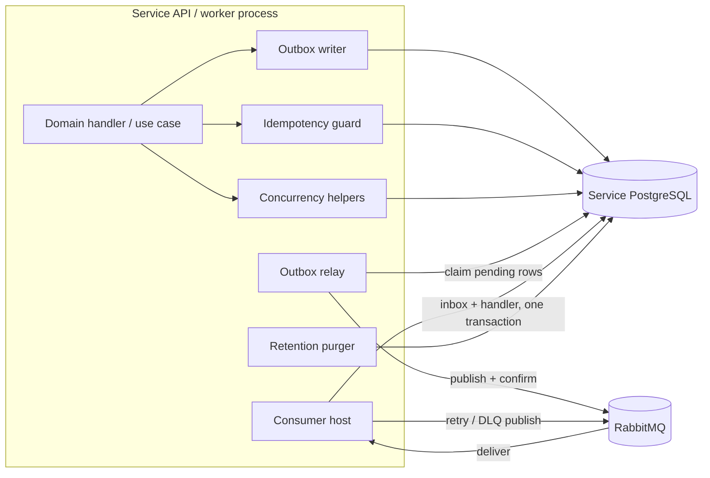
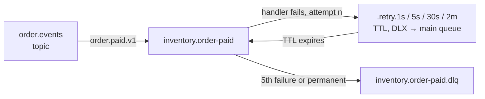

# LLD — Reliability Building Blocks

[Docs](../README.md) › [Low-level design](README.md)

| | |
|---|---|
| **Status** | Approved (2026-11-12) |
| **Last updated** | 2026-11-12 |
| **Component** | Shared reliability library used by every domain service (plumbing only, no domain code) |
| **HLD** | [high-level-design.md §9.2](../high-level-design/high-level-design.md#92-reliability-patterns), HLD-ADR-005 … 009 |
| **Decision records** | [LLD-ADR-001 … 006, 009 … 011, 015](adr/README.md) |

## 1. Problem and scope

Every Bloom service must publish messages without losing them, consume messages without applying them twice, accept retried client requests without repeating money movements, and update shared rows without races. This library implements those mechanisms once so every service behaves identically.

**In scope**

| Module | Purpose |
|---|---|
| Outbox writer | Adds messages to the outbox inside the caller's transaction |
| Outbox relay | Publishes pending outbox rows to RabbitMQ with publisher confirms |
| Message contracts | Envelope, naming, serialization, versioning rules |
| Topology | Declares exchanges, queues, retry queues, DLQs |
| Consumer host | Inbox deduplication, handler invocation, ACK, retry and DLQ routing |
| Idempotency guard | Claims, replays and resumes idempotency keys |
| Concurrency helpers | Conditional (atomic) updates and optimistic locking |
| Error mapping | Maps library failures to gRPC status + `ErrorInfo` reason |
| Retention purger | Deletes expired outbox, inbox and idempotency rows |
| DLQ admin | Inspect, replay, discard dead-lettered messages (§7.7, LLD-ADR-009) |

**Out of scope:** domain logic, saga state machines (each orchestrating service's LLD), which endpoints and messages exist (each service's LLD), gateway concerns, Redis usage.

## 2. Requirements and constraints

| ID | Requirement | Source |
|---|---|---|
| RL-01 | A message is published if and only if the transaction that created it commits. | QA-07, HLD-ADR-006 |
| RL-02 | A consumer applies each message's effect at most once per handler. | HG-3, HLD-ADR-007 |
| RL-03 | A retried client request with the same idempotency key never repeats its effect and always gets the same final answer. | BI-05, HLD-ADR-008 |
| RL-04 | Counters can't go past their bounds under any concurrency. | BI-01 … BI-04, HLD-ADR-009 |
| RL-05 | Read-modify-write updates never overwrite a newer version. | HLD-ADR-009 |
| RL-06 | A failing message is processed **5 times in total**, then dead-lettered. | HLD-ADR-007 |
| RL-07 | Outbox-to-broker delay p95 < 1 s at 600 messages/s per service (launch peak: ~200 checkouts/s × ~3 messages). | QA-05, derived |

**Constraints:** .NET, PostgreSQL (one database per service), RabbitMQ 3-node cluster with quorum queues, JSON payloads (LLD-ADR-004).

## 3. Component structure



| Module | Runs in | Collaborates with |
|---|---|---|
| Outbox writer, Idempotency guard, Concurrency helpers | API and worker (in-process calls) | The caller's database transaction |
| Outbox relay, Consumer host, Retention purger | Worker deployment only | Database, RabbitMQ |
| Topology | Worker startup (idempotent declarations) | RabbitMQ |
| DLQ admin | API deployment (gRPC service, Admin only) | RabbitMQ, database (audit via outbox) |

## 4. Data model

Each service database contains these tables. Names are fixed so dashboards and the purger work across services.

### 4.1 `outbox_messages`

| Column | Type | Constraints | Notes |
|---|---|---|---|
| `id` | `uuid` | PK | UUIDv7, generated by the writer. Becomes the message ID. |
| `message_type` | `text` | not null | For example `order.paid.v1` (§5.1) |
| `kind` | `text` | not null, `event` \| `command` | |
| `exchange` | `text` | not null | `<producer>.events` or `<target>.commands` |
| `routing_key` | `text` | not null | The `message_type` |
| `payload` | `jsonb` | not null | Message body (§5.2) |
| `headers` | `jsonb` | not null | `traceparent`, `correlation_id`, `causation_id` |
| `status` | `text` | not null, `pending` \| `sent` | |
| `attempts` | `int` | not null, default 0 | Failed publish attempts |
| `last_error` | `text` | null | Last publish error |
| `created_at` | `timestamptz` | not null, default `now()` | |
| `sent_at` | `timestamptz` | null | Set when confirmed |

Indexes: partial index on `(id) WHERE status = 'pending'` (relay scan); index on `(sent_at) WHERE status = 'sent'` (purge).

### 4.2 `inbox_messages`

| Column | Type | Constraints | Notes |
|---|---|---|---|
| `consumer` | `text` | PK part 1 | Handler name, for example `order.payment-succeeded` |
| `message_id` | `uuid` | PK part 2 | The producer's outbox `id` |
| `message_type` | `text` | not null | |
| `processed_at` | `timestamptz` | not null, default `now()` | |

Primary key `(consumer, message_id)` ([LLD-ADR-006](adr/LLD-ADR-006-inbox-key.md)). Index on `(processed_at)` for purge.

### 4.3 `idempotency_keys`

| Column | Type | Constraints | Notes |
|---|---|---|---|
| `user_id` | `uuid` | PK part 1 | From the trusted identity context, never from the request body |
| `key` | `text` | PK part 2 | Client-supplied UUID |
| `operation` | `text` | not null | For example `order.StartCheckout` |
| `request_hash` | `bytea` | not null | SHA-256 of the request (§7.4) |
| `status` | `text` | not null, `in_progress` \| `completed` | |
| `locked_until` | `timestamptz` | not null | Claim time + 60 s; meaningful while `in_progress` |
| `response_status` | `int` | null | gRPC status code of the stored outcome |
| `response_body` | `bytea` | null | Serialized response message or error details |
| `created_at` | `timestamptz` | not null, default `now()` | |
| `completed_at` | `timestamptz` | null | |

Index on `(created_at)` for purge.

### 4.4 Row version

Every table updated by read-modify-write has `version bigint not null default 0` ([LLD-ADR-005](adr/LLD-ADR-005-explicit-row-version.md)). Counter tables updated only by conditional updates (§7.5) don't need it.

## 5. Message contracts

### 5.1 Naming

| Item | Format | Example |
|---|---|---|
| Message type | `<producer>.<name>.v<N>` (lowercase, dot-separated) | `order.paid.v1`, `inventory.release-reservation.v1` |
| Event exchange | `<producer>.events` (topic, durable) | `order.events` |
| Command exchange | `<target>.commands` (direct, durable) | `inventory.commands` |
| Consumer queue | `<consumer-service>.<handler>` (quorum) | `inventory.order-paid` |
| Retry queues | `<queue>.retry.<delay>` (quorum) | `inventory.order-paid.retry.30s` |
| Dead-letter queue | `<queue>.dlq` (quorum) | `inventory.order-paid.dlq` |

### 5.2 Envelope

The JSON body of every message:

| Field | Type | Required | Notes |
|---|---|---|---|
| `messageId` | uuid | ✓ | = outbox `id` |
| `messageType` | string | ✓ | §5.1 |
| `kind` | `event` \| `command` | ✓ | |
| `producer` | string | ✓ | Service name |
| `occurredAt` | RFC 3339 UTC | ✓ | When the business change committed: the database time of the outbox row's insert (`outbox_messages.created_at`), set by the relay when it publishes (§10) |
| `correlationId` | uuid | ✓ | Same across one business flow (for example one checkout) |
| `causationId` | uuid | — | `messageId` of the message that caused this one |
| `payload` | object | ✓ | Type-specific body |

AMQP properties: `message_id` = `messageId`, `type` = `messageType`, `content_type` = `application/json`, `delivery_mode` = 2 (persistent). AMQP headers: `traceparent` (W3C), `x-attempt` (int, set on retries).

Payload types are C# records in a contracts package per producer. Only the producer changes its package.

### 5.3 Versioning ([LLD-ADR-004](adr/LLD-ADR-004-message-format-versioning.md))

1. Within a version, changes are **additive only**: new optional fields. Never remove, rename or change the type of a field.
2. Consumers **ignore unknown fields**.
3. A breaking change creates `…v<N+1>`. The producer publishes **both versions** until every consumer has moved, then retires the old one.

## 6. Broker topology ([LLD-ADR-002](adr/LLD-ADR-002-rabbitmq-topology.md))



| Queue | Arguments |
|---|---|
| Consumer queue | `x-queue-type=quorum`, `x-dead-letter-exchange=""`, `x-dead-letter-routing-key=<queue>.dlq` ([LLD-ADR-015](adr/LLD-ADR-015-consumer-queue-dlx.md)) |
| Retry queue (`1s`, `5s`, `30s`, `2m`) | `x-queue-type=quorum`, `x-message-ttl=<delay ms>`, `x-dead-letter-exchange=""`, `x-dead-letter-routing-key=<consumer queue>` |
| DLQ | `x-queue-type=quorum`, no TTL |

Retry and DLQ messages are published by the consumer host directly to the queue (default exchange, routing key = queue name). Declarations run at worker startup and are idempotent.

## 7. Behaviour

### 7.1 Writing a message

1. The handler calls the outbox writer **inside its open database transaction**.
2. The writer inserts one `outbox_messages` row (`status = pending`), copying `traceparent` and `correlation_id` from the current context and setting `causation_id` when handling a message.
3. The row commits or rolls back with the business change (RL-01).

**Never** publish to RabbitMQ directly from a handler.

### 7.2 Relay loop

Runs continuously in the worker. Several instances are safe.

1. `BEGIN`.
2. `SELECT … FROM outbox_messages WHERE status = 'pending' ORDER BY id LIMIT 100 FOR UPDATE SKIP LOCKED`.
3. Publish each row (persistent, with confirms) to its `exchange` / `routing_key`.
4. Wait for confirms, **timeout 5 s**.
5. Confirmed rows: `status = 'sent'`, `sent_at = now()`. Nacked or timed-out rows: `attempts = attempts + 1`, `last_error = …`, stay `pending`.
6. `COMMIT`.
7. If the batch returned 100 rows, loop immediately. Otherwise sleep **200 ms**.

| Situation | Result |
|---|---|
| Broker unreachable | Rows stay `pending`; loop retries; `outbox_oldest_pending_age_seconds` grows and alerts. |
| Crash after publish, before commit | Rows stay `pending` and are published again. Consumers deduplicate (inbox). |
| Two relay instances | `SKIP LOCKED` gives each a disjoint batch. |

**Ordering:** rows are published in `id` (time) order within a batch. There's no global ordering guarantee across instances or consumers. Handlers must tolerate reordering (§10).

### 7.3 Consuming

The consumer host uses manual ACK with a bounded prefetch.

1. Receive a delivery. Read `x-attempt` (absent = 1).
2. Deserialize the envelope. Failure → **permanent** (step 8).
3. `BEGIN`.
4. `INSERT INTO inbox_messages (consumer, message_id, message_type) … ON CONFLICT DO NOTHING`.
5. 0 rows inserted → **duplicate**: `COMMIT`, ACK, stop.
6. Invoke the handler in the same transaction. The handler may write outbox rows (§7.1).
7. `COMMIT`, then ACK. Done.
8. On exception: `ROLLBACK`, then classify. **Exception:** if `BEGIN`, `COMMIT` or the inbox insert (step 4) failed because the service's own PostgreSQL can't be reached, NACK the delivery with requeue and do **not** count an attempt; stop consuming, probe the database with `SELECT 1` every 1 s, and resume consuming when the probe succeeds ([HLD-ADR-019](../high-level-design/adr/HLD-ADR-019-consumers-pause-during-own-db-outage.md)). The pause is per consumer queue (each queue pauses on its own outage and probes on its own) and covers consumers only; the outbox relay (§7.2) keeps its own loop. Every other failure is classified as follows:
   - **Permanent** (thrown as a permanent failure by the handler, unknown message type, invalid payload): publish to `<queue>.dlq` with headers `x-failure-reason`, `x-failed-at`; ACK the original.
   - **Transient** (anything else): if `attempt < 5`, publish to `<queue>.retry.<delay>` with `x-attempt = attempt + 1`, where delay = `1s`, `5s`, `30s`, `2m` for attempts 1, 2, 3, 4; ACK the original. If `attempt = 5`, publish to the DLQ as above; ACK the original.

Retry and DLQ publishes use publisher confirms. If the host crashes before ACK, the broker redelivers the original. The inbox makes that safe.

| Attempt | Delay before next attempt | Cumulative time |
|---|---|---|
| 1 | 1 s | 0 |
| 2 | 5 s | ~1 s |
| 3 | 30 s | ~6 s |
| 4 | 2 min | ~36 s |
| 5 | → DLQ on failure | ~2 min 36 s |

### 7.4 Idempotency guard ([LLD-ADR-001](adr/LLD-ADR-001-two-phase-idempotency.md))

**Applies to** money-moving client operations: start checkout, return requests, staff refund operations (return decisions, lost-package refunds, returned-to-sender refunds), and stock-changing staff operations (goods receipt, stock adjustment). Provider callbacks use the provider event ID instead (payment LLD).

**Input:** `Idempotency-Key` header (UUID string), `user_id` from the trusted identity context, `operation` (fully qualified gRPC method), `request_hash` = SHA-256 of the request message in deterministic protobuf serialization.

**Decision table** (on receiving a request):

| Existing row | Condition | Result |
|---|---|---|
| — | Header missing on a required operation | `INVALID_ARGUMENT` / `IDEMPOTENCY_KEY_REQUIRED` |
| — | Header not a UUID | `INVALID_ARGUMENT` / `IDEMPOTENCY_KEY_INVALID` |
| None | — | Claim and execute (below) |
| Any | `operation` or `request_hash` differs | `INVALID_ARGUMENT` / `IDEMPOTENCY_KEY_REUSED` |
| `completed` | Same operation and hash | Return stored `response_status` + `response_body` unchanged |
| `in_progress` | `locked_until > now()` | `ABORTED` / `IDEMPOTENCY_IN_PROGRESS` |
| `in_progress` | `locked_until <= now()` (stale) | Take over: `UPDATE … SET locked_until = now() + 60 s WHERE user_id = … AND key = … AND status = 'in_progress' AND locked_until <= now()`. 1 row → resume execution; 0 rows → `IDEMPOTENCY_IN_PROGRESS`. |

**Execution, operations without a provider call** (single transaction): insert `in_progress` → run the business change → set `completed` with the outcome → `COMMIT`. A concurrent duplicate blocks on the primary key until commit, then reads `completed` and gets the replay.

**Execution, multi-step operations** (several transactions, no single provider call): (1) Tx 1: claim the key (insert `in_progress`), `COMMIT`, then run the caller's hook; (2) a middle step with several calls and commits; (3) a final step stores the outcome (`completed`). A business rejection returned by a step is stored as the outcome and replayed (see the outcome rules below).

**Execution, operations with a provider call** (two-phase):
1. Tx 1: insert `in_progress`, `locked_until = now() + 60 s`. `COMMIT`.
2. Call the provider with provider idempotency key `bloom:<operation>:<user_id>:<key>`.
3. Tx 2: apply the business change, set `completed` with the outcome. `COMMIT`.

**Outcome rules:**

| Outcome | Stored? | Effect on key |
|---|---|---|
| Success | Yes | `completed`, replayed forever (until purge) |
| Deterministic business rejection (for example `SOLD_OUT`, `LIMIT_EXCEEDED`, validation error) | Yes | `completed`, replayed |
| Transient failure (timeout, provider 5xx, database unavailable) | No | Row deleted, so the same key can retry |
| Crash mid-flight | — | Row stays `in_progress` until `locked_until`, then a retry takes over and resumes; the provider deduplicates the repeated call |

Keys are purged 24 h after `created_at`. A key reused after purge is treated as new.

### 7.5 Conditional (atomic) update

Used for every counter. **Never** read a counter, change it in memory and write it back.

```sql
UPDATE launch_sku_allocation
SET    held = held + @n
WHERE  launch_sku_id = @id
  AND  sold + held + @n <= allocation;
```

| Affected rows | Meaning | Caller action |
|---|---|---|
| 1 | Applied | Continue |
| 0 | Guard failed (or row missing) | Return the domain rejection defined by the owning service (for example `FAILED_PRECONDITION` / `SOLD_OUT`) |

**Example: two buyers, one unit left.** Both run the statement at the same instant. PostgreSQL row-locks the target row: the first update applies (`held` 0 → 1, affected 1). The second waits for the lock, re-evaluates the guard against the new row (`0 + 1 + 1 <= 1` is false), and affects 0 rows, so it's rejected as sold out. No overselling, no application lock.

### 7.6 Optimistic locking

1. Reads return the row's `version` to the caller (gRPC field `version`, ETag for JSON clients).
2. Updates send the expected version.
3. `UPDATE … SET …, version = version + 1 WHERE id = @id AND version = @expected`.
4. Affected 1 → success, return the new version. Affected 0 → if the row exists, `ABORTED` / `CONCURRENCY_CONFLICT`; if not, `NOT_FOUND`.
5. **No automatic retry.** The client reloads.

### 7.7 DLQ admin ([LLD-ADR-009](adr/LLD-ADR-009-dlq-admin-endpoint.md))

A `DeadLetterAdmin` gRPC service from the library, hosted by each domain service's API. Route: `/api/admin/dlq/{service}/**`; `{service}` must equal the hosting service's name, otherwise `NOT_FOUND`. Every method requires `x-bloom-user-type = staff` and `x-bloom-role = admin`, otherwise `PERMISSION_DENIED` / `ROLE_NOT_ALLOWED`.

| Method | Effect |
|---|---|
| `ListDeadLetterQueues` | The service's DLQs (§5.1) with message counts |
| `PeekDeadLetters` | Oldest messages of one DLQ (`limit` 1–100, default 20): envelope, `x-failure-reason`, `x-failed-at`. Removes nothing. |
| `ReplayDeadLetter` | One message (by `messageId`) back to its consumer queue |
| `ReplayAllDeadLetters` | Every message present in one DLQ when the call starts |
| `DiscardDeadLetter` | One message (by `messageId`) removed |

**One pass, no requeue.** An operation takes the DLQ's message count at the start and consumes exactly that many messages. Each message is replayed, discarded, or published back to the DLQ's tail unchanged. Messages are never returned with `nack`/requeue, so the quorum-queue delivery limit can't drop them. Publishes use confirms. Order is preserved after a full pass. Only one operation runs on a DLQ at a time: an operation opens one transaction on the service's database and calls `pg_try_advisory_xact_lock` with a key derived from the DLQ name; false → `ABORTED` / `DLQ_BUSY`. The transaction stays open for the whole pass and its `COMMIT` at the end releases the lock; a dead process closes the connection, which also releases it. The per-message audit commits use their own connections. The lock works through the transaction-mode pooler ([HLD-ADR-004](../high-level-design/adr/HLD-ADR-004-data-ownership.md)) ([LLD-ADR-011](adr/LLD-ADR-011-dlq-pass-lock-transaction-scoped.md), which supersedes LLD-ADR-010).

**Replay** publishes the original body and properties to the consumer queue (default exchange) without `x-attempt`, `x-failure-reason` or `x-failed-at`, so it gets 5 fresh attempts.

**Per message, in this order:** (1) publish (replay or back to tail) and wait for the confirm; (2) commit one `identity.staff-action-recorded.v1` outbox row (replay and discard only); (3) ACK the DLQ delivery.

| Crash point | Result |
|---|---|
| After (1), before (2) | Message replayed without audit; DLQ copy redelivered and stays. Replaying it again is safe (inbox). |
| After (2), before (3) | Audited; DLQ copy redelivered and stays. Replaying it again is safe; discarding again writes a second audit entry. |

**Audit payload:** actor = trusted context; `action` = `<service>.dlq-replayed` \| `<service>.dlq-discarded`; `target_type` = `dlq_message`; `target_id` = `messageId`; `details` = `queue`, `messageType`, `failureReason`.

| Case | Result |
|---|---|
| `messageId` not in the DLQ | `NOT_FOUND` / `DLQ_MESSAGE_NOT_FOUND` (after the full pass) |
| Queue is not one of the service's DLQs | `NOT_FOUND` / `DLQ_NOT_FOUND` |

## 8. Error contract ([LLD-ADR-003](adr/LLD-ADR-003-error-contract.md))

Every error carries a gRPC status and a `google.rpc.ErrorInfo` with `domain = "bloom"` and a stable `reason`. Clients branch on `reason`.

| Situation | gRPC status | HTTP (transcoded) | `reason` |
|---|---|---|---|
| Optimistic-lock conflict | `ABORTED` | 409 | `CONCURRENCY_CONFLICT` |
| Idempotency key in progress | `ABORTED` | 409 | `IDEMPOTENCY_IN_PROGRESS` |
| Same key, different request | `INVALID_ARGUMENT` | 400 | `IDEMPOTENCY_KEY_REUSED` |
| Key missing on a required operation | `INVALID_ARGUMENT` | 400 | `IDEMPOTENCY_KEY_REQUIRED` |
| Key not a UUID | `INVALID_ARGUMENT` | 400 | `IDEMPOTENCY_KEY_INVALID` |
| Not Admin | `PERMISSION_DENIED` | 403 | `ROLE_NOT_ALLOWED` |
| DLQ operation already running | `ABORTED` | 409 | `DLQ_BUSY` |
| Unknown DLQ / message | `NOT_FOUND` | 404 | `DLQ_NOT_FOUND` / `DLQ_MESSAGE_NOT_FOUND` |
| Conditional update rejected | `FAILED_PRECONDITION` | 400 | Defined by the owning service (for example `SOLD_OUT`) |

## 9. Concurrency and consistency guarantees

| Guarantee | Mechanism |
|---|---|
| Message published ⇔ transaction committed | Outbox row in the same transaction; relay with confirms |
| At-least-once delivery | Relay republishes unconfirmed rows; broker redelivers un-ACKed messages |
| Exactly-once effect per handler | Inbox insert in the handler's transaction, key `(consumer, message_id)` |
| No double execution of a keyed request | Primary key on `(user_id, key)`; stale takeover by conditional update |
| Counters within bounds | Guarded single-statement updates |
| No lost updates | Version check on update |

## 10. Edge cases

| Case | Expected behaviour |
|---|---|
| Relay crashes after publish, before marking sent | Message published again; consumers skip it via inbox. |
| Consumer crashes after commit, before ACK | Redelivered; inbox insert affects 0 rows; ACKed as duplicate. |
| Message arrives out of order (for example `paid` after `cancelled`) | Handler must check the aggregate's current state and treat an impossible transition as a no-op, not an error. Required of every handler. |
| Unknown `messageType` on a queue | Permanent → DLQ. |
| Payload missing a required field | Permanent → DLQ. |
| DLQ message replayed after the bug is fixed | Processed normally; failed attempts never wrote an inbox row. |
| Same idempotency key used by two different users | Separate rows (scoped by `user_id`); no interference. |
| Same key reused for a different operation | `IDEMPOTENCY_KEY_REUSED`. |
| Two requests take over a stale key at once | The conditional update lets exactly one win; the other gets `IDEMPOTENCY_IN_PROGRESS`. |
| Clock differences between pods | All time comparisons use the database's `now()`. |
| Broker down for longer than the retry window | Publishing: outbox accumulates safely. Consuming: no deliveries, so no attempts are burned. |

## 11. Security and validation

- `user_id` for idempotency always comes from the trusted identity context set by the gateway, never from the request.
- `Idempotency-Key` must be a UUID string (max 36 characters). Anything else is rejected before touching the database.
- Message payloads carry the minimum personal data needed. Contact data travels only in identity's customer events (HLD §6).
- DLQ admin requires the Admin role from the trusted identity context; every replay or discard is recorded in the audit log (§7.7). API pods connect to RabbitMQ with the service's own credentials, limited to its own queues.
- Broker connections use per-service credentials allowed only on that service's exchanges and queues.

## 12. Observability

**Metrics** (Prometheus, labelled by `service`):

| Metric | Labels | Purpose |
|---|---|---|
| `outbox_pending_count` | — | Backlog |
| `outbox_oldest_pending_age_seconds` | — | Relay health (RL-07) |
| `outbox_publish_total` | `result` = `confirmed` \| `failed` | Broker health |
| `consumer_messages_total` | `consumer`, `result` = `success` \| `duplicate` \| `retry` \| `dlq` | Consumer health |
| `consumer_handle_seconds` | `consumer` | Handler latency |
| `dlq_depth` | `queue` | Dead letters |
| `idempotency_requests_total` | `operation`, `result` = `new` \| `replay` \| `in_progress` \| `reused` \| `takeover` | Retry patterns |
| `optimistic_conflicts_total` | `entity` | Contention (R-07) |
| `conditional_update_rejections_total` | `counter` | Sold-out and limit hits |

**Logs:** structured, always including `message_id`, `message_type`, `correlation_id`, `consumer` (when consuming) and trace IDs.

**Alerts (initial thresholds, tuned after load tests):** `dlq_depth > 0`; `outbox_oldest_pending_age_seconds > 60`; `idempotency_requests_total{result="takeover"}` rising (signals crashes mid-request).

**Traces:** relay and consumer continue the trace from `traceparent`, so a trace spans producer → broker → consumer.

## 13. Retention

A daily worker job deletes in batches of 1,000:

| Table | Rule |
|---|---|
| `outbox_messages` | `status = 'sent' AND sent_at < now() - 7 days`. Pending rows are never purged. |
| `inbox_messages` | `processed_at < now() - 14 days` |
| `idempotency_keys` | `created_at < now() - 24 hours` |

The audit log (owned by identity) is kept indefinitely.

## 14. Test cases

| # | Case | Expected |
|---|---|---|
| T-01 | Transaction with an outbox row rolls back | No row, nothing published |
| T-02 | Relay publishes, broker confirms | Row `sent`, `sent_at` set |
| T-03 | Broker nacks | Row stays `pending`, `attempts` = 1 |
| T-04 | Two relays run concurrently on 200 pending rows | Each row published once per successful confirm; no row claimed by both |
| T-05 | Same message delivered twice | Handler effect applied once; second ACKed as duplicate |
| T-06 | Two handlers in one service consume the same message | Each applies it once |
| T-07 | Handler throws transient error 5 times | Attempts 1–5 at ~0, 1 s, 6 s, 36 s, 2 min 36 s; then in DLQ |
| T-08 | Handler throws permanent error | Straight to DLQ with reason, no retries |
| T-09 | Replay DLQ message after fix (`ReplayDeadLetter`) | Processed once; one audit event |
| T-10 | Idempotent request, new key | Executes; row `completed` |
| T-11 | Same key, same request, after completion | Same stored response, no second effect |
| T-12 | Same key, different request | `IDEMPOTENCY_KEY_REUSED` |
| T-13 | Two identical requests at once | One executes; the other gets the replay (single-tx) or `IDEMPOTENCY_IN_PROGRESS` (two-phase) |
| T-14 | Two-phase: crash after provider call, before tx 2 | After 60 s, retry takes over, provider returns the same result, one effect |
| T-15 | Business rejection (`SOLD_OUT`) then retry with same key | Same `SOLD_OUT` |
| T-16 | Transient failure then retry with same key | Re-executes |
| T-17 | 50 concurrent conditional updates on a counter with 1 unit | Exactly 1 succeeds |
| T-18 | Update with stale version | `CONCURRENCY_CONFLICT`, row unchanged |
| T-19 | Purge job | Only rows past retention removed; pending outbox rows kept |
| T-20 | `ReplayAllDeadLetters` on a DLQ with 3 messages | All 3 back on the consumer queue with no `x-attempt`; 3 audit events; DLQ empty |
| T-21 | `DiscardDeadLetter` on the middle of 3 messages | 2 remain in original order; one audit event |
| T-22 | `PeekDeadLetters` twice | Same messages, same order; nothing removed; no audit event |
| T-23 | Two operations on one DLQ at once | One runs; the other gets `DLQ_BUSY` |
| T-24 | Staff caller with role Support | `ROLE_NOT_ALLOWED`; DLQ unchanged |

## 15. Alternatives and open questions

Alternatives are recorded in LLD-ADR-001 … 006 and HLD-ADR-006 … 009.

| ID | Question |
|---|---|
| — | None open. |
