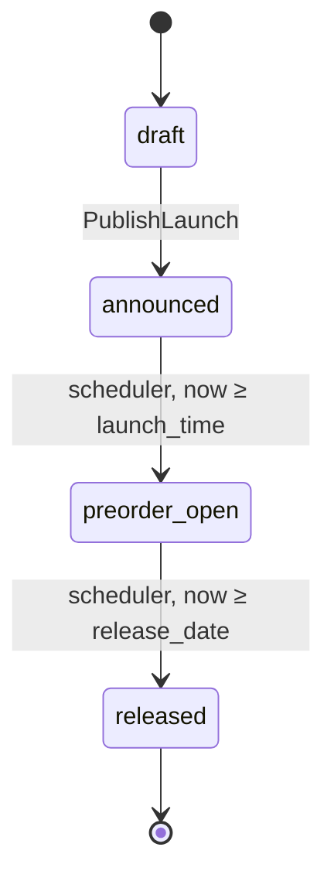

# LLD — launch service

[Docs](../README.md) › [Low-level design](README.md)

| | |
|---|---|
| **Status** | Approved (2026-11-12) |
| **Last updated** | 2026-10-31 |
| **Product rules** | [04-launch](../product-design/04-launch.md) (LCH-R01 … R28), BI-01, BI-03 |
| **HLD** | [high-level-design.md §5, §8.1](../high-level-design/high-level-design.md), HLD-ADR-009, HLD-ADR-012 |
| **Depends on** | [00-reliability.md](00-reliability.md) (outbox, inbox, conditional updates, error contract) |

## 1. Problem and scope

`launch` runs launch events: it lets a limited number of customers through a fair waiting room and guarantees that pre-order allocation (BI-01) and per-account purchase limits (BI-03) are never exceeded, at 100k queued customers and ~200 checkouts/s.

**In scope:** launch setup and stages, the waiting room (join, status, admission), admission passes, allocation and purchase-limit counters, allocation holds for `order`, hold settlement from `order` messages, the "launch stage changed" event.

**Out of scope:** orders and payment (`order`, `payment`), stock and backorders (`inventory`), product visibility (`catalog`, fed by this service's events), checkout expiry (`order` owns hold lifetime).

## 2. Requirements and constraints

| ID | Requirement | Source |
|---|---|---|
| LR-01 | `sold + held ≤ allocation` for every launch SKU, always. | BI-01, LCH-R03 |
| LR-02 | `sold + held ≤ purchase_limit` for every (account, launch product), always. | BI-03, LCH-R11, R12 |
| LR-03 | A pass enables exactly one successful hold; failed attempts don't consume it. | LCH-R22 |
| LR-04 | Waiting-room status p95 < 50 ms at 20k req/s; never touches Postgres. | QA-04 |
| LR-05 | Hold p95 within the checkout budget (checkout start p95 < 300 ms overall). | QA-03 |
| LR-06 | Admission never exceeds the configured rate, nor outstanding passes beyond units available. | HLD-ADR-012 |
| LR-07 | `launch` never releases a hold on its own; only `order` does. | Owner decision |

## 3. Component structure

| Component | Deployment | Responsibility |
|---|---|---|
| Customer API | API | Join waiting room, waiting-room status, public launch info |
| Hold API | API | `HoldAllocation` for `order` |
| Admin API | API | Create and edit launches, SKUs, limits, publish |
| Admission worker | Worker | Admits customers once per second per active launch |
| Stage scheduler | Worker | Moves launches to *Pre-order open* and *Released* on time |
| Consumers | Worker | `order.paid.v1` (hold → sold), `launch.release-allocation-hold.v1` (release) |
| Stuck-hold monitor | Worker | Reports holds still *held* after 30 min |
| Reliability plumbing | Both | Outbox relay, inbox, purger ([00-reliability.md](00-reliability.md)) |

## 4. Data model

### 4.1 PostgreSQL (launch database)

**`launches`**

| Column | Type | Constraints |
|---|---|---|
| `id` | `uuid` | PK (UUIDv7) |
| `name` | `text` | not null |
| `stage` | `text` | not null, `draft` \| `announced` \| `preorder_open` \| `released` |
| `launch_time` | `timestamptz` | not null |
| `release_date` | `timestamptz` | not null, `> launch_time` |
| `admission_rate` | `int` | not null, `1 … admission_ceiling` (config, initial 200) |
| `waiting_room_closed_at` | `timestamptz` | null; set when closed for good |
| `version` | `bigint` | not null, default 0 |
| `created_at`, `updated_at` | `timestamptz` | not null |

**`launch_products`** — PK `(launch_id, product_id)`

| Column | Type | Constraints |
|---|---|---|
| `launch_id` | `uuid` | FK → `launches` |
| `product_id` | `uuid` | catalog product ID, unique across launches (a product can never be in two launches) |
| `purchase_limit` | `int` | not null, `> 0` |

**`launch_skus`** — PK `(launch_id, sku_id)`

| Column | Type | Constraints |
|---|---|---|
| `launch_id` | `uuid` | FK → `launches` |
| `sku_id` | `uuid` | catalog SKU ID, unique across launches |
| `product_id` | `uuid` | FK → `launch_products (launch_id, product_id)`, indexed by `ix_launch_skus_launch_id_product_id` |
| `allocation` | `int` | not null, `≥ 0` |
| `held` | `int` | not null, default 0, `≥ 0` |
| `sold` | `int` | not null, default 0, `≥ 0` |
| — | — | `CHECK (held + sold <= allocation)` (backstop for LR-01) |

**`limit_usage`** — PK `(launch_id, account_id, product_id)`

| Column | Type | Constraints |
|---|---|---|
| `launch_id`, `account_id`, `product_id` | `uuid` | |
| `held` | `int` | not null, default 0, `≥ 0` |
| `sold` | `int` | not null, default 0, `≥ 0` |

**`holds`**

| Column | Type | Constraints |
|---|---|---|
| `id` | `uuid` | PK (UUIDv7) |
| `order_id` | `uuid` | not null, **unique** (idempotent `HoldAllocation`) |
| `launch_id` | `uuid` | not null |
| `account_id` | `uuid` | not null |
| `pass_id` | `uuid` | not null |
| `status` | `text` | not null, `held` \| `sold` \| `released` |
| `version` | `bigint` | not null, default 0 |
| `created_at`, `updated_at` | `timestamptz` | not null |

Index: `(status, created_at) WHERE status = 'held'` (stuck-hold monitor).

**`hold_lines`** — PK `(hold_id, sku_id)`: `hold_id`, `sku_id`, `product_id`, `quantity int > 0`.

**`consumed_passes`** — PK `pass_id`: `pass_id uuid`, `launch_id`, `account_id`, `order_id`, `consumed_at`.

Plus the reliability tables (`outbox_messages`, `inbox_messages`).

### 4.2 Redis (launch's own instance, AOF + replica)

| Key | Type | Content | TTL |
|---|---|---|---|
| `wr:{launchId}:q` | sorted set | member = `accountId`, score per §6.2 | Deleted when the room closes |
| `wr:{launchId}:pass:{accountId}` | string | `passId|expiresAtUnixMs` | 600 s |
| `wr:{launchId}:passes` | sorted set | member = `passId`, score = expiry (ms) | Deleted when the room closes |
| `wr:{launchId}:state` | string | Cached public view of the launch and the `sold_out` flag (§6.1); a miss reloads it once per pod per launch | 5 s, refreshed from Postgres |
| `wr:{launchId}:tick` | string | Admission pacing guard, set `NX` by the admission script (§6.4 step 7, [LLD-ADR-012](adr/LLD-ADR-012-admission-paced-per-launch.md)) | 1000 ms |

The `{launchId}` hash tag keeps one launch's keys together, so the admission script runs atomically.

### 4.3 Admission pass token

`base64url(payload) "." base64url(HMAC-SHA256(key[kid], payload))`, payload JSON: `{ "pid": passId, "aid": accountId, "lid": launchId, "exp": unixMs, "kid": keyId }`.

Keys are held only by `launch` (Sealed Secret). On rotation, the old key stays valid for 10 minutes (the pass lifetime).

## 5. Interfaces

### 5.1 gRPC API

| Method | Caller | Request → Response | Auth |
|---|---|---|---|
| `GetLaunch` | Anyone | `launch_id` → public launch info, stage, waiting-room state; `NOT_FOUND` for a draft or unknown launch | Public |
| `AdminGetLaunch` | Catalog manager, Admin | `launch_id` → the admin view of §4 | Staff role |
| `AdminListLaunches` | Catalog manager, Admin | page → the admin view of §4 for each launch | Staff role |
| `JoinWaitingRoom` | Customer | `launch_id` → `WaitingRoomStatus` | Customer (every customer email is verified at sign-up, so LCH-R06 holds by construction) |
| `GetWaitingRoomStatus` | Customer | `launch_id` → `WaitingRoomStatus` | Customer |
| `HoldAllocation` | order | `order_id`, `pass_token`, `lines[{sku_id, quantity}]` → `hold_id`, `lines` | Service identity + forwarded customer context |
| `CreateLaunch` | Catalog manager, Admin | name, launch time, release date, admission rate → launch | Staff role |
| `AddLaunchProduct` | Catalog manager, Admin | `launch_id`, `product_id`, `purchase_limit` | Staff role |
| `AddLaunchSku` | Catalog manager, Admin | `launch_id`, `sku_id`, `product_id`, `allocation` (validated with catalog) | Staff role |
| `SetAllocation` | Catalog manager, Admin | `launch_id`, `sku_id`, `allocation`, `version` | Staff role |
| `SetPurchaseLimit` | Catalog manager, Admin | `launch_id`, `product_id`, `purchase_limit`, `version` | Staff role |
| `SetReleaseDate` | Catalog manager, Admin | `launch_id`, `release_date`, `version` | Staff role |
| `SetLaunchTime` | Catalog manager, Admin | `launch_id`, `launch_time`, `version` | Staff role |
| `SetAdmissionRate` | Catalog manager, Admin | `launch_id`, `admission_rate`, `version` | Staff role |
| `PublishLaunch` | Catalog manager, Admin | `launch_id`, `version` → stage `announced` | Staff role |

**`WaitingRoomStatus`**

| Field | Type | Present when |
|---|---|---|
| `state` | `not_open` \| `queued` \| `admitted` \| `sold_out` \| `closed` | Always |
| `position` | int (1-based) | `queued` |
| `pass_token`, `pass_expires_at` | string, timestamp | `admitted` |
| `poll_after_seconds` | int (5 ± 1, jittered) | `not_open`, `queued`, `sold_out` |

### 5.2 Outgoing calls

| Call | When | Failure |
|---|---|---|
| catalog `GetSku` (gRPC) | `AddLaunchSku` | Admin action fails with `UNAVAILABLE`; staff retry |

### 5.3 Messages

| Message | Direction | Consumer handler / producer |
|---|---|---|
| `launch.stage-changed.v1` | Published | Consumed by catalog. Payload: `launchId`, `stage`, `launchTime`, `releaseDate`, `products[{productId, purchaseLimit}]`, `skus[{skuId, productId}]` |
| `identity.staff-action-recorded.v1` | Published | Every admin change |
| `order.paid.v1` | Consumed (`launch.order-paid`) | Only events carrying a `launchId` |
| `launch.release-allocation-hold.v1` | Consumed (`launch.release-allocation-hold`) | Command from order: `orderId`, `reason` |
| `launch.hold-released.v1` | Published → order | `orderId`. Written in the same transaction as **every** applied release command, including no-ops (saga completion, [03-order](03-order.md)) |

### 5.4 Error reasons (`ErrorInfo.reason`)

| Reason | Status | When |
|---|---|---|
| `WAITING_ROOM_NOT_OPEN` | `FAILED_PRECONDITION` | Join earlier than 15 min before launch time |
| `WAITING_ROOM_CLOSED` | `FAILED_PRECONDITION` | Join after the room closed or after release |
| `PASS_INVALID` | `FAILED_PRECONDITION` | Bad signature, unknown `kid`, other account or launch |
| `PASS_EXPIRED` | `FAILED_PRECONDITION` | Pass past `exp` |
| `PASS_ALREADY_USED` | `FAILED_PRECONDITION` | Pass already consumed by a successful hold |
| `LAUNCH_NOT_OPEN` | `FAILED_PRECONDITION` | Hold when stage isn't `preorder_open` |
| `SKU_NOT_IN_LAUNCH` | `INVALID_ARGUMENT` | A line's SKU isn't in this launch |
| `LIMIT_EXCEEDED` | `FAILED_PRECONDITION` | LR-02 would break; metadata: `productId`, `remaining` |
| `SOLD_OUT` | `FAILED_PRECONDITION` | LR-01 would break; metadata: `skuId` |
| `HOLD_CONFLICT` | `INVALID_ARGUMENT` | Same `order_id` retried with a different account, launch or lines |
| `ALLOCATION_DECREASE_NOT_ALLOWED` | `FAILED_PRECONDITION` | Lowering allocation from *Announced* on (LCH-R24) |
| `PURCHASE_LIMIT_LOCKED` | `FAILED_PRECONDITION` | Changing a limit from *Pre-order open* on (LCH-R25) |
| `INVALID_STAGE` | `FAILED_PRECONDITION` | Admin action not allowed in the current stage |
| `NOT_IN_QUEUE` | `NOT_FOUND` | Waiting-room status when the room is open and the customer has no pass and no position (§6.3) |
| `NOT_FOUND` | `NOT_FOUND` | Unknown record; `GetLaunch` for a draft or unknown launch |
| `VALIDATION_FAILED` | `INVALID_ARGUMENT` | Bad request field, named in `ErrorInfo` metadata; admission rate above the ceiling; `AddLaunchProduct` for a product already in a launch; `PublishLaunch` rule failures (§6.7) |
| `ROLE_NOT_ALLOWED` | `PERMISSION_DENIED` | Caller's role may not call the method (00-reliability §8) |
| `CONCURRENCY_CONFLICT` | `ABORTED` | Stale `version` |

## 6. Behaviour

### 6.1 Stages and waiting-room state

Waiting-room state is derived, not stored (except `waiting_room_closed_at`):

| State | Condition |
|---|---|
| `not_open` | stage `draft`, or `announced` and `now < launch_time − 15 min` |
| `open` | `announced` and `now ≥ launch_time − 15 min`, or `preorder_open`, and not closed. Admission starts at `launch_time`. |
| `sold_out` | open, and every launch SKU has `held + sold = allocation` (LCH-R17) |
| `closed` | `waiting_room_closed_at` set (LCH-R23), or stage `released` (LCH-R28) |

**Scheduler (every 5 s):** for each launch with `stage = announced AND launch_time <= now()`, set `preorder_open`. For each with `stage = preorder_open AND release_date <= now()`, set `released` and `waiting_room_closed_at = now()` if null. Each transition is a conditional update on `stage` (single winner across replicas) and writes `launch.stage-changed.v1` to the outbox in the same transaction.

### 6.2 Join

1. Check the identity context: caller is a customer (email verified by construction, [06-identity §6.0](06-identity.md)).
2. Check state: `not_open` → `WAITING_ROOM_NOT_OPEN`; `closed` → `WAITING_ROOM_CLOSED`; `sold_out` → return `sold_out` (LCH-R17).
3. If `wr:{L}:pass:{A}` exists → return `admitted` (sign the token, §6.4).
4. Compute the score:
   - `now < launch_time` → uniform random in `[0, 1)` (LCH-R07: random order among pre-launch joiners).
   - `now ≥ launch_time` → `1 + (now − launch_time)` in seconds, millisecond precision (arrival order, always after pre-launch joiners).
5. `ZADD wr:{L}:q NX score A` (one position per account, LCH-R06; repeated joins keep the original score).
6. Return the status (§6.3).

### 6.3 Status

1. `wr:{L}:pass:{A}` exists → `admitted` with a signed token.
2. Else `closed` per state → `closed`. A closed room never shows `queued`.
3. Else `ZRANK wr:{L}:q A` → `queued`, `position = rank + 1`.
4. Else → `sold_out` or `not_open` per state, otherwise `NOT_IN_QUEUE` (client offers to join).

Each call is at most two Redis reads plus the cached state. No Postgres access (LR-04).

### 6.4 Admission tick (worker, every 1 s per launch in `preorder_open` and not closed)

1. `BEGIN`; `SELECT pg_try_advisory_xact_lock(hashtext('launch-admission:' || L))`. False → `ROLLBACK`, skip (another replica has this launch).
2. `available = SUM(allocation − held − sold)` over the launch's SKUs.
3. `ZREMRANGEBYSCORE wr:{L}:passes -inf now`; `outstanding = ZCARD wr:{L}:passes`.
4. `n = min(admission_rate, available − outstanding)`.
5. If `available = 0`: if no `holds` row for L has `status = held`, set `waiting_room_closed_at = now()` (LCH-R23); `COMMIT`; stop. Else (`sold_out`, waiting for releases) `COMMIT`; stop.
6. If `n ≤ 0`: `COMMIT`; stop.
7. Run the **admission Lua script** with `n` pre-generated pass IDs (UUIDv7) and `exp = now + 600 s`. Atomically: `SET wr:{L}:tick 1 NX PX 1000` first; if the key exists, pop nothing and return 0 (admission is paced per launch, not per replica, LR-06, [LLD-ADR-012](adr/LLD-ADR-012-admission-paced-per-launch.md)). Otherwise `ZPOPMIN wr:{L}:q n`; for each popped account, `SET wr:{L}:pass:{A} "pid|exp" EX 600` and `ZADD wr:{L}:passes exp pid`.
8. `COMMIT`.

The token is signed when the customer reads it (§6.3), not stored, so a worker crash can't pop a customer without recording their pass.

### 6.5 HoldAllocation (one transaction)

1. Verify the token: signature with `kid`, `lid = launch`, `aid` = customer in the forwarded identity context, `exp > now()` (database time). Failure → `PASS_INVALID` / `PASS_EXPIRED`.
2. If a `holds` row exists for `order_id`: same account, launch and lines → return the stored hold (idempotent retry); anything different → `HOLD_CONFLICT`.
3. Read the `launches` row `FOR SHARE`, first, before the product and SKU locks: `stage = preorder_open` and not closed, otherwise `LAUNCH_NOT_OPEN`. Every SKU belongs to the launch, otherwise `SKU_NOT_IN_LAUNCH`.
4. `INSERT INTO consumed_passes …`. Conflict → `PASS_ALREADY_USED`.
5. For each product, **in ascending `product_id` order**: `INSERT INTO limit_usage … ON CONFLICT DO NOTHING`, then
   `UPDATE limit_usage SET held = held + @n WHERE launch_id = @L AND account_id = @A AND product_id = @P AND held + sold + @n <= @limit`. 0 rows → `ROLLBACK`, `LIMIT_EXCEEDED`.
6. For each SKU, **in ascending `sku_id` order**: `UPDATE launch_skus SET held = held + @q WHERE launch_id = @L AND sku_id = @S AND held + sold + @q <= allocation`. 0 rows → `ROLLBACK`, `SOLD_OUT`.
7. Insert `holds` (`held`) and `hold_lines`.
8. `COMMIT`. Then best effort: `ZREM wr:{L}:passes pid`, `DEL wr:{L}:pass:{A}`.

A failed hold rolls back step 4, so the pass stays usable (LR-03). Fixed lock order (the launch row, then products, then SKUs, each ascending) prevents deadlocks between concurrent holds.

### 6.6 Settlement

| Message | Hold status | Action (one transaction with the inbox insert) |
|---|---|---|
| `order.paid.v1` | `held` | Per line: `launch_skus held −= q, sold += q`; per product: `limit_usage held −= n, sold += n`; hold → `sold` |
| `order.paid.v1` | `sold` / `released` / none | No-op (duplicate or reordered) |
| `release-allocation-hold` | `held` | Per line: `held −= q`; per product: `held −= n`; hold → `released` |
| `release-allocation-hold` | `sold` | Per line: `sold −= q`; per product: `sold −= n`; hold → `released` (cancellation after payment) |
| `release-allocation-hold` | `released` / none | No-op |

Every release command, including a no-op, also writes `launch.hold-released.v1` to the outbox so `order`'s saga can complete. Released units return to the pool immediately (LCH-R16). If customers are still queued, the next admission tick admits again because `available > 0` (LCH-R18).

### 6.7 Admin rules

| Action | Allowed stages | Rule |
|---|---|---|
| Create | — | `release_date > launch_time`; `1 ≤ admission_rate ≤ ceiling` |
| Add product, add SKU | `draft`, `announced` | SKU validated with catalog; a SKU can belong to one launch only; a new product needs a purchase limit; a product can be in one launch only (`VALIDATION_FAILED` for a product already in a launch). In `announced`, publishes `launch.stage-changed.v1` so catalog shows the new SKU. Not allowed from `preorder_open`. |
| `SetLaunchTime` | `draft` | Fixed once announced |
| `SetAdmissionRate` | Any stage before `released` | `1 ≤ rate ≤ ceiling`; read by the admission worker on every tick, so it takes effect within ~1 s |
| `SetAllocation` | `draft`: any value ≥ 0; `announced`, `preorder_open`: increase only | LCH-R24 |
| `SetPurchaseLimit` | `draft`, `announced` | Locked from `preorder_open` (LCH-R25) |
| `SetReleaseDate` | Before `released` | New date `> now()` and `> launch_time` (LCH-R27) |
| `PublishLaunch` | `draft` | ≥ 1 SKU, and ≥ 1 SKU per product; every product has a limit; `launch_time > now()`. A rule failure is `VALIDATION_FAILED` (field `skus` or `launch_time`) |

Every admin change uses optimistic locking (`version`), is audited (`identity.staff-action-recorded.v1`), and publishes `launch.stage-changed.v1` when it affects stage, products or SKUs. From `announced` on, a change to a limit or to the release date also publishes it, because both are in its payload. Every write to `launches` adds 1 to `version`, including `AddLaunchProduct`, `AddLaunchSku` and the scheduler's transitions. The version is checked before the stage rules.

## 7. Concurrency and consistency

| Risk | Protection |
|---|---|
| Overselling allocation | Guarded update (§6.5 step 6) + `CHECK` constraint |
| Exceeding the limit | Guarded update on `limit_usage` (§6.5 step 5) |
| Pass reuse | Primary key on `consumed_passes.pass_id` in the hold transaction |
| Two admission workers | Transaction-level advisory lock per launch, plus the tick key `wr:{L}:tick` (§6.4 step 7, [LLD-ADR-012](adr/LLD-ADR-012-admission-paced-per-launch.md)) |
| Hold vs room close / stage change | Row lock on `launches`: a hold reads it `FOR SHARE` (§6.5 step 3). Room close (admission tick §6.4 step 5 and the settlement-side close) and every stage change (scheduler, admin) take it `FOR UPDATE` before evaluating their conditions, in a statement after the lock (a fresh READ COMMITTED snapshot) |
| Losing a customer between pop and pass | Pop and pass record in one Lua script |
| Duplicate or reordered settlement | Inbox + hold-status guards (§6.6) |
| Deadlocks between holds | Fixed lock order |
| Delayed "paid" after a release | Impossible by design: only `order` releases, and `order` never emits "paid" for an order it expired (HLD-ADR-013) |

## 8. Edge cases

| Case | Expected behaviour |
|---|---|
| Customer's checkout expires (hold released) | They must queue again (LCH-R22); `JoinWaitingRoom` adds them at the back. |
| Pass expires unused | `wr:{L}:pass:{A}` expires; status returns `NOT_IN_QUEUE`; customer may rejoin at the back. |
| SKU sells out while customer holds a pass | `SOLD_OUT` for that SKU; pass still valid for other SKUs (LR-03). |
| Redis fails over | Up to ~1 s of joins and admissions lost (accepted, R-03). Tokens already shown stay valid (HMAC needs no Redis). The pass cap may briefly undercount. While Redis is unreachable, `GetLaunch`, join and status return `UNAVAILABLE`; holds are unaffected. |
| Paid pre-order cancelled after the room closed | Units return to the pool, but the room stays closed (LCH-R23). They sell as regular stock after the release date. (Owner decision.) |
| Release date reached while customers queue | Room closes; status `closed`; SKUs then sell as regular (LCH-R28). |
| `order` retries `HoldAllocation` after a timeout | Same `order_id` returns the existing hold. |
| Account joins twice | `ZADD NX` keeps the first score. |

## 9. Security and validation

- `account_id` always comes from the forwarded identity context, never from the request body; the pass's `aid` must match it.
- `HoldAllocation` accepts calls only from `order` (Linkerd allow rule) and requires a customer context.
- Quantities: integers ≥ 1. Lines: 1 … number of SKUs in the launch, no duplicate `sku_id`.
- `JoinWaitingRoom` is behind the gateway's strict per-user rate limit (HLD §9.1).
- Pass keys never leave `launch`.

## 10. Observability

| Metric | Labels | Purpose |
|---|---|---|
| `waiting_room_size` | `launch` | Queue length (`ZCARD`) |
| `admissions_total` | `launch` | Admission rate vs configured |
| `passes_outstanding` | `launch` | Pass cap |
| `allocation_available` | `launch`, `sku` | Units left |
| `holds_total` | `launch`, `result` = `ok` \| `sold_out` \| `limit_exceeded` \| `pass_*` | Checkout outcomes |
| `hold_seconds` | — | LR-05 |
| `waiting_room_status_seconds` | — | LR-04 |
| `stuck_holds` | `launch` | Holds `held` > 30 min |
| `admission_ticks_total` | `launch`, `result` = `admitted` \| `skipped_lock` \| `none` | Worker health |

While Redis is down, the admission worker logs its Error at most once per minute per launch. The stuck-hold monitor logs an Error when a hold first becomes stuck; afterwards `stuck_holds` carries it.

**Alerts:** `stuck_holds > 0` (stuck checkout saga in `order`); status p95 > 50 ms; hold p95 above budget; no admission tick for a launch in `preorder_open` for 10 s while customers are queued.

## 11. Test cases

| # | Case | Expected |
|---|---|---|
| L-01 | 1,000 concurrent holds for a SKU with allocation 100 | Exactly 100 succeed; `held + sold = 100` |
| L-02 | Account with limit 2 holds 2, then tries 1 more with a new pass | `LIMIT_EXCEEDED` |
| L-03 | Same pass used for two holds concurrently | One succeeds; the other `PASS_ALREADY_USED` |
| L-04 | Hold fails `SOLD_OUT`, then same pass on another SKU | Succeeds |
| L-05 | Join before launch time × 10,000 accounts | Admission order is random (not join order) |
| L-06 | Join after launch time | Positioned after every pre-launch joiner, in arrival order |
| L-07 | Two worker replicas tick together, or tick out of phase | One admits per tick; admitted per second ≤ rate |
| L-08 | 50 units available, 50 outstanding passes | Tick admits 0 |
| L-09 | Release command for a `held` hold | Units back in pool; next tick admits |
| L-10 | `order.paid.v1` delivered twice | Hold sold once |
| L-11 | Release arrives before paid (reordered) for an expired order | Hold `released`; later `paid` is a no-op |
| L-12 | Sold out and no holds left | Room closes; queued customers see `closed` |
| L-13 | Lower allocation while `announced` | `ALLOCATION_DECREASE_NOT_ALLOWED` |
| L-14 | Change limit while `preorder_open` | `PURCHASE_LIMIT_LOCKED` |
| L-15 | Release date reached | Stage `released`, room closed, event published |
| L-16 | Tampered token | `PASS_INVALID` |
| L-17 | Load: 100k queued, 20k status req/s | p95 < 50 ms |
| L-18 | Load: 200 holds/s across 12 SKUs | p95 within budget, zero invariant violations |
| L-19 | Add a SKU while `announced` | Added; `launch.stage-changed.v1` published |
| L-20 | Add a SKU or change `launch_time` while `preorder_open` / `announced` respectively | `INVALID_STAGE` |
| L-21 | Lower `admission_rate` mid-launch | Next tick admits at the new rate |
| L-22 | Set `admission_rate` above the ceiling | `INVALID_ARGUMENT` |

## 12. Open questions

| ID | Question |
|---|---|
| — | None open. OQ-L-1 to OQ-L-3 resolved 2026-10-31 (§6.7). |
