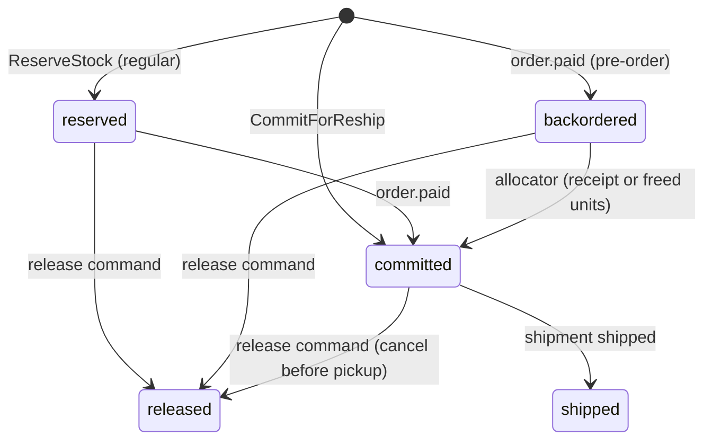

# LLD — inventory service

| | |
|---|---|
| **Status** | Approved (2026-10-31) |
| **Last updated** | 2026-10-31 |
| **Product rules** | [03-inventory](../product-design/03-inventory.md) (INV-R01 … R20), BI-02, BI-06, BI-07, LCH-R19, R20 |
| **HLD** | [hld.md §5, §8.5](../high-level-design/hld.md), HLD-ADR-009, HLD-ADR-013 |
| **Depends on** | [00-reliability.md](00-reliability.md) |

## 1. Problem and scope

`inventory` is the source of truth for how many units of each SKU Bloom has, which physical serial units exist, and every change to them. It must never let regular sales exceed stock (BI-02), must give arriving launch stock to waiting pre-orders first (INV-R10), and must record every change in an append-only ledger (BI-06).

**In scope:** stock counters per SKU, reservations for regular checkouts, commitments for paid orders, pre-order backorders, goods receipts, adjustments, serial units and their states, serial assignment at packing, effects of shipment / returns / delivery failures, reship commitments, the stock ledger, stock views.

**Out of scope:** prices and launch allocation (`catalog`, `launch`), checkout lifetime (`order` releases reservations), shipments and inspections (`fulfillment` tells inventory the outcome), warranty coverage (`fulfillment`).

## 2. Requirements and constraints

| ID | Requirement | Source |
|---|---|---|
| IR-01 | `reserved ≤ on_hand` for every SKU, always (available never negative). | BI-02, INV-R03 |
| IR-02 | Received launch stock goes to the oldest backorders, strict FIFO, in the receipt's transaction. | INV-R10, R11 |
| IR-03 | Every counter change writes a ledger entry in the same transaction; entries are never modified. | INV-R17, R18 |
| IR-04 | Each shipped serial unit is linked to exactly one order (or reship). | BI-07, INV-R15 |
| IR-05 | `inventory` never releases a reservation on its own; only `order` does. | Owner decision |
| IR-06 | A decrease adjustment can't exceed available stock. | Owner decision |
| IR-07 | A goods receipt is atomic: all lines and serials are recorded, or none. | Owner decision |
| IR-08 | Reserve p95 fits the checkout budget (checkout start p95 < 300 ms overall). | QA-03 |

## 3. Component structure

| Component | Deployment | Responsibility |
|---|---|---|
| Stock API | API | `ReserveStock`, `GetAvailability`, `CommitForReship` (service callers) |
| Packing API | API | `AssignSerial`, `UnassignSerial`, `ReplaceSerial` (fulfillment) |
| Warehouse API | API | Goods receipts, adjustments, stock levels, ledger, serial lookup (staff) |
| Consumers | Worker | `order.paid.v1`, `inventory.release-reservation.v1`, `fulfillment.shipment-shipped.v1`, return and delivery-failure commands |
| Backorder allocator | In-process routine | Fills backorders strict FIFO inside the calling transaction |
| Stuck-reservation monitor | Worker | Reports reservations still `reserved` after 30 min |
| Reliability plumbing | Both | Outbox, inbox, purger ([00-reliability.md](00-reliability.md)) |

## 4. Data model (inventory database)

### 4.1 `stock_items` — one row per SKU, created at its first receipt

| Column | Type | Constraints | Meaning |
|---|---|---|---|
| `sku_id` | `uuid` | PK | Catalog SKU |
| `product_id` | `uuid` | not null | From catalog at first receipt |
| `serialized` | `bool` | not null | From catalog at first receipt (locked there) |
| `on_hand` | `int` | ≥ 0 | Physical units not promised to a paid order |
| `reserved` | `int` | ≥ 0, `CHECK (reserved <= on_hand)` | Part of `on_hand` held by unpaid checkouts |
| `committed` | `int` | ≥ 0 | Promised to paid orders / reships, not yet shipped |
| `returned` | `int` | ≥ 0 | Customer returns held, never resold |
| `damaged` | `int` | ≥ 0 | Damaged units (adjustments, failed delivery inspection) |
| `lost` | `int` | ≥ 0 | Lost in warehouse or in transit |
| `updated_at` | `timestamptz` | not null | |

`available = on_hand − reserved`. Physical sellable-or-promised units = `on_hand + committed`.

### 4.2 `stock_allocations` — what each order (or reship) holds per SKU

| Column | Type | Constraints |
|---|---|---|
| `ref_id` | `uuid` | PK part 1: `order_id`, or `reship_id` for reships |
| `sku_id` | `uuid` | PK part 2 |
| `order_id` | `uuid` | not null (= `ref_id` except for reships) |
| `kind` | `text` | `regular` \| `preorder` \| `reship` |
| `quantity` | `int` | > 0 |
| `status` | `text` | `reserved` \| `backordered` \| `committed` \| `shipped` \| `released` |
| `paid_at` | `timestamptz` | null; set for pre-orders (FIFO key) |
| `version` | `bigint` | default 0 |
| `created_at`, `updated_at` | `timestamptz` | |

Indexes: `(sku_id, paid_at, order_id) WHERE status = 'backordered'` (FIFO); `(created_at) WHERE status = 'reserved'` (stuck monitor).

### 4.3 `serial_units`

| Column | Type | Constraints |
|---|---|---|
| `serial` | `text` | PK, trimmed, upper-case |
| `imei` | `text` | null, unique when present (cellular devices) |
| `sku_id` | `uuid` | FK → `stock_items` |
| `status` | `text` | `in_stock` \| `assigned` \| `shipped` \| `returned` \| `damaged` \| `lost` |
| `ref_id` | `uuid` | null; set when `assigned` / `shipped` (order or reship) |
| `receipt_id` | `uuid` | not null |
| `version` | `bigint` | default 0 |
| `updated_at` | `timestamptz` | |

Index: `(sku_id, status)`.

### 4.4 Receipts, adjustments, ledger

| Table | Key columns |
|---|---|
| `goods_receipts` | `id` (UUIDv7), `staff_id`, `note`, `received_at` |
| `goods_receipt_lines` | `(receipt_id, sku_id)`, `quantity` |
| `stock_adjustments` | `id`, `sku_id`, `serial` (null), `delta` (≠ 0), `reason_code`, `note` (required), `staff_id`, `created_at` |
| `stock_ledger` | `id` (UUIDv7), `sku_id`, `entry_type`, `d_on_hand`, `d_reserved`, `d_committed`, `d_returned`, `d_damaged`, `d_lost`, `ref_type`, `ref_id`, `actor`, `created_at` |

`stock_ledger` is append-only: the service's database role has `INSERT` and `SELECT` only. Kept indefinitely.

**Ledger entry types:** `received`, `reserved`, `reservation_released`, `committed`, `backorder_allocated`, `commitment_released`, `shipped`, `customer_returned`, `rts_restocked`, `rts_damaged`, `lost_in_transit`, `adjusted`.

**Adjustment reason codes:** `damaged_in_warehouse` (−), `lost_in_warehouse` (−), `found` (+), `count_correction` (±), `other` (±).

## 5. Interfaces

### 5.1 gRPC

| Method | Caller | Request → Response |
|---|---|---|
| `ReserveStock` | order | `order_id`, `lines[{sku_id, quantity}]` → `ok` |
| `GetAvailability` | order | `sku_ids[]` → `[{sku_id, available}]` (cart flags, CHK-R18) |
| `CommitForReship` | fulfillment | `reship_id`, `order_id`, `lines[{sku_id, quantity}]` → `ok` |
| `AssignSerial` | fulfillment | `ref_id`, `sku_id`, `serial` → `ok` |
| `UnassignSerial` | fulfillment | `ref_id`, `serial` → `ok` |
| `ReplaceSerial` | fulfillment | `ref_id`, `old_serial`, `new_serial` → `ok` |
| `RecordGoodsReceipt` | Warehouse, Admin | `note`, `lines[{sku_id, quantity, serials[]?, imeis[]?}]` → `receipt_id` |
| `AdjustStock` | Warehouse, Admin | `sku_id`, `delta`, `reason_code`, `note`, `serial?` / `new_serials?` → `adjustment_id` |
| `ListStockLevels` | Warehouse, Catalog manager, Support, Admin | filters → counters per SKU |
| `GetLedger` | Warehouse, Admin | `sku_id`, time range, page → entries |
| `GetSerial` | Warehouse, Support, Admin | `serial` → unit status and `ref_id` |

### 5.2 Outgoing calls

| Call | When | Failure |
|---|---|---|
| catalog `LockSkuForStock` (gRPC) | First receipt of a SKU (no `stock_items` row) | Receipt fails with `UNAVAILABLE`; Warehouse retries |

### 5.3 Messages

| Message | Direction | Notes |
|---|---|---|
| `inventory.stock-allocated.v1` | Published → order | `orderId`; emitted when **every** pre-order line of the order is `committed` |
| `identity.staff-action-recorded.v1` | Published | Receipts, adjustments, serial changes |
| `order.paid.v1` | Consumed (`inventory.order-paid`) | Payload includes `launchId` (null for regular), `paidAt`, lines |
| `inventory.release-reservation.v1` | Consumed (`inventory.release-reservation`) | Command from order: `orderId` |
| `inventory.reservation-released.v1` | Published → order | `orderId`. Written in the same transaction as **every** applied release command, including no-ops (saga completion, [03-order](03-order.md)) |
| `fulfillment.shipment-shipped.v1` | Consumed (`inventory.shipment-shipped`) | `refId`, lines |
| `inventory.receive-customer-return.v1` | Consumed | Command from fulfillment: `orderId`, accepted units `[{skuId, serial?, quantity}]` |
| `inventory.receive-returned-to-sender.v1` | Consumed | Command from fulfillment: `refId`, units `[{skuId, serial?, quantity, outcome: sealed \| failed}]` |
| `inventory.mark-lost-in-transit.v1` | Consumed | Command from fulfillment: `refId` |

### 5.4 Error reasons

| Reason | Status | When |
|---|---|---|
| `SOLD_OUT` | `FAILED_PRECONDITION` | Not enough available stock; metadata `skuId` |
| `RESERVATION_CONFLICT` | `INVALID_ARGUMENT` | Same `order_id` / `reship_id` retried with different lines |
| `SKU_NOT_STOCKED` | `FAILED_PRECONDITION` | No `stock_items` row (never received) |
| `SERIAL_NOT_AVAILABLE` | `FAILED_PRECONDITION` | Serial unknown, other SKU, or not `in_stock` |
| `SERIAL_COUNT_EXCEEDED` | `FAILED_PRECONDITION` | All units of the line already have serials |
| `NOT_COMMITTED` | `FAILED_PRECONDITION` | Assigning serials to an allocation that isn't `committed` |
| `RECEIPT_INVALID` | `INVALID_ARGUMENT` | Bad receipt; details list every bad serial / line |
| `ADJUSTMENT_EXCEEDS_AVAILABLE` | `FAILED_PRECONDITION` | Decrease larger than `available` (IR-06) |
| `SERIAL_ASSIGNED` | `FAILED_PRECONDITION` | Adjusting a serial that's assigned to an order |

## 6. Behaviour

All counter changes are guarded single-statement updates ([00-reliability.md §7.5](00-reliability.md)) and write a ledger row in the same transaction. Multi-SKU operations lock `stock_items` rows **in ascending `sku_id` order**.

### 6.1 ReserveStock (regular checkout)

1. Existing allocations for `order_id`: same lines → return `ok` (idempotent retry); different → `RESERVATION_CONFLICT`.
2. For each SKU ascending: `UPDATE stock_items SET reserved = reserved + @q WHERE sku_id = @s AND on_hand - reserved >= @q`. 0 rows → `ROLLBACK`; `SKU_NOT_STOCKED` if no row, else `SOLD_OUT`.
3. Insert `stock_allocations` (`regular`, `reserved`); ledger `reserved`. `COMMIT`.

### 6.2 `order.paid.v1`

- **Regular** (`launchId` null): for each `reserved` allocation: `reserved −= q, on_hand −= q, committed += q`; status `committed`; ledger `committed`. Allocations not `reserved` → no-op.
- **Pre-order** (`launchId` set): insert `backordered` allocations with `paid_at`; then run the allocator (§6.4) for each SKU.

### 6.3 Goods receipt (IR-07)

1. Validate the whole request first; collect every error and return `RECEIPT_INVALID` with all of them if any:
   - quantity > 0; no duplicate `sku_id` lines;
   - serialized SKU: `serials` count = quantity, no duplicates within the request, none existing in `serial_units`; IMEIs (if given) unique;
   - non-serialized SKU: no serials.
2. For each SKU without a `stock_items` row: call catalog `LockSkuForStock` (outside the transaction, idempotent) and keep `serialized` and `product_id`.
3. `BEGIN`. Insert missing `stock_items` rows. Insert receipt, lines, `serial_units` (`in_stock`). `on_hand += q` per SKU; ledger `received`.
4. Run the allocator for each SKU (§6.4).
5. Audit event. `COMMIT`.

Steps 3–5 are one transaction, so received units are never visible as available before backorders are served (IR-02).

### 6.4 Backorder allocator (strict FIFO)

Runs inside the caller's transaction with the SKU row locked (`SELECT … FOR UPDATE` on `stock_items`).

1. Read `backordered` allocations for the SKU ordered by `(paid_at, order_id)`.
2. For each in order: if `on_hand − reserved ≥ quantity` → `on_hand −= q, committed += q`, status `committed`, ledger `backorder_allocated`; else **stop** (strict FIFO: no one behind the oldest unfilled backorder is served; lines are never split).
3. For each order touched: if all its pre-order allocations are now `committed`, write `inventory.stock-allocated.v1` to the outbox.

Callers: pre-order payment (§6.2), goods receipt (§6.3), freed committed units (§6.5), returned-to-sender restock (§6.7), increase adjustments (§6.8).

### 6.5 Release command (`inventory.release-reservation.v1`)

For each allocation of the order:

| Status | Action |
|---|---|
| `reserved` | `reserved −= q`; ledger `reservation_released` |
| `backordered` | No counters |
| `committed` | `committed −= q, on_hand += q`; any `assigned` serials of the ref → `in_stock`; ledger `commitment_released`; then run the allocator for the SKU (freed units serve waiting pre-orders first) |
| `shipped`, `released` | No-op |

Status → `released`. The same transaction writes `inventory.reservation-released.v1` to the outbox, also when nothing needed releasing, so `order`'s saga can complete.

### 6.6 Packing serial operations

| Operation | Checks | Effect |
|---|---|---|
| `AssignSerial` | Allocation `(ref_id, sku_id)` is `committed`; serials already assigned to it < quantity; serial is `in_stock` and of that SKU | Serial → `assigned`, `ref_id` set |
| `UnassignSerial` | Serial `assigned` to `ref_id` | Serial → `in_stock`, `ref_id` cleared |
| `ReplaceSerial` | Both of the above, one transaction | Old → `in_stock`, new → `assigned` |

Non-serialized SKUs have no serial operations. All three are audited (INV-R19).

### 6.7 Shipment, returns and delivery failures

| Message | Effect |
|---|---|
| `fulfillment.shipment-shipped.v1` | For each `committed` allocation of `refId`: `committed −= q`, status `shipped`; serials `assigned` → `shipped`; ledger `shipped`. A serialized line without all serials assigned → permanent failure (DLQ + alert), because fulfillment must never ship it. |
| `receive-customer-return` | Serial → `returned` (or quantity for non-serialized); `returned += q`; ledger `customer_returned` (INV-R16) |
| `receive-returned-to-sender`, `sealed` | Serial → `in_stock`; `on_hand += q`; ledger `rts_restocked`; run allocator (INV-R20) |
| `receive-returned-to-sender`, `failed` | Serial → `damaged`; `damaged += q`; ledger `rts_damaged` |
| `mark-lost-in-transit` | Serials `shipped` for `refId` → `lost`; `lost += q`; ledger `lost_in_transit` |

### 6.8 Adjustments

| Direction | Rule |
|---|---|
| Decrease (`damaged_in_warehouse`, `lost_in_warehouse`, `count_correction −`, `other −`) | Guarded `UPDATE … SET on_hand = on_hand - @n WHERE sku_id = @s AND on_hand - reserved >= @n` → else `ADJUSTMENT_EXCEEDS_AVAILABLE`. `damaged` or `lost += n` for the first two codes. Serialized: the named serial must be `in_stock` (assigned → `SERIAL_ASSIGNED`); it becomes `damaged` / `lost`. |
| Increase (`found`, `count_correction +`, `other +`) | `on_hand += n`. Serialized: either new serials (validated as in a receipt) or a `lost` serial back to `in_stock` (`lost −= 1`). Then run the allocator. |

Every adjustment requires a note, writes `stock_adjustments` + ledger `adjusted`, and is audited (INV-R12).

### 6.9 Reship commit

`CommitForReship` is idempotent by `reship_id` (same lines → `ok`; different → `RESERVATION_CONFLICT`). Per SKU ascending: guarded `on_hand −= q, committed += q WHERE on_hand - reserved >= q`, else `SOLD_OUT` (Support then chooses refund). Inserts `reship` allocations as `committed`. Packing and shipping then work on `ref_id = reship_id`.

## 7. Concurrency and consistency

| Risk | Protection |
|---|---|
| Overselling regular stock | Guarded updates + `CHECK (reserved <= on_hand)` |
| Regular buyer taking arriving launch stock | Receipt and allocation in one transaction with the SKU row locked |
| Two receipts for the same SKU at once | Both lock the SKU row; the allocator runs once per transaction, serially |
| Deadlocks | Ascending `sku_id` lock order everywhere |
| Duplicate / reordered messages | Inbox + allocation-status guards (§6.5, §6.7 tables) |
| Serial double-assigned | Primary key + status check in a guarded update (`WHERE status = 'in_stock'`) |
| Delayed "paid" after a release | Impossible by design: only `order` releases (IR-05) |

## 8. Edge cases

| Case | Expected behaviour |
|---|---|
| Release command arrives for a pre-order still `backordered` | Status `released`; no counters touched. |
| Pre-order paid when stock is already on hand | Allocator commits it immediately; `stock-allocated` published. `order` still holds it until release (LCH-R19). |
| Receipt smaller than the oldest backorder | Units stay in `on_hand`; nothing allocated (strict FIFO). Before release they can't be bought by others (order blocks regular sale of launch SKUs). |
| Stock arrives after release while regular checkouts reserve | Allocator runs first in the receipt transaction; regular buyers only see what's left. |
| Paid order cancelled during packing | Release frees committed units, unassigns serials, runs allocator. |
| Damaged unit is promised to an order | Adjustment refused (IR-06); Warehouse waits for release, or Support cancels or reships first. |
| Receipt with one duplicate serial among 100 | Whole receipt rejected with that serial listed. |
| catalog unavailable on a first receipt | Receipt fails; nothing written. |
| `GetAvailability` for a never-received SKU | `available = 0`. |

## 9. Security and validation

- Staff identity and role come from the trusted context; Warehouse API methods check roles per [10-accounts-access §3](../product-design/10-accounts-access.md).
- `ReserveStock` is callable only by `order`; packing and reship methods only by `fulfillment` (Linkerd allow rules).
- Serials: 1–32 chars after trimming, `[A-Z0-9]`. IMEI: 15 digits with a valid Luhn check digit.
- Adjustment note: 1–500 characters.
- Inventory holds no customer personal data.

## 10. Observability

| Metric | Labels | Purpose |
|---|---|---|
| `stock_available` | `sku` | Stock level |
| `reserve_total` | `result` = `ok` \| `sold_out` | Checkout outcomes |
| `reserve_seconds` | — | IR-08 |
| `backorders_waiting` | `sku` | Unfilled pre-orders |
| `backorder_wait_seconds` | — | Time from payment to allocation |
| `stuck_reservations` | — | `reserved` > 30 min |
| `adjustments_total` | `reason_code` | Shrinkage |
| `ledger_entries_total` | `entry_type` | Activity |

**Alerts:** `stuck_reservations > 0` (stuck checkout saga in `order`); any DLQ message on a shipment consumer (IR-04 violation attempt); reserve p95 above budget.

## 11. Test cases

| # | Case | Expected |
|---|---|---|
| I-01 | 500 concurrent reserves of 1 for a SKU with available 10 | Exactly 10 succeed |
| I-02 | `ReserveStock` retried with same `order_id` | `ok`, reserved once |
| I-03 | Regular `order.paid` | reserved −q, on_hand −q, committed +q |
| I-04 | Receipt of 5 with backorders [2, 2, 3] (oldest first) | First two committed (4 units), 1 left in on_hand; third waits |
| I-05 | Receipt of 1 with backorders [2, 1] | Nothing allocated (strict FIFO) |
| I-06 | Receipt while 100 concurrent regular reserves run (post-release) | Backorders served first; regular reserves never see the backorder units |
| I-07 | Receipt with a duplicate serial | Whole receipt rejected, bad serial listed |
| I-08 | First receipt of a SKU | catalog lock called once; later receipts don't call it |
| I-09 | Release of a committed allocation with assigned serials | Units to on_hand, serials `in_stock`, allocator runs |
| I-10 | Assign a serial of another SKU | `SERIAL_NOT_AVAILABLE` |
| I-11 | Assign more serials than quantity | `SERIAL_COUNT_EXCEEDED` |
| I-12 | Shipment for a serialized line missing serials | DLQ + alert, nothing changed |
| I-13 | Customer return accepted | Serial `returned`, `returned` +1, not sellable |
| I-14 | Returned-to-sender sealed | Serial `in_stock`, on_hand +1, allocator runs |
| I-15 | Decrease adjustment larger than available | `ADJUSTMENT_EXCEEDS_AVAILABLE` |
| I-16 | Reship with no stock | `SOLD_OUT` |
| I-17 | Duplicate `order.paid` | Applied once |
| I-18 | Ledger row update attempt | Rejected by database permissions |

## 12. Open questions

| ID | Question |
|---|---|
| — | None open. |
