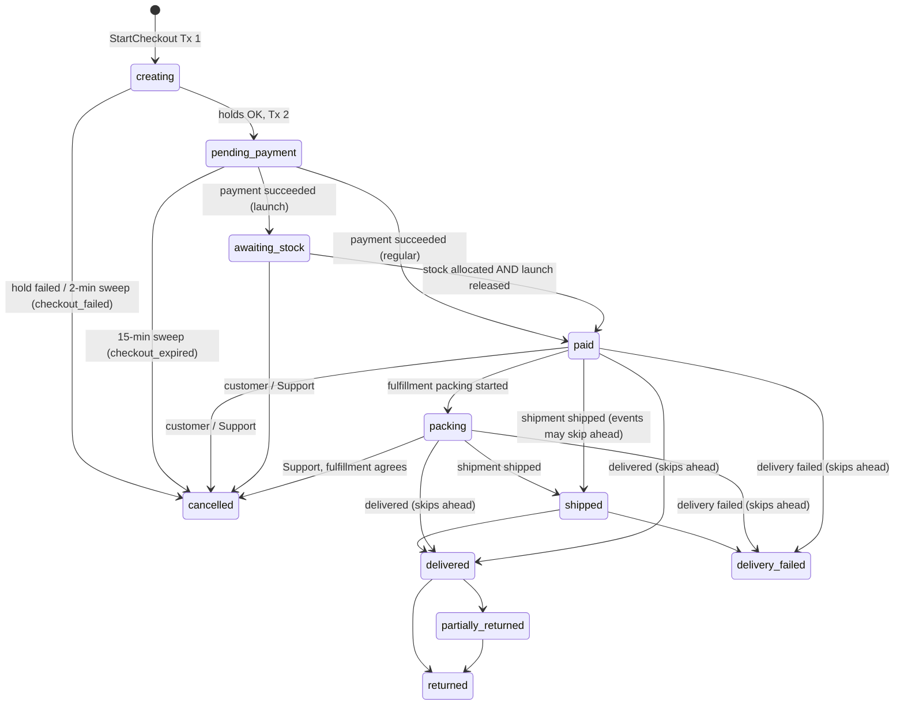

# LLD — order service

[Docs](../README.md) › [Low-level design](README.md)

| | |
|---|---|
| **Status** | Approved (2026-11-12) |
| **Last updated** | 2026-10-31 |
| **Product rules** | [05-checkout-payment](../product-design/05-checkout-payment.md) (CHK-R01 … R18), [06-orders-fulfillment](../product-design/06-orders-fulfillment.md) (ORD-R01 … R17), [08-promotions](../product-design/08-promotions.md) (PRM-R01 … R13), LCH-R13 … R16, R19, WAR-R01, ACC-R06, R13, BI-04, BI-05 |
| **HLD** | [high-level-design.md §5, §8.1 – §8.3, §8.5](../high-level-design/high-level-design.md), HLD-ADR-005, HLD-ADR-013 |
| **Depends on** | [00-reliability.md](00-reliability.md), [01-launch.md](01-launch.md), [02-inventory.md](02-inventory.md) |

## 1. Problem and scope

`order` turns a cart (or a launch pass) into a paid order and owns the order until it's delivered, cancelled, failed or returned. It orchestrates the checkout and cancellation sagas, holds coupons in the same transaction as the order, and expires unpaid checkouts.

**In scope:** cart, checkout start (regular and launch), pricing (discount split, tax, shipping), coupons and coupon uses, order lifecycle and history, expiry sweep, customer and Support cancellation, late-payment handling, pre-order release hold, checkout settings, order-side anonymization, the unsettled-orders check.

**Out of scope:** charging and refunding (`payment`), stock and allocation (`inventory`, `launch`), packing, shipping, returns and refund amounts for returns (`fulfillment`), prices (`catalog`).

## 2. Requirements and constraints

| ID | Requirement | Source |
|---|---|---|
| OR-01 | Checkout start p95 < 300 ms at launch peak, including catalog, launch/inventory and payment calls. | QA-03 |
| OR-02 | No hold is ever orphaned: every hold belongs to an order record that exists before the hold is requested. | Owner decision |
| OR-03 | Coupon uses (held + consumed) never exceed total or per-customer limits. | BI-04 |
| OR-04 | An order is never both *Cancelled* and shipped. | Owner decision |
| OR-05 | Line amounts always sum exactly to the order total; refunds per line never exceed the line's paid amount. | CHK-R15, BI-05 |
| OR-06 | Prices, discount, tax and shipping are fixed at checkout start. | CHK-R04, CAT-R08 |
| OR-07 | A pre-order moves to *Paid* only when its stock is allocated **and** its launch is released. | LCH-R19, ORD-R16 |

## 3. Component structure

| Component | Deployment | Responsibility |
|---|---|---|
| Cart API | API | Cart CRUD, cart view with availability flags |
| Checkout API | API | `StartCheckout` (regular and launch), idempotent |
| Order API | API | Order history, details, customer cancel |
| Staff API | API | Support search, Support cancel; coupons (Catalog manager); checkout settings (Admin) |
| Internal API | API | `HasUnsettledOrders` (identity) |
| Sweeps | Worker | Creating-order compensation (2 min), checkout expiry (15 min), stuck-saga monitor |
| Consumers | Worker | Payment, inventory, launch, fulfillment, identity messages (§5.3) |
| Reliability plumbing | Both | Idempotency guard, outbox, inbox ([00-reliability.md](00-reliability.md)) |

## 4. Data model (order database)

### 4.1 Orders

**`orders`**

| Column | Type | Constraints / notes |
|---|---|---|
| `id` | `uuid` | PK (UUIDv7) |
| `number` | `text` | unique; `BLM-` + 8 Crockford base32 chars, random |
| `account_id` | `uuid` | not null |
| `kind` | `text` | `regular` \| `launch` |
| `launch_id` | `uuid` | null unless `launch` |
| `status` | `text` | `creating` (internal) \| `pending_payment` \| `paid` \| `awaiting_stock` \| `packing` \| `shipped` \| `delivered` \| `cancelled` \| `delivery_failed` \| `partially_returned` \| `returned` |
| `cancel_reason` | `text` | null; `checkout_failed` \| `checkout_expired` \| `customer` \| `support` |
| `stock_allocated` | `bool` | default false (pre-orders) |
| `launch_released` | `bool` | default false (pre-orders) |
| `handed_to_fulfillment` | `bool` | default false; true once "order ready to fulfill" is emitted |
| `deadline_at` | `timestamptz` | `creating`: +2 min; `pending_payment`: +15 min; else null |
| `shipping_option` | `text` | `standard` \| `express` |
| `ship_to` | `jsonb` | address snapshot (name, lines, city, state, ZIP, phone) |
| `currency` | `text` | `USD` |
| `subtotal_cents`, `discount_cents`, `tax_cents`, `shipping_cents`, `total_cents` | `bigint` | ≥ 0; `total = Σ line totals + shipping` |
| `tax_rate_bp` | `int` | basis points locked at checkout start |
| `payment_id` | `uuid` | null until created |
| `delivered_at` | `timestamptz` | null |
| `version` | `bigint` | default 0 |
| `created_at`, `updated_at` | `timestamptz` | |

Indexes: `(status, deadline_at) WHERE status IN ('creating','pending_payment')` (sweeps); `(account_id, created_at DESC)` (history); `(launch_id, status) WHERE kind = 'launch'` (release).

**`order_lines`** — PK `(order_id, line_no)`

| Column | Type | Notes |
|---|---|---|
| `line_no` | `int` | 1-based |
| `kind` | `text` | `product` \| `warranty_plan` |
| `sku_id` | `uuid` | product SKU, or the plan's catalog SKU |
| `product_id`, `category_id` | `uuid` | snapshot |
| `name` | `text` | snapshot |
| `serialized` | `bool` | snapshot |
| `parent_line_no` | `int` | plans only: the covered device line |
| `coverage_months` | `int` | plans only |
| `quantity` | `int` | > 0; product lines ≤ 10 for regular orders (CHK-R03) |
| `unit_price_cents` | `bigint` | snapshot |
| `discount_cents` | `bigint` | this line's share of the coupon (§6.3) |
| `tax_cents` | `bigint` | |
| `paid_cents` | `bigint` | `unit_price × qty − discount + tax` |
| `returned_qty` | `int` | default 0 |
| `refunded_cents` | `bigint` | default 0, `≤ paid_cents` |

**`order_status_history`**: `order_id`, `from_status`, `to_status`, `actor_type` (`customer` \| `staff` \| `system`), `actor_id`, `reason`, `at` (ORD-R04).

**`order_sagas`** — one row per running saga

| Column | Type | Notes |
|---|---|---|
| `order_id`, `type` | `uuid`, `text` | PK; `type` = `checkout_compensation` \| `expiry` \| `cancellation` \| `late_payment` |
| `pending_steps` | `text[]` | subset of `inventory_release`, `launch_release`, `refund`, `refund_failed` |
| `started_at`, `completed_at` | `timestamptz` | |

**`checkout_keys`** — PK `(account_id, idempotency_key)`: `order_id`. A resumed `StartCheckout` finds its order through it (§6.2).

**`order_returns`** — one row per return: `order_id` (FK to `orders`), `return_id`, `closed_at timestamptz` null. PK `(order_id, return_id)`. A return is open while `closed_at` is null (§5.3).

### 4.2 Cart

**`carts`** — PK `account_id`; `version`, `updated_at`.
**`cart_lines`** — PK `(account_id, line_no)`: `kind`, `sku_id`, `parent_line_no` (plans), `quantity`. Launch SKUs are never allowed in the cart.

### 4.3 Coupons

**`coupons`**

| Column | Type | Constraints |
|---|---|---|
| `id` | `uuid` | PK |
| `code_normalized` | `text` | unique; upper-cased, trimmed (PRM-R12) |
| `code_display` | `text` | as entered |
| `type` | `text` | `percent` \| `fixed` |
| `value` | `int` | percent: 1–100; fixed: cents > 0 |
| `scope` | `text` | `order` \| `selected` |
| `min_spend_cents` | `bigint` | null |
| `starts_at`, `expires_at` | `timestamptz` | null |
| `total_limit`, `per_customer_limit` | `int` | null = unlimited |
| `uses_count` | `int` | held + consumed; `CHECK (total_limit IS NULL OR uses_count <= total_limit)` |
| `active` | `bool` | false after deactivation (PRM-R13) |
| `version` | `bigint` | |

**`coupon_scope_items`**: `coupon_id`, `target_type` (`product` \| `category`), `target_id`.
**`coupon_customer_usage`** — PK `(coupon_id, account_id)`: `uses_count`.
**`coupon_uses`** — PK `order_id`: `coupon_id`, `account_id`, `status` (`held` \| `consumed` \| `released` \| `restored`), timestamps.

### 4.4 Settings

**`checkout_settings`** — single row: `express_fee_cents`, `version`, `updated_by`, `updated_at`. The migration seeds `express_fee_cents = 1500`. The tax rate comes from service configuration (`TaxRateBasisPoints`, default `825`), read at checkout start (CHK-R08).

## 5. Interfaces

### 5.1 gRPC

| Method | Caller | Request → Response |
|---|---|---|
| `GetCart` | Customer | → lines with current price, `available`, `out_of_stock` (CHK-R18). Per line: `available` = catalog `buyable`; `out_of_stock` = inventory `available` < line quantity (flags omitted when inventory is unreachable, §5.2) |
| `UpsertCartLine` / `RemoveCartLine` | Customer | line → cart (optimistic `version`). `UpsertCartLine` identifies a line by (`kind`, `sku_id`) for products and (`kind`, `sku_id`, `parent_line_no`) for plans; `quantity` is absolute, 0 removes the line. Removing a device line (`RemoveCartLine` or quantity 0) removes its plan lines. Upsert checks through catalog `GetPricing`: `LAUNCH_ITEMS_IN_CART`, `SKU_NOT_BUYABLE`, `QUANTITY_LIMIT`, `WARRANTY_NOT_ELIGIBLE`. `version` is required on writes; an account with no cart row has version 0 |
| `StartCheckout` | Customer | **`Idempotency-Key` required.** `source` = `cart` \| `launch{launch_id, pass_token, lines[]}`, `ship_to`, `shipping_option`, `coupon_code?` → `order_id`, `number`, totals, `payment_url`, `deadline_at` |
| `GetOrder` | Customer (own), Support, Admin | `order_id` → order, lines, history. For a customer caller, history keeps `from`, `to`, `at` and `actor_type`; it drops `actor_id` unless it is the customer, and drops `reason` on rows with `actor_type = staff`. System rows keep their reason codes (for example `checkout_expired`), and customer rows keep theirs. Support and Admin see everything |
| `ListMyOrders` | Customer | page → orders |
| `CancelOrder` | Customer | `order_id`, `version` → order |
| `SupportCancelOrder` | Support, Admin | `order_id`, `reason`, `version` → order |
| `SearchOrders` | Support, Admin | number / account / status → orders |
| `CreateCoupon` / `UpdateCoupon` / `DeactivateCoupon` / `ListCoupons` | Catalog manager, Admin | coupon fields, `version`. `UpdateCoupon` edits every field except the code; `total_limit` below `uses_count` → `VALIDATION_FAILED` |
| `GetCheckoutSettings` / `SetExpressFee` | Admin | `express_fee_cents`, `version` |
| `HasUnsettledOrders` | identity | `account_id` → `bool` |

### 5.2 Outgoing gRPC calls

| Call | When | Failure handling |
|---|---|---|
| catalog `GetPricing(sku_ids)` | Cart view, checkout start | Checkout: fail with `UNAVAILABLE` (idempotency key released, retry safe) |
| inventory `GetAvailability` | Cart view | Flags omitted; cart still shown |
| inventory `ReserveStock` | Regular checkout | Compensate (§6.2). `ORDER_RELEASED` → the checkout answers `CHECKOUT_CLOSED` |
| launch `HoldAllocation` | Launch checkout | Compensate (§6.2) |
| payment `CreatePayment(order_id, order_number, amount, account, display_lines)` | Checkout start (after Tx 2) | Any failure → `UNAVAILABLE` (key released, order stays `pending_payment`) with an error log; retry with same key resumes. The 15-min sweep expires the order if the client never retries (§6.2) |
| fulfillment `CancelPackTask(order_id, by)` | Cancel of an order with `handed_to_fulfillment` | §6.6 |

`display_lines` match [04-payment §5.1](04-payment.md): one per order line, plus Express shipping.

`GetPricing` returns per SKU: `price_cents`, `name`, `product_id`, `category_id`, `kind` (`product` \| `warranty_plan`), `serialized`, `buyable`, `launch {launch_id, stage}?`, and for plans `eligible_product_ids`, `coverage_months`.

### 5.3 Messages

**Published**

| Message | When | Key payload |
|---|---|---|
| `order.paid.v1` | Payment confirmed (any order) | `orderId`, `orderNumber`, `accountId`, `launchId?`, `paidAt`, `totalCents`, `lines[{skuId, quantity}]` (product lines only, no warranty plans) |
| `order.ready-to-fulfill.v1` | Order reaches `paid` | `orderId`, `accountId`, `number`, `shipTo`, `shippingOption`, `shippingCents`, `totalCents`, `lines[{lineNo, kind, skuId, productId, serialized, quantity, parentLineNo, coverageMonths, paidCents, taxCents}]` |
| `order.cancelled.v1` | Any cancellation | `orderId`, `orderNumber`, `accountId`, `reason` (`customer` \| `support` \| `checkout_expired` \| `checkout_failed` \| `late_payment`) |
| `order.preorder-delayed.v1` | Launch released while a pre-order still has no stock allocated (once per order, INV-R11) | `orderId`, `orderNumber`, `accountId` |
| `order.delivered.v1` | Delivered | `orderId`, `accountId`, `productIds[]`, `deliveredAt` |
| `inventory.release-reservation.v1` | Command | `orderId` |
| `launch.release-allocation-hold.v1` | Command | `orderId`, `reason` = the order's cancel reason (`checkout_failed`, `checkout_expired`, `customer`, `support`) |
| `payment.refund-payment.v1` | Command | `orderId`, `refundId`, `amountCents`, `reason` (`cancellation` \| `late_payment`), `lines?[{lineNo, amountCents}]` |
| `payment.cancel-payment.v1` | Command (checkout expired or failed) | `orderId` |
| `identity.staff-action-recorded.v1` | Staff actions | |

**Consumed** (handler names `order.<message>`)

| Message | Effect |
|---|---|
| `payment.succeeded.v1` | §6.4 |
| `payment.failed.v1` | No effect: status unchanged; the customer retries on Stripe's page within the deadline (CHK-R13) |
| `payment.refund-completed.v1` | Update line `refunded_cents` (when the refund carries line amounts; a zero-cent amount is accepted, only a negative one is rejected) and remove `refund` **or** `refund_failed` from the open saga's `pending_steps`; when empty → completed |
| `payment.refund-failed.v1` | Replace `refund` with `refund_failed` in the open saga's `pending_steps` and log an error, so the saga stays open and `sagas_stuck` shows it; Support resolves (payment alerts) |
| `inventory.stock-allocated.v1` | `stock_allocated = true`; §6.5 |
| `inventory.reservation-released.v1` | Complete `inventory_release` step |
| `launch.hold-released.v1` | Complete `launch_release` step |
| `launch.stage-changed.v1` | On `stage = released`: `launch_released = true` for every `creating`, `pending_payment` and `awaiting_stock` order of that launch; §6.5 |
| `fulfillment.packing-started.v1` | `paid` → `packing` |
| `fulfillment.shipment-shipped.v1` | → `shipped` |
| `fulfillment.shipment-delivered.v1` | → `delivered`, `delivered_at`; publish `order.delivered.v1` |
| `fulfillment.delivery-failed.v1` | → `delivery_failed`; coupon use → `restored` (ORD-R17) |
| `fulfillment.return-requested.v1` / `fulfillment.return-closed.v1` | Per `returnId`: insert an `order_returns` row / mark it closed |
| `fulfillment.return-decided.v1` | Add accepted units to `returned_qty`; status → `partially_returned` or `returned` (§6.7) |
| `identity.account-deleted.v1` | Anonymize (§6.9) |

### 5.4 Error reasons

| Reason | Status | When |
|---|---|---|
| `CART_EMPTY` | `FAILED_PRECONDITION` | Checkout from an empty cart |
| `SKU_NOT_BUYABLE` | `FAILED_PRECONDITION` | Inactive, archived, or launch SKU outside its launch flow |
| `LAUNCH_ITEMS_IN_CART` | `INVALID_ARGUMENT` | Launch SKU added to the cart (LCH-R13) |
| `MIXED_LAUNCH_ORDER` | `INVALID_ARGUMENT` | Launch checkout with non-launch lines or another launch's SKUs |
| `QUANTITY_LIMIT` | `INVALID_ARGUMENT` | > 10 on a regular product line (CHK-R03) |
| `WARRANTY_NOT_ELIGIBLE` | `INVALID_ARGUMENT` | Plan not eligible for its parent line, or plan qty > parent qty |
| `ADDRESS_INVALID` | `INVALID_ARGUMENT` | Not a valid US address (CHK-R06) |
| `COUPON_NOT_FOUND` / `COUPON_INACTIVE` / `COUPON_NOT_STARTED` / `COUPON_EXPIRED` | `FAILED_PRECONDITION` | |
| `COUPON_MIN_SPEND` | `FAILED_PRECONDITION` | Eligible lines below minimum (PRM-R11) |
| `COUPON_NOT_APPLICABLE` | `FAILED_PRECONDITION` | No eligible lines, or launch order (LCH-R14) |
| `COUPON_LIMIT_REACHED` | `FAILED_PRECONDITION` | Total or per-customer limit (BI-04) |
| `ORDER_TOTAL_TOO_LOW` | `FAILED_PRECONDITION` | Order total below 50 cents (CHK-R20) |
| `SOLD_OUT`, `LIMIT_EXCEEDED`, `PASS_*` | as returned | Passed through from inventory / launch |
| `CANCEL_NOT_ALLOWED` | `FAILED_PRECONDITION` | Status doesn't allow it, or packing already started (customer); fulfillment's `PACKING_STARTED` maps to it |
| `ALREADY_SHIPPED` | `FAILED_PRECONDITION` | Support cancel refused by fulfillment |
| `CHECKOUT_CLOSED` | `FAILED_PRECONDITION` | A resumed checkout whose order was already cancelled, or Tx 2 finds the order no longer `creating`, or inventory answered `ORDER_RELEASED`: "This checkout was cancelled; start a new one." Stored on the key |
| `COUPON_CODE_TAKEN` | `ALREADY_EXISTS` | `CreateCoupon` with a code that already exists (ignoring case) |
| `NOT_FOUND` | `NOT_FOUND` | Unknown record |
| `VALIDATION_FAILED` | `INVALID_ARGUMENT` | Bad request field, named in `ErrorInfo` metadata |
| `ROLE_NOT_ALLOWED` | `PERMISSION_DENIED` | Caller's role may not call the method (00-reliability §8) |
| `CONCURRENCY_CONFLICT` | `ABORTED` | Stale `version` |
| `IDEMPOTENCY_KEY_REQUIRED`, `IDEMPOTENCY_KEY_INVALID`, `IDEMPOTENCY_KEY_REUSED` | `INVALID_ARGUMENT` | Key missing, not a UUID, or reused for a different request (00-reliability §7.4). A resumed `StartCheckout` whose source kind, launch, shipping option or address differs from the first request → `IDEMPOTENCY_KEY_REUSED`, also against an already-swept order (not `CHECKOUT_CLOSED`) |

## 6. Behaviour

### 6.1 Order lifecycle

`creating` is internal: never shown to customers, never in history lists. Every transition is a guarded update on `status` (and `version`) and writes one `order_status_history` row (from → to). Fulfillment events may skip ahead: `shipped` from `paid` \| `packing`; `delivered` and `delivery_failed` from `paid` \| `packing` \| `shipped`. A late earlier event finds the order further on and is a no-op.

### 6.2 StartCheckout

Guarded by the idempotency key (multi-step form, [00-reliability.md §7.4](00-reliability.md)). The `order_id` is generated in Tx 1 and stored in `checkout_keys`, so a resumed request reuses it.

1. **Validate input** (no I/O): address format, shipping option, coupon code format.
2. **Tx 1:** claim the idempotency key; insert the order (`orders`: `creating`, `deadline_at = now + 2 min`, new `number`) and its `checkout_keys` row. Commit.
3. **Price:** catalog `GetPricing` for every SKU. Validate:
   - regular: every product SKU `buyable`, no launch SKU in `pre-launch` stages, quantities ≤ 10;
   - launch: every product SKU in the given launch, stage `preorder_open` (judged by its launch, not by `buyable`: catalog returns `buyable = false` for `preorder_open`, [08-catalog §6.1](08-catalog.md)); plans only;
   - plans: eligible for the parent line's product; plan qty ≤ parent qty (WAR-R01).
4. **Compute totals** (§6.3), including the coupon check (validity, eligibility, minimum spend). A total below 50 cents → `ORDER_TOTAL_TOO_LOW` (CHK-R20). No counters touched yet.
5. **Hold (gRPC):** regular → inventory `ReserveStock(order_id, product lines)`; launch → launch `HoldAllocation(order_id, pass, product lines)`.
6. **Tx 2:** hold the coupon (§6.8); insert lines; set totals, `tax_rate_bp`, `status = pending_payment`, `deadline_at = now + 15 min`. Commit.
7. **Payment (gRPC):** `CreatePayment(order_id, total, account)` (idempotent by `order_id`); store `payment_id`.
8. Complete the idempotency key with the response (order, totals, payment URL, deadline).

**Failures:**

| Failure at | Result |
|---|---|
| Step 3, 4 (validation, coupon) | Tx: order → `cancelled` (`checkout_failed`). Business error stored on the key. |
| Step 5 (`SOLD_OUT`, `LIMIT_EXCEEDED`, `PASS_*`) | Tx: order → `cancelled`; saga `checkout_compensation` with a release command for the other side's partial holds (none for single-service holds). Error stored. On a resumed order (found through `checkout_keys`, not inserted by this request), any hold rejection also sends the release command and opens `checkout_compensation`, so an earlier attempt's hold isn't orphaned (OR-02). |
| Step 6 (coupon limit reached) | Tx: order → `cancelled` + release command for the hold + saga. `COUPON_LIMIT_REACHED` stored. |
| Step 5–7 transient (timeout, unavailable) | Key released; order stays `creating` or `pending_payment`. Retry with same key resumes from the order's status. |
| Crash anywhere | Key stale after 60 s → resume on retry. If the client never retries, the **creating sweep** (deadline 2 min) cancels the order and sends release commands. |
| Step 7 fails after retries end | Order stays `pending_payment`; the 15-min sweep expires it. |

**Resume.** A retry that finds its order through `checkout_keys` continues by the order's status:

| Order status | Result |
|---|---|
| `creating` | Continue at step 5 |
| `pending_payment` | `CHECKOUT_CLOSED` if `deadline_at` has passed, else continue at step 7 |
| `paid`, `awaiting_stock` or later | The normal response with `payment_url = ""` |
| `cancelled` | `CHECKOUT_CLOSED` |

Release commands for holds that were never placed are no-ops in launch / inventory, which still publish the completion event (§5.3), so sagas always finish.

### 6.3 Pricing

All amounts are integer cents.

1. Product line gross = `unit_price × qty`. Plan line gross = plan price × qty.
2. **Eligible lines** (PRM-R04): product lines (not plans), regular orders only, in coupon scope (`order`, or matching product / category).
3. Minimum spend: Σ eligible gross ≥ `min_spend_cents` (PRM-R11).
4. Discount `D`: percent → `floor(Σ eligible × value / 100)`; fixed → `value`; capped at Σ eligible (PRM-R05).
5. **Split** (largest remainder): each eligible line gets `floor(D × gross_i / Σ eligible)`; the leftover cents go one each to lines with the largest fractional remainders, ties to the lower `line_no`. Σ shares = `D` exactly.
6. **Tax** per product line: `round_half_up((gross − discount) × tax_rate_bp / 10000)`. Plans and shipping: 0 (CHK-R08).
7. `paid_cents = gross − discount + tax`. Shipping: Standard 0, Express `express_fee_cents`.
8. `total = Σ paid_cents + shipping`. The total must be at least 50 cents (CHK-R20).

### 6.4 Payment succeeded

| Order status | Action |
|---|---|
| `pending_payment` | regular → `paid`; launch → `awaiting_stock`. Coupon use → `consumed`. Outbox `order.paid.v1`. Regular: also `order.ready-to-fulfill.v1`, `handed_to_fulfillment = true`, and the bought items leave the cart in the same transaction (CHK-R19); items added during the checkout stay. |
| `cancelled` (expired / failed) | **Late payment** (HLD-ADR-013): saga `late_payment`; outbox `payment.refund-payment.v1` (full amount). Customer notified via `order.cancelled.v1` reason. |
| Anything else | No-op (duplicate) |

### 6.5 Pre-order release hold (OR-07)

Whenever `stock_allocated` or `launch_released` becomes true on an `awaiting_stock` order, check both. If both are true: → `paid`; outbox `order.ready-to-fulfill.v1`; `handed_to_fulfillment = true`.

On `launch.stage-changed.v1` with `stage = released`: set `launch_released = true` on every `creating`, `pending_payment` and `awaiting_stock` order of that launch, in batches of 500 (guarded updates) repeated until a batch is empty, so a 5,000-order launch doesn't run in one transaction. An order paid after the release enters `awaiting_stock` with the flag set and moves to `paid` when `stock-allocated` arrives. `awaiting_stock` orders that still have `stock_allocated = false` get `order.preorder-delayed.v1` (once per order, INV-R11); only the release batch sends it.

### 6.6 Cancellation (customer and Support)

| Actor | Allowed statuses |
|---|---|
| Customer | `paid`, `awaiting_stock` (ORD-R05), and only if fulfillment hasn't started packing |
| Support | `paid`, `awaiting_stock`, `packing` (ORD-R14) |

1. If `handed_to_fulfillment`: call fulfillment `CancelPackTask(order_id, by = customer|support)`.
   - Customer and fulfillment says packing started → `CANCEL_NOT_ALLOWED`.
   - Support and shipment already handed to the carrier → `ALREADY_SHIPPED`.
   - Fulfillment hasn't received the order yet → it records a cancellation marker so the late "ready to fulfill" is ignored, and returns OK.
2. **Tx:** status → `cancelled` (guarded on the expected status); coupon use → `restored` (PRM-R10); saga `cancellation` with steps; outbox:
   - `payment.refund-payment.v1` (full `total_cents`, ORD-R06);
   - regular → `inventory.release-reservation.v1`;
   - launch → `launch.release-allocation-hold.v1` **and** `inventory.release-reservation.v1` (the backorder or commitment);
   - `order.cancelled.v1`.

### 6.7 Delivery, failures and returns

- `shipment-delivered` → `delivered`, `delivered_at`; publish `order.delivered.v1` (catalog review eligibility).
- `delivery-failed` → `delivery_failed`; coupon use `restored`. The refund is orchestrated by fulfillment (ORD-R17).
- `return-decided` (accepted units only; rejected units don't count): add to each line's `returned_qty`. If every product line has `returned_qty = quantity` → `returned`, else `partially_returned`. A decision with no accepted units leaves the status unchanged.

### 6.8 Coupon hold (inside Tx 2)

1. `UPDATE coupons SET uses_count = uses_count + 1 WHERE id = @c AND active AND (total_limit IS NULL OR uses_count + 1 <= total_limit) AND (starts_at IS NULL OR starts_at <= now()) AND (expires_at IS NULL OR expires_at > now())` → 0 rows: `COUPON_LIMIT_REACHED` (or the specific validity reason).
2. `INSERT … ON CONFLICT DO NOTHING` into `coupon_customer_usage`, then guarded `uses_count + 1 <= per_customer_limit` → 0 rows: `COUPON_LIMIT_REACHED`.
3. Insert `coupon_uses` (`held`).

**Use transitions:** `held → consumed` (paid); `held → released` (expired / failed: both counters −1); `consumed → restored` (cancelled before shipping or delivery failed: both counters −1). Deactivation (PRM-R13) sets `active = false`; existing `held` uses still complete.

### 6.9 Sweeps and anonymization

| Job | Every | Action |
|---|---|---|
| Creating sweep | 10 s | `creating` past deadline (`FOR UPDATE SKIP LOCKED`, batch 100) → `cancelled` (`checkout_failed`), release command(s), saga |
| Expiry sweep | 10 s | `pending_payment` past deadline → `cancelled` (`checkout_expired`); coupon `released`; release command(s); `payment.cancel-payment.v1`; saga `expiry` |
| Stuck-saga monitor | 1 min | Sagas not completed after 30 min → metric + alert |

**Account deleted (ACC-R06):** replace `ship_to` name, address lines and phone with `"[deleted]"` on all the account's orders; delete the cart. Amounts, SKUs, dates and `account_id` stay.

**`HasUnsettledOrders`** (ACC-R13) returns true if any order of the account has: status in `pending_payment`, `paid`, `awaiting_stock`, `packing`, `shipped`; or an `order_returns` row with `closed_at` null; or `delivered_at > now() − 14 days`.

## 7. Concurrency and consistency

| Risk | Protection |
|---|---|
| Orphaned holds | Order row exists before any hold; creating sweep compensates (OR-02) |
| Double checkout from retries | Idempotency key + `order_id` stored with it; holds idempotent by `order_id` |
| Coupon over-redemption | Guarded counters in Tx 2 + `CHECK` (OR-03) |
| Cancel vs pickup race | fulfillment decides first via `CancelPackTask` (OR-04) |
| Paid vs expired race | Both are guarded status updates; the loser sees the new status (late payment → refund) |
| Reordered messages | Status guards per consumer table (§5.3); impossible transitions are no-ops |
| Release of 5,000 pre-orders | Batched guarded updates |

## 8. Edge cases

| Case | Expected behaviour |
|---|---|
| Price changes during checkout | Locked prices used (OR-06). |
| Cart item price changed since added | Shown at the current price; checkout uses it. |
| Customer pays twice from two tabs | One Stripe Checkout Session per order (`CreatePayment` idempotent by `order_id`); provider + payment layers stop a second charge. |
| Payment succeeds 1 s after expiry | Late payment saga refunds in full. |
| `stock-allocated` arrives before `order.paid` was processed | Can't happen: inventory only creates the backorder from `order.paid`. |
| Launch released before any stock arrives | `launch_released = true`; order waits for `stock_allocated`. |
| Launch released while a checkout is open | The flag is set on the open order too; once paid, it waits only for stock. |
| Coupon deactivated while held | Checkout completes with the coupon. |
| Support cancels during packing, carrier already scanned | `ALREADY_SHIPPED`; order unchanged. |
| Account deleted with unsettled orders | Refused by identity (ACC-R13) via `HasUnsettledOrders`. |
| Fixed coupon larger than eligible total | Capped at eligible total. |
| Fulfillment events arrive out of order | Events may skip ahead (§6.1); a late earlier event finds the order further on and is a no-op. Each applied transition writes one history row. |
| Cart write followed by a catalog outage | The write is kept, the answer is `UNAVAILABLE`, and a retry is safe (absolute set / remove). |

## 9. Security and validation

- `account_id` always comes from the trusted identity context. Customers can only read and cancel their own orders (ownership check on every call).
- `ship_to`: US only; state is a USPS 2-letter code; ZIP `^\d{5}(-\d{4})?$`; name ≤ 100, lines ≤ 100 chars; phone E.164.
- Coupon code: 3–32 chars `[A-Za-z0-9-]`.
- A negative `version`, or a `parent_line_no` on a non-plan line → `VALIDATION_FAILED`.
- Staff methods check roles ([10-accounts-access §3](../product-design/10-accounts-access.md)); all staff actions are audited.
- `HasUnsettledOrders` callable only by identity (Linkerd allow rule).

## 10. Observability

| Metric | Labels | Purpose |
|---|---|---|
| `checkout_start_seconds` | `kind` | OR-01 |
| `checkout_total` | `kind`, `result` (`ok`, `sold_out`, `limit_exceeded`, `coupon_*`, `failed`) | Outcomes |
| `orders_by_status` | `status` | Lifecycle |
| `checkout_expired_total` | — | Abandonment |
| `late_payments_total` | — | Late-payment refunds |
| `sagas_running` / `sagas_stuck` | `type` | Saga health |
| `coupon_redemptions_total` | `result` | Coupon use |
| `cancellations_total` | `actor`, `result` | Cancel outcomes |

**Alerts:** `sagas_stuck > 0`; checkout p95 > 300 ms; `late_payments_total` rising (deadline too short or payment issues).

## 11. Test cases

| # | Case | Expected |
|---|---|---|
| O-01 | Regular checkout happy path | `pending_payment`, reservation, coupon held, payment URL |
| O-02 | Retry with the same key after success | Same order and secret, no second hold |
| O-03 | Crash after hold, before Tx 2; no retry | Creating sweep cancels, release sent, saga completes |
| O-04 | `SOLD_OUT` from inventory | Order `cancelled`, error stored on key, retry returns same error |
| O-05 | Coupon with 1 use left, 2 concurrent checkouts | One gets it; other `COUPON_LIMIT_REACHED`, its hold released |
| O-06 | Discount 1000 cents over lines 333/333/334 | Shares sum to 1000 exactly |
| O-07 | Tax rounding at half a cent | Rounded up |
| O-08 | Expiry after 15 min | `cancelled`, coupon released, release + cancel-payment commands |
| O-09 | Payment succeeds after expiry | Full refund command, `late_payment` saga |
| O-10 | Pre-order: stock allocated, launch not released | Stays `awaiting_stock` |
| O-11 | Launch released with 5,000 allocated pre-orders | All → `paid` in batches, each emits ready-to-fulfill once |
| O-12 | Customer cancels `paid` order before packing | Refund + release commands, coupon restored |
| O-13 | Customer cancels after packing started | `CANCEL_NOT_ALLOWED` |
| O-14 | Support cancels during packing, not shipped | Cancelled; fulfillment task cancelled |
| O-15 | Support cancels, already shipped | `ALREADY_SHIPPED` |
| O-16 | Launch order cancelled | Both launch and inventory release commands |
| O-17 | Launch checkout with a regular SKU | `MIXED_LAUNCH_ORDER` |
| O-18 | Plan qty 2 on device qty 1 | `WARRANTY_NOT_ELIGIBLE` |
| O-19 | All units returned | `returned`; partial → `partially_returned` |
| O-20 | Account deleted | Addresses anonymized, cart deleted, amounts kept |
| O-21 | `HasUnsettledOrders` with delivery 10 days ago | true |

## 12. Open questions

| ID | Question |
|---|---|
| — | None open. |
