# LLD — fulfillment service

[Docs](../README.md) › [Low-level design](README.md)

| | |
|---|---|
| **Status** | Approved (2026-10-31) |
| **Last updated** | 2026-10-31 |
| **Product rules** | [06-orders-fulfillment](../product-design/06-orders-fulfillment.md) ORD-R08 … R17, [07-returns-refunds](../product-design/07-returns-refunds.md) RET-R01 … R15, WAR-R01 … R06, BI-05, BI-07 |
| **HLD** | [high-level-design.md §5, §8.4](../high-level-design/high-level-design.md), HLD-ADR-005, HLD-ADR-018 |
| **Depends on** | [00-reliability.md](00-reliability.md), [02-inventory.md](02-inventory.md), [03-order.md](03-order.md), [04-payment.md](04-payment.md) |

## 1. Problem and scope

`fulfillment` gets paid orders physically to customers and back: packing with serial scanning, carrier labels and tracking, delivery failures, returns with inspection, refund amounts for returns and failures, and warranty coverage per serial.

**In scope:** pack tasks, serial scanning (via inventory), outbound / return / ship-back shipments with Shippo, tracking, handover, cancellation of pack tasks, possibly-lost detection, lost and returned-to-sender handling, return requests, inspections, return decisions, refund amount calculation, warranty coverage and lookup.

**Out of scope:** stock counts (`inventory`), executing refunds (`payment`), order status (`order`, fed by this service's events), customer notifications (`notification`).

## 2. Requirements and constraints

| ID | Requirement | Source |
|---|---|---|
| FR-01 | A package is never handed over for a cancelled task, and a handed-over task is never cancelled. | OR-04 |
| FR-02 | Refunds per order line never exceed the line's paid amount; full returns of a line refund it exactly. | BI-05, RET-R06, R07 |
| FR-03 | Every shipped serialized unit is scanned and linked before handover. | BI-07, ORD-R08 |
| FR-04 | Tracking callbacks are never trusted: status is always re-fetched from Shippo. | Owner decision |
| FR-05 | At most one paid label per shipment; duplicates are detected and voided. | Owner decision |
| FR-06 | Warranty coverage is linked to a serial at packing and starts at delivery. | WAR-R02, R03 |

## 3. Component structure

| Component | Deployment | Responsibility |
|---|---|---|
| Warehouse API | API | Start packing, scan / unassign / replace serials, complete packing, handover scan, receive return, record inspection, record returned-to-sender inspection |
| Support API | API | Return decisions, confirm lost (refund or reship), dismiss possibly-lost |
| Customer API | API | Request return, list own returns, warranty coverage lookup |
| Internal API | API | `CancelPackTask` (order) |
| Shippo webhook | API | Plain HTTP `POST /webhooks/shippo/{secret}` |
| Label worker | Worker | Buys / voids labels (lookup before buy) |
| Sweeps | Worker | Possibly-lost (hourly), return expiry (hourly), daily label check |
| Consumers | Worker | `order.ready-to-fulfill.v1`, `payment.refund-completed.v1`, `payment.refund-failed.v1`, `identity.account-deleted.v1` |
| Reliability plumbing | Both | Outbox, inbox, idempotency guard ([00-reliability.md](00-reliability.md)) |

## 4. Data model (fulfillment database)

### 4.1 Packing and shipments

**`pack_tasks`**

| Column | Type | Notes |
|---|---|---|
| `id` | `uuid` | PK |
| `ref_id` | `uuid` | **unique**: `order_id`, or `reship_id` |
| `order_id` | `uuid` | |
| `kind` | `text` | `order` \| `reship` |
| `status` | `text` | `pending` \| `packing` \| `packed` \| `handed_over` \| `cancelled` |
| `cancelled_before_arrival` | `bool` | true for a cancellation marker created before the order arrived |
| `ship_to` | `jsonb` | address snapshot |
| `shipping_option` | `text` | `standard` \| `express` |
| `version` | `bigint` | |
| `created_at`, `updated_at` | `timestamptz` | |

**`pack_task_lines`** — PK `(task_id, line_no)`: `kind`, `sku_id`, `product_id`, `serialized`, `quantity`, `parent_line_no`, `coverage_months`.
**`pack_task_serials`** — PK `(task_id, serial)`: `line_no`, `seq` (scan order), `scanned_at`.

**`shipments`**

| Column | Type | Notes |
|---|---|---|
| `id` | `uuid` | PK; also the Shippo metadata reference |
| `pack_task_id` | `uuid` | null for return labels |
| `return_request_id` | `uuid` | null unless `return` / `ship_back` |
| `order_id` | `uuid` | |
| `direction` | `text` | `outbound` \| `return` \| `ship_back` |
| `service` | `text` | `standard` \| `express` |
| `status` | `text` | `label_pending` \| `label_ready` \| `handed_over` \| `in_transit` \| `delivered` \| `returned_to_sender` \| `possibly_lost` \| `lost` \| `void_pending` \| `voided` |
| `shippo_transaction_id` | `text` | unique, null until bought |
| `tracking_number` | `text` | unique, null until bought |
| `label_url` | `text` | |
| `last_tracking_at` | `timestamptz` | last carrier update |
| `handed_over_at`, `delivered_at` | `timestamptz` | |
| `version` | `bigint` | |

### 4.2 Money accounting per order line

**`order_line_accounts`** — PK `(order_id, line_no)`, fed by `order.ready-to-fulfill.v1`

| Column | Type | Notes |
|---|---|---|
| `kind`, `parent_line_no` | | product or warranty plan |
| `quantity` | `int` | |
| `paid_cents`, `tax_cents` | `bigint` | from order |
| `refunded_units` | `int` | default 0, `≤ quantity` |
| `refunded_cents` | `bigint` | default 0, `CHECK (refunded_cents <= paid_cents)` (FR-02) |

**`order_accounts`** — PK `order_id`: `account_id`, `shipping_cents`, `total_cents`, `shipping_refunded` (bool), `delivered_at`.

### 4.3 Returns and failures

**`return_requests`**: `id`, `order_id`, `account_id`, `status` (`requested` \| `label_issued` \| `in_transit` \| `received` \| `inspected` \| `decided` \| `expired`), `expires_at` (request + 14 days, RET-R15), `return_shipment_id`, `version`, timestamps.

**`return_units`** — PK `(return_id, unit_no)`

| Column | Notes |
|---|---|
| `line_no` | product or plan line |
| `received_serial` | recorded at inspection (serialized lines) |
| `inspection_result` | `ok` \| `damaged` \| `missing_parts` \| `wrong_item` |
| `inspection_notes` | |
| `decision` | `full` \| `partial` \| `reject` |
| `refund_cents` | price + tax for this unit |
| `refund_tax_cents` | tax part (RET-R14) |

**`delivery_failures`**: `shipment_id` (PK), `kind` (`returned_to_sender` \| `lost`), `status` (`possibly_lost` \| `confirmed` \| `resolved_refund` \| `resolved_reship` \| `dismissed`), `rts_outcomes` (jsonb per unit: `sealed` \| `failed`), `reship_id`, `decided_by`, timestamps.

**`fulfillment_sagas`** — PK `(ref_id, type)`: `type` = `return_refund` \| `delivery_failure`; `pending_steps` (`refund`); `started_at`, `completed_at`.

### 4.4 Warranty

**`warranty_coverages`**

| Column | Notes |
|---|---|
| `id` | PK |
| `order_id`, `plan_line_no`, `device_line_no` | |
| `serial` | covered unit; unique among `active` / `pending_delivery` |
| `coverage_months` | |
| `status` | `pending_delivery` \| `active` \| `cancelled` |
| `starts_at`, `ends_at` | set at delivery |

## 5. Interfaces

### 5.1 gRPC and HTTP

| Method | Caller | Request → Response |
|---|---|---|
| `StartPacking` | Warehouse | `task_id`, `version` → task |
| `ScanSerial` / `UnassignSerial` / `ReplaceSerial` | Warehouse | `task_id`, `line_no`, `serial` (…) → task |
| `CompletePacking` | Warehouse | `task_id`, `version` → task + shipment (`label_pending`) |
| `HandOver` | Warehouse | `tracking_number` or `shipment_id` → shipment |
| `CancelPackTask` | order | `order_id`, `by` = `customer` \| `support` → `ok` |
| `RequestReturn` | Customer | `order_id`, `units[{line_no, quantity}]` → return request |
| `ListMyReturns` | Customer | → returns |
| `ReceiveReturn` | Warehouse | `return_id` → return |
| `RecordInspection` | Warehouse | `return_id`, `units[{unit_no, received_serial?, result, notes}]` → return |
| `DecideReturn` | Support, Admin | **`Idempotency-Key` required.** `return_id`, `units[{unit_no, decision, partial_cents?}]` → refund summary |
| `RecordReturnedToSender` | Warehouse | `shipment_id`, `units[{serial?, sku_id, outcome}]` → failure |
| `ConfirmLost` | Support, Admin | **`Idempotency-Key` required.** `shipment_id`, `resolution` = `refund` \| `reship` → failure |
| `DismissPossiblyLost` | Support, Admin | `shipment_id` → failure |
| `GetCoverage` | Customer (own), Support, Admin | `serial` → coverage |
| `POST /webhooks/shippo/{secret}` | Shippo (gateway public route) | Tracking event → `200` |

### 5.2 Outgoing calls

| Call | When |
|---|---|
| inventory `AssignSerial` / `UnassignSerial` / `ReplaceSerial` | Scans (sync, before the local write; idempotent for the same `ref_id`) |
| inventory `CommitForReship` | `ConfirmLost(reship)` |
| Shippo `shipments` + `transactions` (label buy), `refunds` (void), `tracks` (re-fetch) | Label worker, webhook |

### 5.3 Messages

| Message | Direction | Payload / effect |
|---|---|---|
| `fulfillment.packing-started.v1` | Published → order | `orderId` |
| `fulfillment.shipment-shipped.v1` | Published → order, inventory, notification | `orderId`, `refId`, `lines[{skuId, quantity, serials[]}]`, `trackingNumber` |
| `fulfillment.shipment-delivered.v1` | Published → order, notification | `orderId`, `refId`, `deliveredAt` |
| `fulfillment.delivery-failed.v1` | Published → order, notification | `orderId`, `kind` |
| `fulfillment.return-requested.v1` | Published → order | `orderId`, `returnId` |
| `fulfillment.return-closed.v1` | Published → order, notification | `orderId`, `returnId`, `reason` (`decided` \| `expired`) |
| `fulfillment.return-label-issued.v1` | Published → notification | `orderId`, `returnId`, `labelUrl` (when the return label is bought) |
| `fulfillment.return-received.v1` | Published → notification | `orderId`, `returnId` (on `ReceiveReturn`) |
| `fulfillment.return-decided.v1` | Published → order, notification | `orderId`, `returnId`, `accepted[{lineNo, quantity}]`, `refundCents` |
| `payment.refund-payment.v1` | Command → payment | `orderId`, `refundId`, `amountCents`, `lines[{lineNo, amountCents}]` |
| `inventory.receive-customer-return.v1` / `receive-returned-to-sender.v1` / `mark-lost-in-transit.v1` | Commands → inventory | per [02-inventory §5.3](02-inventory.md) |
| `identity.staff-action-recorded.v1` | Published | Every staff action |
| `order.ready-to-fulfill.v1` | Consumed | Creates the pack task and line accounts |
| `payment.refund-completed.v1` / `refund-failed.v1` | Consumed | Saga step `refund` done / marked failed |
| `identity.account-deleted.v1` | Consumed | Anonymize addresses |

### 5.4 Error reasons

| Reason | Status | When |
|---|---|---|
| `PACKING_STARTED` | `FAILED_PRECONDITION` | `CancelPackTask` by customer after packing started |
| `ALREADY_SHIPPED` | `FAILED_PRECONDITION` | `CancelPackTask` by Support after handover |
| `SERIALS_INCOMPLETE` | `FAILED_PRECONDITION` | `CompletePacking` with unscanned serialized units |
| `LABEL_NOT_READY` | `FAILED_PRECONDITION` | `HandOver` before the label is bought |
| `RETURN_WINDOW_CLOSED` | `FAILED_PRECONDITION` | `RequestReturn` > 14 days after delivery |
| `RETURN_QUANTITY_EXCEEDED` | `INVALID_ARGUMENT` | More units than delivered minus already returned or requested |
| `INVALID_RETURN_STATE` | `FAILED_PRECONDITION` | Action not allowed in the return's status |
| `PARTIAL_EXCEEDS_SHARE` | `INVALID_ARGUMENT` | Partial amount above the unit's share (RET-R07) |
| `RESHIP_NO_STOCK` | `FAILED_PRECONDITION` | inventory `SOLD_OUT` on reship; choose refund |

## 6. Behaviour

### 6.1 Pack task lifecycle

```mermaid
stateDiagram-v2
    [*] --> pending : order.ready-to-fulfill
    [*] --> cancelled : CancelPackTask before arrival (marker)
    pending --> packing : StartPacking (publish packing-started)
    pending --> cancelled : CancelPackTask (customer or Support)
    packing --> packed : CompletePacking (all serials scanned)
    packing --> cancelled : CancelPackTask (Support)
    packed --> cancelled : CancelPackTask (Support; label voided)
    packed --> handed_over : HandOver scan (publish shipment-shipped)
```

- `order.ready-to-fulfill.v1` for a `ref_id` that already has a `cancelled` marker → ignored.
- **`CancelPackTask`** (guarded on status in one transaction): no task → insert marker, `ok`; `pending` → `cancelled`; `packing` / `packed` → customer `PACKING_STARTED`, Support `cancelled` (+ label `void_pending` if bought); `handed_over` → `ALREADY_SHIPPED`. Serials are unassigned by inventory when it processes order's release command.

### 6.2 Packing

1. **Scan:** call inventory `AssignSerial(ref_id, sku_id, serial)`, then insert `pack_task_serials` with the next `seq`. A retry after a timeout repeats both; inventory returns `ok` for a serial already assigned to the same `ref_id`.
2. **CompletePacking:** every serialized line has `quantity` serials → else `SERIALS_INCOMPLETE`. In one transaction: task → `packed`; insert outbound `shipments` (`label_pending`, service from the order); create `warranty_coverages` (`pending_delivery`): for each plan line, its `quantity` units attach to the **first N serials by `seq`** of the parent line (FR-06).
3. **Label worker** (§6.6) buys the label → `label_ready`.
4. **HandOver** (Warehouse scans the label): shipment `label_ready` → `handed_over`, task → `handed_over`, publish `fulfillment.shipment-shipped.v1` (FR-01, FR-03).

### 6.3 Tracking

Webhook: wrong secret → `404`. Otherwise read `tracking_number`, **re-fetch** status from Shippo `tracks` (FR-04), and apply:

| Shippo status | Outbound shipment | Return shipment |
|---|---|---|
| `TRANSIT` | `handed_over` → `in_transit` | `label_issued` → `in_transit` |
| `DELIVERED` | → `delivered`; `order_accounts.delivered_at`; coverages → `active` (`starts_at = delivered_at`, `ends_at = + coverage_months`); publish `shipment-delivered` | Informational (Warehouse confirms with `ReceiveReturn`) |
| `RETURNED` | → `returned_to_sender`; Warehouse inspects on arrival (§6.5) | — |
| `FAILURE` | → `possibly_lost`; alert Support | — |

Every update sets `last_tracking_at`. Transitions are guarded, so repeated or late callbacks are no-ops.

**Possibly-lost sweep (hourly):** outbound `handed_over` / `in_transit` with `last_tracking_at` (or `handed_over_at`) older than 7 days → `possibly_lost`, `delivery_failures` row, alert.

### 6.4 Returns

| Step | Rule |
|---|---|
| `RequestReturn` | Order delivered and `now ≤ delivered_at + 14 days` (RET-R01). Units per line ≤ `quantity − refunded_units −` units in open requests. Product units → request `requested`, label worker buys a **return label** → `label_issued`. **Plan-only** request (WAR-R06): decided immediately as a full refund (no shipping, no inspection). Publish `return-requested`. |
| Expiry (hourly) | `label_issued` past `expires_at` → `expired`; return label voided; publish `return-closed` (RET-R15). |
| `ReceiveReturn` | `in_transit` / `label_issued` → `received`; publish `return-received`. |
| `RecordInspection` | Per unit: `result`, notes, `received_serial` for serialized lines (must be one shipped on this order, else `wrong_item`). → `inspected`. |
| `DecideReturn` | §6.4.1. → `decided`; publish `return-decided` and `return-closed`. |

#### 6.4.1 Refund amount (one transaction)

1. **Unit share** for line L: `floor(paid_cents / quantity)`, except the unit that would make `refunded_units = quantity`, which gets `paid_cents − refunded_cents` (FR-02). Tax part: the same rule applied to `tax_cents`.
2. Per unit decision: `full` → share; `partial` → `partial_cents ≤ share` (else `PARTIAL_EXCEEDS_SHARE`), tax part = `round_half_up(partial × unit_tax / share)` (RET-R14); `reject` → 0.
3. **Plans** (WAR-R05): for each accepted (`full` or `partial`) device unit whose serial has a coverage, add that plan unit's full share and set the coverage `cancelled`.
4. **Express fee** (RET-R13): if, after this decision, every product unit of the order is refunded (`refunded_units = quantity` on all product lines) and `shipping_refunded` is false → add `shipping_cents`, set `shipping_refunded`.
5. Guarded updates on `order_line_accounts` (`refunded_cents + x <= paid_cents`).
6. Outbox: `payment.refund-payment.v1` (`refundId` = new UUIDv7, total, per-line breakdown); `inventory.receive-customer-return.v1` for accepted product units; `return-decided`; `return-closed`. Saga `return_refund` (step `refund`).
7. Rejected units: insert a `ship_back` shipment (`label_pending`) to the customer at Bloom's cost (RET-R08).

### 6.5 Delivery failures (ORD-R12, R13, R17)

| Trigger | Action (one transaction + saga `delivery_failure`) |
|---|---|
| `RecordReturnedToSender` (after `RETURNED`) | `inventory.receive-returned-to-sender.v1` with per-unit `sealed` / `failed`; refund **remaining order total** (`total_cents − Σ refunded`, includes Express); coverages `cancelled`; publish `delivery-failed`; failure `resolved_refund` |
| `ConfirmLost(refund)` | `inventory.mark-lost-in-transit.v1`; same full refund; coverages `cancelled`; publish `delivery-failed`; `resolved_refund` |
| `ConfirmLost(reship)` | inventory `CommitForReship(reship_id, product lines)` (sync; `SOLD_OUT` → `RESHIP_NO_STOCK`); `inventory.mark-lost-in-transit.v1` for the original; new pack task (`kind = reship`, `ref_id = reship_id`, same lines and address); coverages move to the new serials at its packing; `resolved_reship`. Order stays *Shipped*. |
| `DismissPossiblyLost` | Shipment back to its previous status; failure `dismissed` |

### 6.6 Label worker

- **Buy** (`label_pending`, every 5 s, `SKIP LOCKED`): search Shippo transactions by `metadata = shipment.id`; if one exists, reuse it; else create shipment + transaction with that metadata. Store transaction ID, tracking number, label URL → `label_ready`. For a return label, the same transaction sets the return request to `label_issued` and publishes `return-label-issued`. Errors retry with the 1 s / 5 s / 30 s / 2 min schedule, then alert.
- **Void** (`void_pending`): Shippo refund request → `voided`.
- **Daily check:** labels found in Shippo with Bloom metadata but no matching `shipments` row, or a second transaction for one shipment, are voided and reported (FR-05).

## 7. Concurrency and consistency

| Risk | Protection |
|---|---|
| Cancel vs handover | Both are guarded updates on `pack_tasks.status` (FR-01) |
| Ready-to-fulfill after cancel | Cancellation marker on `ref_id` (unique) |
| Over-refund | Guarded `order_line_accounts` updates + `CHECK` (FR-02) |
| Duplicate return decision | `Idempotency-Key` on `DecideReturn` and `ConfirmLost` |
| Duplicate labels | Lookup by metadata before buying + daily check (FR-05) |
| Forged tracking | Secret URL + re-fetch (FR-04) |
| Late / repeated tracking | Guarded shipment transitions |

## 8. Edge cases

| Case | Expected behaviour |
|---|---|
| Customer returns 1 of 2 units, then the other | 500 cents, then 501 cents for a 1001-cent line. |
| Device returned with partial refund, plan covered it | Plan refunded in full (WAR-R05). |
| Every unit returned across two requests | Express fee added on the request that completes the order. |
| Wrong serial comes back | Inspection `wrong_item`; Support usually rejects; unit shipped back. |
| Plan returned alone after 14 days | `RETURN_WINDOW_CLOSED`. |
| Customer never ships the return | Expires after 14 days; label voided; `return-closed`. |
| Package flagged possibly lost, then delivered | `DELIVERED` applies; possibly-lost dismissed automatically. |
| Reship with no stock | `RESHIP_NO_STOCK`; Support chooses refund. |
| Returned-to-sender after a partial earlier refund | Refunds the remaining total only. |

## 9. Security and validation

- Customers can only request returns and look up coverage for their own orders (`account_id` from the trusted context vs `order_accounts.account_id`).
- Warehouse and Support methods check roles; every staff action is audited.
- Shippo webhook secret and API key are Sealed Secrets; the webhook route accepts `POST` only, ≤ 64 KB, rate-limited per IP.
- **Account deleted:** `ship_to` on tasks and shipments anonymized (`"[deleted]"`), keeping tracking numbers and amounts.

## 10. Observability

| Metric | Labels | Purpose |
|---|---|---|
| `pack_tasks_by_status` | `status` | Warehouse backlog |
| `time_to_handover_seconds` | `shipping_option` | Paid → handed over |
| `labels_total` | `result` = `bought` \| `reused` \| `failed` \| `voided` | Label health |
| `possibly_lost_open` | — | Lost queue |
| `returns_by_status` | `status` | Returns pipeline |
| `refund_amount_cents_total` | `reason` = `return` \| `delivery_failure` | Money out |
| `tracking_webhooks_total` | `result` | Webhook health |

**Alerts:** label failures after retries; `possibly_lost_open > 0`; refund saga stuck > 30 min; duplicate labels found by the daily check.

## 11. Test cases

| # | Case | Expected |
|---|---|---|
| F-01 | Cancel (Support) vs HandOver at the same instant | Exactly one wins |
| F-02 | CancelPackTask before ready-to-fulfill arrives | Marker; later event ignored |
| F-03 | Customer cancel during packing | `PACKING_STARTED` |
| F-04 | CompletePacking with a missing serial | `SERIALS_INCOMPLETE` |
| F-05 | 1 plan for a 2-unit device line | Covers the first scanned serial |
| F-06 | Label buy times out, retry | One label (reused by metadata) |
| F-07 | Forged webhook | Re-fetch shows real status; nothing wrong applied |
| F-08 | No tracking for 7 days | `possibly_lost`, alert |
| F-09 | Return 2 units of a 1001-cent line separately | 500 + 501 |
| F-10 | Partial 300 on a 1000 share with 80 tax | Tax part 24 |
| F-11 | Full return of all units | Express fee included once |
| F-12 | Returned-to-sender, one unit sealed, one failed | Inventory gets both outcomes; full remaining refund |
| F-13 | ConfirmLost(reship) with stock | Reship task created; order stays shipped |
| F-14 | DecideReturn retried with same key | One refund command |
| F-15 | Return request expires | Label voided, `return-closed` |

## 12. Open questions

| ID | Question |
|---|---|
| — | None open. |
