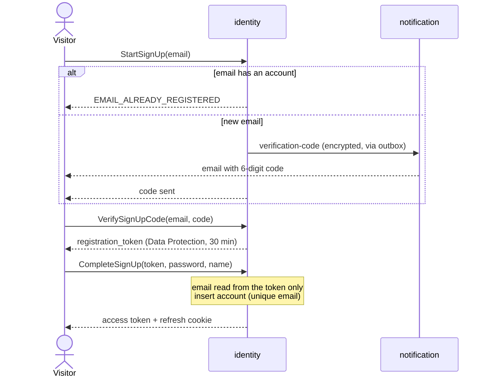

# LLD — identity service

[Docs](../README.md) › [Low-level design](README.md)

| | |
|---|---|
| **Status** | Approved (2026-11-12) |
| **Last updated** | 2026-10-31 |
| **Product rules** | [10-accounts-access](../product-design/10-accounts-access.md) ACC-R01 … R14, BI-06 |
| **HLD** | [high-level-design.md §5, §9.1](../high-level-design/high-level-design.md), HLD-ADR-010, HLD-ADR-011, HLD-ADR-016 |
| **Decision records** | [LLD-ADR-008](adr/LLD-ADR-008-verify-first-signup.md), [LLD-ADR-013](adr/LLD-ADR-013-revoked-refresh-not-reuse.md) |
| **Depends on** | [00-reliability.md](00-reliability.md), [03-order.md](03-order.md) (`HasUnsettledOrders`) |

## 1. Problem and scope

`identity` knows who every customer and staff member is, issues the tokens the gateway verifies, revokes them when needed, and keeps the audit log of staff actions.

**In scope:** customer sign-up, email verification, sign-in (password, Google), password reset, sessions (access + refresh tokens), revocation, re-authentication, address book, account deletion, staff invitation, staff MFA, roles, signing keys and JWKS, audit log.

**Out of scope:** authorization inside other services (they check ownership with the trusted context), token verification (gateway), notification sending (`notification`, fed by events).

## 2. Requirements and constraints

| ID | Requirement | Source |
|---|---|---|
| ID-01 | An email belongs to at most one account, customer or staff. | ACC-R14 |
| ID-02 | Revocations reach the gateway within ~1 s. | QA-08, ACC-R10 |
| ID-03 | Reusing a rotated refresh token revokes **all** of the user's sessions. | Owner decision |
| ID-04 | Staff can't get tokens without a valid TOTP code. | ACC-R09 |
| ID-05 | Sign-in and password reset never reveal whether an email has an account. Sign-up does say "email already registered" (owner decision), so it is rate-limited per email and per IP. | Security, owner decision |
| ID-08 | A customer account can only be created for an email proven by a code; the email comes from a protected registration token, never from the request. | Owner decision |
| ID-06 | Email change, password change, Google unlink and deletion need a sign-in within the last 5 min. | Owner decision |
| ID-07 | Password hashing ~100 ms; sign-in p95 < 300 ms (hash included). | Performance |

## 3. Component structure

| Component | Deployment | Responsibility |
|---|---|---|
| Auth API | API | Sign-up (email → code → registration token → account), sign-in, Google, refresh, sign-out, reset |
| Account API | API | Profile, email / password change, Google link / unlink, addresses, deletion |
| Staff API | API | Invite acceptance, staff sign-in + TOTP |
| Admin API | API | Invite, list, change role, deactivate / reactivate, reset MFA, audit log query |
| JWKS endpoint | API | `GET /.well-known/jwks.json` (internal, read by the gateway) |
| Audit consumer | Worker | `identity.staff-action-recorded.v1` from every service → `audit_log` |
| Cleanup jobs | Worker | Expired codes, invitations, refresh tokens |
| Reliability plumbing | Both | Outbox, inbox ([00-reliability.md](00-reliability.md)) |

## 4. Data model

### 4.1 PostgreSQL (identity database)

**`accounts`** — customers and staff in one table, so ID-01 is a unique index

| Column | Type | Constraints / notes |
|---|---|---|
| `id` | `uuid` | PK (UUIDv7) |
| `type` | `text` | `customer` \| `staff` |
| `email_normalized` | `text` | **unique** (lower-cased, trimmed) |
| `email_display` | `text` | |
| `password_hash` | `text` | Argon2id PHC string; null for Google-only customers |
| `google_sub` | `text` | unique, null; customers only |
| `name` | `text` | |
| `role` | `text` | staff only: `admin` \| `catalog_manager` \| `warehouse` \| `support` |
| `totp_secret_enc` | `bytea` | staff only; encrypted with a key from Sealed Secrets |
| `status` | `text` | `active` \| `deactivated` (staff) \| `deleted` (customer) |
| `tokens_valid_after` | `timestamptz` | access tokens with `iat` before this are revoked |
| `version` | `bigint` | |
| `created_at`, `updated_at`, `last_sign_in_at` | `timestamptz` | |

**`refresh_tokens`**

| Column | Type | Notes |
|---|---|---|
| `id` | `uuid` | PK |
| `family_id` | `uuid` | one family per sign-in |
| `account_id` | `uuid` | |
| `token_hash` | `bytea` | unique; SHA-256 of the 256-bit random token |
| `status` | `text` | `active` \| `rotated` \| `revoked` |
| `auth_time` | `timestamptz` | time of the interactive sign-in that started the family |
| `expires_at` | `timestamptz` | customers: issue + 7 days (sliding); staff: `auth_time` + 12 h (absolute) |
| `created_at`, `used_at` | `timestamptz` | |
| `user_agent`, `ip` | `text` | |

Index: `(family_id)`, `(account_id) WHERE status = 'active'`.

Every account's email is verified by construction (customers at sign-up or by Google, staff by invitation), so there is no `email_verified` column.

**`verification_codes`**: `id`, `purpose` (`signup` \| `reset_password` \| `change_email`), `target_email` (normalized), `account_id` (null for `signup`), `code_hmac` (HMAC-SHA256 with a server pepper), `attempts` (≤ 5), `expires_at`, `consumed_at`, `created_at`. Index `(target_email, purpose) WHERE consumed_at IS NULL`.

**`data_protection_keys`**: the ASP.NET Core Data Protection key ring (EF Core key store), each key encrypted at rest with a certificate from Sealed Secrets. Shared by all identity pods; default 90-day key rotation.

**`staff_invitations`**: `id`, `email_normalized`, `role`, `token_hash`, `invited_by`, `expires_at` (+72 h), `accepted_at`.

**`addresses`**: `id`, `account_id`, `label`, `recipient`, `line1`, `line2`, `city`, `state` (USPS code), `zip`, `phone` (E.164), `is_default`, `version`. Max 10 per account.

**`audit_log`** (append-only: role has `INSERT`/`SELECT` only; kept indefinitely)

| Column | Notes |
|---|---|
| `id` | the event's `messageId` (dedup), or a local UUIDv7 |
| `occurred_at` | |
| `actor_id`, `actor_role` | staff member |
| `service` | producing service |
| `action` | for example `launch.allocation-changed`, `order.support-cancelled` |
| `target_type`, `target_id` | |
| `details` | `jsonb` (before / after where relevant) |

Indexes: `(occurred_at)`, `(actor_id, occurred_at)`, `(target_type, target_id)`.

### 4.2 Redis (identity's own instance)

| Key | Content | TTL |
|---|---|---|
| `signin:fail:{accountId}` | failure count | 15 min |
| `signin:block:{accountId}` | present = blocked | 15 min |
| `mfa:challenge:{id}` | `accountId`, attempts | 5 min |
| `mfa:fail:{accountId}` / `mfa:block:{accountId}` | as sign-in | 15 min |
| `mfa:used:{accountId}:{step}` | TOTP replay block | 90 s |
| `code:cooldown:{email}:{purpose}` | resend cooldown | 60 s |
| `code:hourly:{email}:{purpose}` | codes sent this hour | 1 h |

### 4.3 Tokens

**Access token** (JWT, ES256, header `kid`), lifetime 15 min:

| Claim | Value |
|---|---|
| `iss` / `aud` | `bloom-identity` / `bloom` |
| `sub` | account ID |
| `typ` | `customer` \| `staff` |
| `role` | staff only |
| `auth_time` | interactive sign-in time (for ID-06) |
| `sid` | `family_id` of the refresh-token family |
| `iat`, `exp`, `jti` | |

**Refresh token:** 256-bit random, base64url, in cookie `bloom_rt`: `Secure; HttpOnly; SameSite=Strict; Path=/auth/refresh`. Stored only as SHA-256.

**Registration token:** ASP.NET Core Data Protection time-limited protector, purpose `bloom.registration.v1`, lifetime **30 min**, payload `{ email, verifiedAt }`. Authenticated encryption: the client can't read or alter it. Stateless; a second use is stopped by the unique `email_normalized` index.

**Signing keys:** P-256 keys mounted from Sealed Secrets. JWKS publishes the active key and the next key. Rotation: add the next key to JWKS at least 1 h before switching; keep the old public key for 1 h after the switch (> 15-min token life + gateway cache).

## 5. Interfaces

### 5.1 gRPC / HTTP

| Method | Caller | Notes |
|---|---|---|
| `StartSignUp` | Anyone | email → code sent, or `EMAIL_ALREADY_REGISTERED` (also used to resend) |
| `VerifySignUpCode` | Anyone | email, code → `registration_token` |
| `CompleteSignUp` | Anyone | `registration_token`, password, name → account + tokens (email taken from the token only) |
| `SignIn` | Anyone | email, password → customers: tokens; staff: `mfa_challenge_id` |
| `VerifyStaffMfa` | Staff | challenge, TOTP code → tokens |
| `SignInWithGoogle` | Anyone | Google ID token (from Google Identity Services on the client) → tokens |
| `Refresh` | Cookie | → new access token + rotated cookie |
| `SignOut` / `SignOutEverywhere` | Signed in | revoke family / all sessions. `SignOut` takes `sid` in the request (read by the client from its own token). |
| `RequestPasswordReset` / `ResetPassword` | Anyone | email → code; email + code + new password |
| `GetMe` | Signed in | profile |
| `ChangeEmail` / `ConfirmEmailChange` | Customer, re-auth | new email → code to new email; code → switch |
| `ChangePassword` | Signed in, re-auth | current + new password |
| `LinkGoogle` / `UnlinkGoogle` | Customer; unlink needs re-auth and a password set | |
| `ListAddresses` / `UpsertAddress` / `DeleteAddress` | Customer | |
| `DeleteAccount` | Customer, re-auth | §6.8 |
| `AcceptStaffInvitation` | Invitee | invite token, name, password, TOTP enrolment (secret + first code) → tokens |
| `InviteStaff` / `ListStaff` / `ChangeStaffRole` / `DeactivateStaff` / `ReactivateStaff` / `ResetStaffMfa` | Admin | |
| `QueryAuditLog` | Admin | filters: time range, actor, service, action, target; paged |
| `GET /.well-known/jwks.json` | gateway (internal) | |

### 5.2 Messages

| Message | Direction | Payload |
|---|---|---|
| `identity.customer-registered.v1` | → notification | `accountId` (uuid), `email` (string), `name` (string) |
| `identity.contact-changed.v1` | → notification | `accountId` (uuid), `email` (string), `name` (string) |
| `identity.account-deleted.v1` | → notification, catalog, order, fulfillment | `accountId` (uuid) |
| `identity.tokens-revoked.v1` | → api-gateway | `accountId` (uuid), `issuedBefore` (Unix ms, number) |
| `identity.verification-code.v1` | → notification | `email` (string), `purpose` (string), `encryptedCode` (string), `expiresAt` (timestamp) (email-only; NTF-R04). `encryptedCode` = AES-256-GCM with a key shared only by identity and notification (Sealed Secret), so outbox rows and broker messages never hold a usable code. Layout: base64url(nonce ‖ ciphertext ‖ tag) of the UTF-8 code, 12-byte random nonce, 16-byte tag, no associated data. |
| `identity.staff-invited.v1` | → notification | `email` (string), `role` (string), `inviteUrl` (string) (email-only) |
| `identity.staff-action-recorded.v1` | Consumed (`identity.audit`) from every service | actor, action, target, details |

### 5.3 Error reasons

| Reason | Status | When |
|---|---|---|
| `INVALID_CREDENTIALS` | `UNAUTHENTICATED` | Wrong email / password, unknown email, or blocked (same response, ID-05). Also: wrong current password (`ChangePassword`, re-enrol accept), counted toward the `signin:fail` / `signin:block` lockout; invalid Google ID token; a staff account with no TOTP secret, after the password check (§6.1) |
| `MFA_INVALID` | `UNAUTHENTICATED` | Wrong / expired TOTP or challenge; wrong first TOTP code at enrolment |
| `EMAIL_ALREADY_REGISTERED` | `ALREADY_EXISTS` | `StartSignUp` with an email that has an account (customer or staff) |
| `EMAIL_TAKEN` | `ALREADY_EXISTS` | `CompleteSignUp` race, change email to an existing email (ID-01), or `InviteStaff` for an email with an account |
| `REGISTRATION_TOKEN_INVALID` | `FAILED_PRECONDITION` | Token tampered, wrong purpose, or older than 30 min |
| `PASSWORD_WEAK` | `INVALID_ARGUMENT` | Length or breached-list rule |
| `CODE_INVALID` | `FAILED_PRECONDITION` | Wrong, expired, consumed, or 5 attempts used |
| `CODE_RATE_LIMITED` | `RESOURCE_EXHAUSTED` | Within cooldown or > 5 codes/hour |
| `REAUTH_REQUIRED` | `FAILED_PRECONDITION` | `auth_time` older than 5 min (ID-06) |
| `GOOGLE_NOT_ALLOWED` | `FAILED_PRECONDITION` | Google sign-in for a staff email |
| `REFRESH_INVALID` | `UNAUTHENTICATED` | Unknown, expired or revoked refresh token |
| `UNSETTLED_ORDERS` | `FAILED_PRECONDITION` | Deletion refused (ACC-R13); metadata: earliest retry date if known |
| `ORDER_SERVICE_UNAVAILABLE` | `UNAVAILABLE` | Deletion check failed (fail safe, "try later") |
| `LAST_ADMIN` | `FAILED_PRECONDITION` | Deactivating or demoting the only active Admin |
| `INVITATION_INVALID` | `FAILED_PRECONDITION` | Unknown, expired or used invite token |
| `VALIDATION_FAILED` | `INVALID_ARGUMENT` | Bad email, name, address field or TOTP secret; field name in `ErrorInfo` metadata |
| `NOT_FOUND` | `NOT_FOUND` | Unknown address, staff id, or a customer id given to a staff action |
| `ADDRESS_LIMIT_REACHED` | `FAILED_PRECONDITION` | 11th address |
| `PASSWORD_REQUIRED` | `FAILED_PRECONDITION` | `UnlinkGoogle` with no password |
| `GOOGLE_ALREADY_LINKED` | `ALREADY_EXISTS` | Google account linked to another account |

Deactivating a deactivated account or reactivating an active one succeeds as a no-op.

## 6. Behaviour

### 6.0 Sign-up (ID-08)

1. **StartSignUp:** normalize the email. Existing account → `EMAIL_ALREADY_REGISTERED`. Otherwise apply the code limits (§6.5: cooldown, hourly cap per email; the gateway limits per IP), insert a `signup` code (invalidating any previous one for that email), outbox `verification-code`.
2. **VerifySignUpCode:** code must match, be unconsumed, unexpired, with attempts left (else `CODE_INVALID`, attempts + 1). Mark consumed; return a registration token for that email.
3. **CompleteSignUp:** unprotect the token (`REGISTRATION_TOKEN_INVALID` if it fails or is older than 30 min); validate password and name; insert the customer account with the token's email (unique index → `EMAIL_TAKEN` on a race or reuse); outbox `customer-registered`; issue tokens (§6.3).

No account row exists until step 3, so an unverified email can never become an account.

### 6.1 Sign-in (password)

1. Look up by `email_normalized`. Unknown → verify the password against a fixed dummy hash (equal timing) → `INVALID_CREDENTIALS`.
2. `signin:block` present → `INVALID_CREDENTIALS`.
3. Verify Argon2id. Failure → increment `signin:fail`; at 5 → set `signin:block` (15 min) → `INVALID_CREDENTIALS`.
4. Status must be `active` (deactivated staff, deleted customer → `INVALID_CREDENTIALS`).
5. Customer → issue tokens (§6.3). Staff → create `mfa:challenge` → return `mfa_challenge_id`. A staff account with no TOTP secret (after `ResetStaffMfa`) gets `INVALID_CREDENTIALS` after the password check (failures count toward lockout), with no challenge.
6. `VerifyStaffMfa`: TOTP (RFC 6238, 30 s step, ±1 step window, a code can't be reused within its window); 5 failures → `mfa:block`. Success → issue tokens.

Argon2id parameters: memory 64 MiB, iterations 3, parallelism 1, tuned so one hash takes ~100 ms in production pods (ID-07); stored in the PHC string so they can be raised later (rehash on next sign-in).

### 6.2 Google sign-in (ACC-R02)

Verify the ID token: signature (Google JWKS, cached), `iss`, `aud` = Bloom's client ID, `exp`, `email_verified = true`.

| Situation | Result |
|---|---|
| `google_sub` matches an account | Sign in |
| Email matches a **staff** account | `GOOGLE_NOT_ALLOWED` |
| Email matches a customer whose `google_sub` is set to a different value | `EMAIL_TAKEN` (a linked Google identity is never replaced) |
| Email matches a customer (`google_sub` null) | Link (`google_sub` set), sign in. Safe because every customer email was proven at sign-up, so it can't be pre-hijacked. |
| No match | Create customer (no password), publish `customer-registered`, sign in |

### 6.3 Issuing and refreshing tokens

**Issue:** new `family_id`; insert refresh token (`active`, `auth_time = now`); set cookie; sign access token.

**Refresh** (one transaction, row locked by `token_hash`):

| Token state | Result |
|---|---|
| Not found / expired | `REFRESH_INVALID` |
| `active` | Mark `rotated`, insert a new `active` token in the same family (customers: `expires_at = now + 7 days`; staff: keep the family's absolute expiry), issue access token with the family's `auth_time` |
| `rotated` (**reuse**) | Revoke every token of the account; `tokens_valid_after = now`; outbox `tokens-revoked`; `REFRESH_INVALID` (ID-03) |
| `revoked` | `REFRESH_INVALID`, no side effects: no revoke-all, no `refresh_total{result="reuse"}` ([LLD-ADR-013](adr/LLD-ADR-013-revoked-refresh-not-reuse.md)) |

Account not `active` → revoke and `REFRESH_INVALID`.

### 6.4 Revocation

`revoke_all(account)`: refresh tokens → `revoked`; `tokens_valid_after = now()`; outbox `identity.tokens-revoked.v1 {accountId, issuedBefore: now}`.

| Trigger | Scope |
|---|---|
| `SignOut` | The family in the request's `sid`, only if it belongs to the caller; the cookie is cleared (its access token expires naturally within 15 min) |
| `SignOutEverywhere`, password change / reset, refresh reuse, account deletion | `revoke_all` |
| Staff deactivation, role change, MFA reset | `revoke_all` (ACC-R10) |

### 6.5 Codes (verification, reset, email change)

- 6 digits from a CSPRNG; stored as HMAC-SHA256(pepper, subject ‖ purpose ‖ code), where subject is the account ID, or the normalized email for `signup`.
- Lifetime: `signup` 15 min, `reset_password` 10 min, `change_email` 15 min. Issuing a new code invalidates the previous one for that email and purpose.
- Max 5 attempts per code; resend cooldown 60 s; max 5 codes per hour per email and purpose.
- Delivery: outbox `identity.verification-code.v1` with the code AES-256-GCM encrypted (only notification can decrypt).
- `RequestPasswordReset` for an unknown email returns the same success response and sends nothing (ID-05).
- Successful `ResetPassword` → new hash, `revoke_all`.

### 6.6 Passwords

12–128 characters, any Unicode (NFKC-normalized), no composition rules, rejected if in the bundled list of the 100k most common breached passwords (`PASSWORD_WEAK`).

### 6.7 Re-authentication (ID-06)

Protected methods check `now − auth_time ≤ 5 min` from the trusted identity context (the gateway forwards `auth_time`). Otherwise `REAUTH_REQUIRED`; the client re-runs sign-in (password, Google, plus TOTP for staff), which starts a fresh family with a new `auth_time`.

### 6.8 Account deletion (ACC-R06, R13)

1. Re-auth check.
2. order `HasUnsettledOrders(account)` (gRPC). True → `UNSETTLED_ORDERS`; unavailable → `ORDER_SERVICE_UNAVAILABLE`.
3. **Tx:** `status = deleted`; `email_normalized = 'deleted+<id>@invalid'` (the real email becomes free); clear `email_display`, `name`, `password_hash`, `google_sub`; delete addresses and codes; `revoke_all`; outbox `identity.account-deleted.v1`.

### 6.9 Staff

| Action | Rule |
|---|---|
| `InviteStaff` | Email not used by any account (ID-01); invite token (72 h, hashed); outbox `staff-invited` |
| `AcceptStaffInvitation` | Valid token; set name and password; generate TOTP secret, confirm with a first code; create account (`staff`, role; the invitation proved the email); issue tokens. If the token's email already has a staff account (re-enrol link, see `ResetStaffMfa`): requires the current password (failures count toward sign-in lockout) and a new TOTP enrolment, no name or new password; sets the new secret; issue tokens |
| `ChangeStaffRole` | Exactly one role (ACC-R08); `revoke_all` so new tokens carry the new role |
| `DeactivateStaff` | `deactivated` + `revoke_all` (ACC-R10) |
| `ResetStaffMfa` | Clears the TOTP secret, `revoke_all`, sends a new invitation-style link to re-enrol: a `staff_invitations` row for the existing staff email, and `staff-invited` published |
| Demote or deactivate on the last active Admin | `LAST_ADMIN` |

Every staff management action is written directly to `audit_log` (same database) in its transaction.

### 6.10 Audit consumer

Inbox transaction: insert `audit_log` with `id = messageId` (`ON CONFLICT DO NOTHING`). `QueryAuditLog` reads it with filters and keyset pagination by `(occurred_at, id)`.

## 7. Concurrency and consistency

| Risk | Protection |
|---|---|
| Two accounts with one email | Unique `email_normalized` (customers and staff in one table) |
| Concurrent refreshes of one token | Row lock on `token_hash`; the second sees `rotated` → reuse → revoke all (strict, as decided; R-04) |
| Revocation vs gateway | Outbox event + gateway Redis within ~1 s; `tokens_valid_after` is the source of truth |
| Code brute force | Per-code attempt cap + hourly cap + HMAC storage |
| Losing the last Admin | `LAST_ADMIN` guard in the same transaction |
| Two default addresses | `UpsertAddress(is_default = true)` locks the account row (`FOR UPDATE`) before it clears the old default. `DeleteAccount` takes the account row first as well, so both lock in the order account → addresses. |
| Concurrent deletes | `DeleteAccount` re-checks `status` under the account row lock: a second concurrent delete gets `NOT_FOUND` and publishes nothing (one `account-deleted`) |

## 8. Edge cases

| Case | Expected behaviour |
|---|---|
| Registration token used twice | Second `CompleteSignUp` → `EMAIL_TAKEN`. |
| Code verified but sign-up never completed | Nothing created; token expires after 30 min. |
| Two tabs refresh at once | Second is treated as reuse; all sessions revoked (frontend must serialize refreshes). |
| Google-only customer wants to delete the account | Re-auth via Google sign-in. |
| Unlink Google with no password set | Refused: set a password first. |
| Staff member loses the TOTP device | Admin `ResetStaffMfa`. |
| Deleted customer's email registers again | Allowed: the email was freed. |
| order down during deletion | `ORDER_SERVICE_UNAVAILABLE`, nothing changed. |
| Address change racing a delete | `UpsertAddress` re-checks `status` under the account row lock: `NOT_FOUND`. |

## 9. Security and validation

- Email: RFC 5321 length limits, normalized lower-case; name 1–100 chars.
- Cookie: `Secure; HttpOnly; SameSite=Strict; Path=/auth/refresh`; refresh responses send `Cache-Control: no-store`.
- Secrets (signing keys, pepper, TOTP encryption key, Data Protection certificate, Google client ID) are Sealed Secrets visible only to identity. The code-encryption key is shared only with notification.
- All auth routes sit behind the gateway's strict per-IP limits (HLD §9.1).
- Logs never contain passwords, codes, tokens or TOTP secrets.

## 10. Observability

| Metric | Labels | Purpose |
|---|---|---|
| `signins_total` | `type`, `method`, `result` | Sign-in outcomes |
| `signin_seconds` | — | ID-07 |
| `refresh_total` | `result` = `rotated` \| `reuse` \| `invalid` | Reuse detections (R-04) |
| `revocations_total` | `trigger` | Revocation volume |
| `codes_sent_total` / `code_failures_total` | `purpose` | Abuse signals |
| `account_deletions_total` | `result` | ACC-R13 refusals |
| `audit_entries_total` | `service` | Audit intake |

**Alerts:** spike in `refresh_total{result="reuse"}` (possible token theft or frontend bug); spike in sign-in failures; any `LAST_ADMIN`-guarded attempt.

## 11. Test cases

| # | Case | Expected |
|---|---|---|
| ID-T01 | `StartSignUp` with an email used by a staff account | `EMAIL_ALREADY_REGISTERED` |
| ID-T01b | `CompleteSignUp` with a tampered or 31-minute-old token | `REGISTRATION_TOKEN_INVALID` |
| ID-T01c | `CompleteSignUp` request carrying a different email field | Ignored; account uses the token's email |
| ID-T01d | Outbox row for a verification code | Holds ciphertext only |
| ID-T02 | 5 wrong passwords | Blocked 15 min; same error as wrong password |
| ID-T03 | Unknown email sign-in timing | Comparable to a real account (dummy hash) |
| ID-T04 | Staff sign-in without TOTP | No tokens |
| ID-T05 | Refresh rotation | Old token `rotated`, new cookie |
| ID-T06 | Reuse of a rotated token | All sessions revoked; `tokens-revoked` published |
| ID-T07 | Staff family after 12 h | `REFRESH_INVALID` |
| ID-T08 | Google, email matches an existing customer | Linked |
| ID-T09 | Google, email matches a staff account | `GOOGLE_NOT_ALLOWED` |
| ID-T10 | 6th code attempt | `CODE_INVALID` |
| ID-T11 | Reset for unknown email | Same response, nothing sent |
| ID-T12 | Change password with `auth_time` 10 min old | `REAUTH_REQUIRED` |
| ID-T13 | Delete with unsettled orders | `UNSETTLED_ORDERS` |
| ID-T14 | Delete succeeds | Personal data cleared, email freed, `account-deleted` published |
| ID-T15 | Deactivate the last Admin | `LAST_ADMIN` |
| ID-T16 | Same staff-action event twice | One audit row |

## 12. Open questions

| ID | Question |
|---|---|
| — | None open. |
