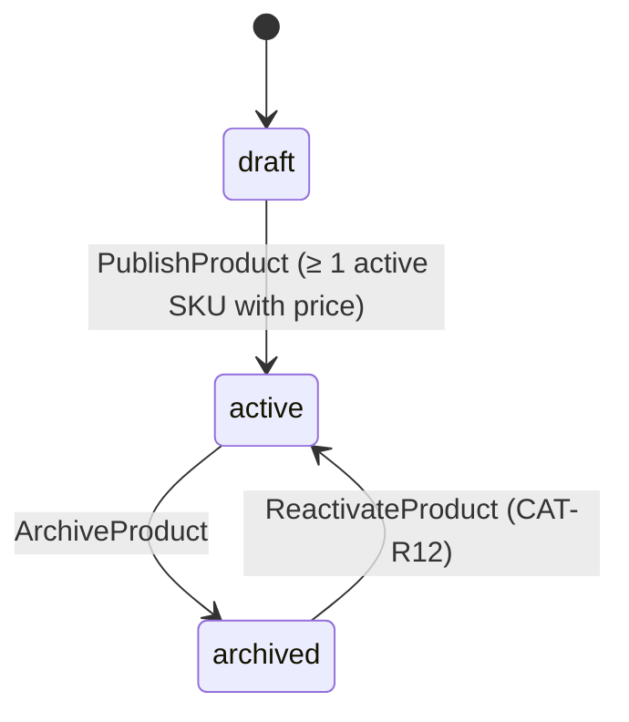

# LLD — catalog service

| | |
|---|---|
| **Status** | Approved (2026-10-31) |
| **Last updated** | 2026-10-31 |
| **Product rules** | [02-catalog](../product-design/02-catalog.md) CAT-R01 … R15, [09-reviews](../product-design/09-reviews.md) REV-R01 … R08, WAR-R01, LCH-R13 |
| **HLD** | [hld.md §5, §6](../high-level-design/hld.md), HLD-ADR-017 |
| **Depends on** | [00-reliability.md](00-reliability.md), [01-launch.md](01-launch.md) (stage events) |

## 1. Problem and scope

`catalog` defines what Bloom sells and at what price, serves fast public browsing and search, and holds verified-buyer reviews. It is the price source for checkout and the owner of the serialized flag.

**In scope:** categories, products and lifecycle, option types and values, SKUs and prices, warranty plans and eligibility, product images, full-text search, reviews and ratings, launch membership copy, the read cache.

**Out of scope:** stock (`inventory`), launch allocation (`launch`), order snapshots (`order` stores its own copy at checkout).

## 2. Requirements and constraints

| ID | Requirement | Source |
|---|---|---|
| CR-01 | Catalog reads p95 < 150 ms at launch peak. | QA-02 |
| CR-02 | `GetPricing` always returns current prices from Postgres (never cached). | CAT-R08, OR-06 |
| CR-03 | The serialized flag can't change once locked by the first goods receipt. | CAT-R14 |
| CR-04 | Product pages reflect a price change within seconds. | Owner decision (delete on write) |
| CR-05 | Only verified buyers review, once per product; hidden reviews don't count. | REV-R01 … R06 |
| CR-06 | A sold product is never hard-deleted. | CAT-R13 |

## 3. Component structure

| Component | Deployment | Responsibility |
|---|---|---|
| Public API | API | Categories, search, product detail, reviews list |
| Customer API | API | Write / edit / delete own review |
| Admin API | API | Categories, products, options, SKUs, prices, plans, images, lifecycle, review moderation |
| Internal API | API | `GetPricing` (order), `GetSku` (launch), `LockSkuForStock` (inventory) |
| Consumers | Worker | `launch.stage-changed.v1`, `order.delivered.v1`, `identity.customer-registered.v1`, `identity.contact-changed.v1`, `identity.account-deleted.v1` |
| Reliability plumbing | Both | Outbox (audit events), inbox ([00-reliability.md](00-reliability.md)) |

## 4. Data model

### 4.1 PostgreSQL (catalog database)

**`categories`**: `id`, `parent_id` (null = top level; a parent must itself be top level, CAT-R01), `name`, `slug` (unique), `sort_order`, `version`.

**`products`**

| Column | Type | Notes |
|---|---|---|
| `id` | `uuid` | PK |
| `category_id` | `uuid` | FK, top or sub level |
| `kind` | `text` | `physical` \| `warranty_plan` (CAT-R06) |
| `name`, `slug` | `text` | `slug` unique |
| `description_md` | `text` | Markdown, ≤ 20,000 chars |
| `specs` | `jsonb` | `[{group, items: [{label, value}]}]`, display-only |
| `serialized` | `bool` | physical only |
| `serialized_locked` | `bool` | set by `LockSkuForStock` (CR-03) |
| `coverage_months` | `int` | warranty plans only |
| `status` | `text` | `draft` \| `active` \| `archived` (CAT-R12) |
| `launch_id`, `launch_stage` | `uuid`, `text` | copy from launch events; null if not a launch product |
| `published_at` | `timestamptz` | first activation (sort "newest") |
| `min_price_cents` | `bigint` | lowest price among active SKUs (maintained on write) |
| `rating_sum`, `rating_count` | `int` | visible reviews only (CAT-R10) |
| `search_vector` | `tsvector` | generated: name (A), option values (B), category name (B), description (C); English config |
| `version` | `bigint` | |

Indexes: GIN on `search_vector`; `(category_id, status)`; `(min_price_cents)`; `(published_at)`.

**`option_types`**: `id`, `product_id`, `name`, `position`. **`option_values`**: `id`, `option_type_id`, `value`, `position`.

**`skus`**

| Column | Type | Notes |
|---|---|---|
| `id` | `uuid` | PK |
| `product_id` | `uuid` | FK |
| `code` | `text` | unique human code (for example `IP17P-256-BLK`) |
| `option_key` | `text` | sorted option value IDs; `UNIQUE (product_id, option_key)` (CAT-R03) |
| `price_cents` | `bigint` | > 0 |
| `active` | `bool` | inactive = hidden, not buyable, kept for history |
| `launch_id` | `uuid` | copy from launch events |
| `version` | `bigint` | |

**`sku_option_values`**: `(sku_id, option_value_id)`.

**`plan_eligibility`**: `(plan_product_id, eligible_product_id)` (CAT-R07).

**`product_images`**: `id`, `product_id`, `sku_id` (null = all SKUs), `storage_key`, `alt_text`, `position`, `status` (`pending` \| `ready`).

**`reviews`**

| Column | Type | Notes |
|---|---|---|
| `id` | `uuid` | PK |
| `product_id` | `uuid` | REV-R02 (per product) |
| `account_id` | `uuid` | null after account deletion |
| `author_display` | `text` | snapshot "First L."; `Former customer` after deletion (REV-R08) |
| `rating` | `smallint` | 1–5 |
| `text` | `text` | null, ≤ 2,000 chars (REV-R04) |
| `status` | `text` | `visible` \| `hidden` |
| `hidden_by`, `hidden_reason` | | Support |
| `version` | `bigint` | |
| `created_at`, `updated_at` | | |

`UNIQUE (product_id, account_id) WHERE account_id IS NOT NULL` (REV-R03).

**`review_eligibility`**: PK `(account_id, product_id)`, `first_delivered_at` (REV-R01).
**`reviewer_names`**: PK `account_id`, `display_name` ("First L."), from identity events.

### 4.2 Redis (catalog's own instance)

| Key | Content | TTL |
|---|---|---|
| `product:{id}` | Product detail view (incl. SKUs, images, rating) | 10 min |
| `categories` | Category tree | 10 min |
| `search:{catalogVersion}:{hash(params)}` | One result page | 10 min |
| `catalog:version` | Integer, incremented by any write that changes listings | none |

### 4.3 Object storage

Bucket `bloom-product-images` (MinIO locally, S3-compatible in the cloud), public read. Key `products/{productId}/{uuid}.{ext}`.

## 5. Interfaces

### 5.1 gRPC

| Method | Caller | Request → Response |
|---|---|---|
| `ListCategories` | Public | → tree |
| `SearchProducts` | Public | `q?`, `category_id?`, `price_min?`, `price_max?`, `option_value_ids[]?`, `sort` (`relevance` \| `price_asc` \| `price_desc` \| `newest` \| `rating`), `page`, `page_size ≤ 48` → products with min price, rating, first image |
| `GetProduct` | Public | `slug` or `id` → product, SKUs (active, visible), options, images, specs, rating, launch info |
| `ListReviews` | Public | `product_id`, `page` → visible reviews, newest first |
| `UpsertMyReview` / `DeleteMyReview` | Customer | `product_id`, `rating`, `text?`, `version?` |
| `GetPricing` | order | `sku_ids[]` → per SKU: `price_cents`, `name`, `product_id`, `category_id`, `kind`, `serialized`, `buyable`, `launch {launch_id, stage}?`, plans: `eligible_product_ids`, `coverage_months` |
| `GetSku` | launch | `sku_id` → `product_id`, `status`, `active`, `launch_id` |
| `LockSkuForStock` | inventory | `sku_id` → `product_id`, `serialized` (sets `serialized_locked`) |
| Admin: `Create/UpdateCategory`, `Create/UpdateProduct`, `SetOptions`, `Create/UpdateSku`, `SetSkuPrice`, `SetSkuActive`, `SetPlanEligibility`, `PublishProduct`, `ArchiveProduct`, `ReactivateProduct`, `CreateImageUpload`, `ConfirmImage`, `ReorderImages`, `DeleteImage` | Catalog manager, Admin | optimistic `version` on updates |
| `HideReview` / `UnhideReview` | Support, Admin | `review_id`, `reason` |

### 5.2 Messages

| Message | Direction | Effect |
|---|---|---|
| `launch.stage-changed.v1` | Consumed | §6.4 |
| `order.delivered.v1` | Consumed | Upsert `review_eligibility` for each `productId` |
| `identity.customer-registered.v1` / `contact-changed.v1` | Consumed | Upsert `reviewer_names` |
| `identity.account-deleted.v1` | Consumed | §6.6 |
| `identity.staff-action-recorded.v1` | Published | Every admin action (prices, lifecycle, moderation) |

### 5.3 Error reasons

| Reason | Status | When |
|---|---|---|
| `SERIALIZED_LOCKED` | `FAILED_PRECONDITION` | Changing `serialized` after lock (CAT-R14) |
| `DUPLICATE_COMBINATION` | `ALREADY_EXISTS` | SKU with an existing option combination |
| `CATEGORY_DEPTH` | `INVALID_ARGUMENT` | Third category level |
| `INVALID_LIFECYCLE` | `FAILED_PRECONDITION` | Disallowed product status change |
| `PUBLISH_INCOMPLETE` | `FAILED_PRECONDITION` | Publish without an active SKU with a price |
| `NOT_VERIFIED_BUYER` | `PERMISSION_DENIED` | Review without eligibility (REV-R01) |
| `IMAGE_INVALID` | `INVALID_ARGUMENT` | Wrong type, too large, or object missing at confirm |

## 6. Behaviour

### 6.1 Product lifecycle and visibility

| Condition | Visible on site | `buyable` (GetPricing) |
|---|---|---|
| No launch, `status = active`, SKU `active` | Yes | Yes |
| `status = draft` / `archived`, or SKU inactive | No | No |
| Launch SKU, stage `draft` | No | No |
| Launch SKU, stage `announced` | Yes | No |
| Launch SKU, stage `preorder_open` | Yes | No for regular checkout; `launch` info returned so order can run the launch flow |
| Launch SKU, stage `released` | As a regular product (product set `active`, CAT-R11) | Yes |

Products are never hard-deleted (CR-06); archiving is the removal path.

### 6.2 Search (HLD-ADR-017)

- Text: `websearch_to_tsquery('english', q)` against `search_vector`; rank with `ts_rank_cd`.
- Filters: category (a top-level category includes its sub-categories); price on `min_price_cents`; each selected option value must match at least one active SKU.
- Sorts: relevance, `min_price_cents` asc/desc, `published_at` desc, rating (`rating_sum / rating_count` desc, then count desc; products without reviews last).
- Only visible products (§6.1). Offset pagination (catalog size is a few hundred products).

### 6.3 Cache (cache-aside, delete on write)

- **Read:** `GET` key → hit: return; miss: load from Postgres, `SET` with TTL 10 min.
- **Write** (after commit): `DEL product:{id}` for each affected product; `DEL categories` for category changes; `INCR catalog:version` for anything affecting listings (price, status, rating, images, options, launch stage). Search keys include the version, so old pages simply stop being read and expire.
- Redis unavailable → read from Postgres directly (degraded latency, correct data).
- `GetPricing`, `GetSku`, `LockSkuForStock` never use the cache (CR-02).

### 6.4 Launch stage events

On `launch.stage-changed.v1`: set `launch_id` on the listed SKUs and `launch_id`, `launch_stage` on their products; bump the cache. On `stage = released`: set the products `active` (and `published_at` if null). Events are applied with a stage-order guard (`draft < announced < preorder_open < released`), so a late older event is a no-op.

### 6.5 Reviews

| Action | Rules |
|---|---|
| Write | Customer must have `review_eligibility (account, product)` (REV-R01; returns don't remove it). One per product (REV-R03). `author_display` copied from `reviewer_names` (never from the request). Visible immediately (REV-R05). Same transaction: `rating_sum += r`, `rating_count += 1`. |
| Edit | Own review; `rating_sum += new − old` if visible. |
| Delete | Own review; row deleted; aggregate decreased if visible. A new review may be written later. |
| Hide / unhide | Support; aggregate decreased / increased (REV-R06). The author isn't notified. |

All aggregate changes are in the same transaction as the review change, on the product row.

### 6.6 Account deleted

`reviews` of the account: `account_id = null`, `author_display = 'Former customer'` (REV-R08), reviews stay visible. Delete `review_eligibility` and `reviewer_names` rows for the account.

### 6.7 Images

1. `CreateImageUpload(product_id, sku_id?, content_type)`: type in `image/jpeg`, `image/png`, `image/webp`; insert `product_images` (`pending`); return a presigned `PUT` URL (5 min, max 5 MB, exact content type).
2. Staff upload directly to storage.
3. `ConfirmImage(image_id)`: `HEAD` the object (exists, size ≤ 5 MB) → `ready`; bump the cache.
4. A daily job deletes `pending` rows older than 24 h and their objects.

### 6.8 Internal calls

- **`GetPricing`:** batch read from Postgres; unknown SKU IDs are returned as `buyable = false` with no price.
- **`LockSkuForStock`:** `UPDATE products SET serialized_locked = true WHERE id = (SELECT product_id FROM skus WHERE id = @s)`; returns the flag (idempotent).
- **`GetSku`:** used by launch when staff add a SKU to a launch.

## 7. Concurrency and consistency

| Risk | Protection |
|---|---|
| Two staff edit a product | Optimistic `version` → 409 |
| Flag change vs first receipt | `SetSerialized` is a guarded update `WHERE serialized_locked = false` |
| Concurrent reviews by the same customer | Unique index |
| Rating drift | Aggregate updated in the review's transaction |
| Stale cache after a write | Delete after commit + TTL safety net + versioned search keys |
| Reordered launch events | Stage-order guard |

## 8. Edge cases

| Case | Expected behaviour |
|---|---|
| Price changed during someone's checkout | Their locked price stands (order); new checkouts use the new price. |
| Last active SKU deactivated | Product shows as unavailable; still visible if `active` (no buyable SKU). |
| Archived product with stock | Not buyable; Warehouse adjusts stock (CAT-R13). |
| Customer renames themselves | Existing reviews keep the snapshot name; new reviews use the new name. |
| Review written before the name event arrives | `author_display = 'Bloom customer'` fallback. |
| Image upload never confirmed | Cleaned after 24 h. |
| Search query with only stop words | Empty text filter; returns filtered/sorted results. |

## 9. Security and validation

- Public endpoints return only visible products and visible reviews.
- Review text is stored as plain text and HTML-escaped by clients; no Markdown or links in reviews.
- Product Markdown is authored by staff only; rendered with a safe subset (no raw HTML).
- Presigned URLs are scoped to one key, one content type, 5 minutes.
- Staff methods check roles; all admin actions are audited.

## 10. Observability

| Metric | Labels | Purpose |
|---|---|---|
| `catalog_read_seconds` | `endpoint`, `cache` = `hit` \| `miss` | CR-01 |
| `catalog_cache_hit_ratio` | `kind` | Cache health |
| `search_seconds` | — | Search latency |
| `get_pricing_seconds` | — | Checkout dependency |
| `reviews_total` | `action` | Review activity |

**Alerts:** read p95 > 150 ms; `get_pricing` p95 > 50 ms; cache hit ratio < 80% during a launch.

## 11. Test cases

| # | Case | Expected |
|---|---|---|
| C-01 | Change `serialized` after `LockSkuForStock` | `SERIALIZED_LOCKED` |
| C-02 | Third-level category | `CATEGORY_DEPTH` |
| C-03 | Duplicate option combination | `DUPLICATE_COMBINATION` |
| C-04 | Price change, then product page read | New price (cache deleted) |
| C-05 | `GetPricing` right after a price change | New price (no cache) |
| C-06 | Launch SKU in `announced` | Visible, `buyable = false` |
| C-07 | Launch released | Product `active`, regular buyable |
| C-08 | Review without delivery | `NOT_VERIFIED_BUYER` |
| C-09 | Second review on the same product | Rejected (unique) |
| C-10 | Hide a 5-star review on a 2-review product averaging 4 | Average becomes 3 |
| C-11 | Account deleted | Reviews show "Former customer", still counted |
| C-12 | Search "pro max 256" with storage filter | Matching products only |
| C-13 | Upload a 6 MB image | Rejected by storage / `IMAGE_INVALID` |

## 12. Open questions

| ID | Question |
|---|---|
| — | None open. |
