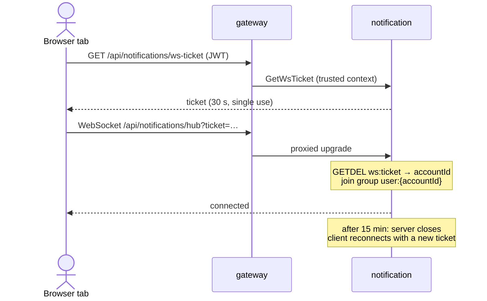

# LLD — notification service

[Docs](../README.md) › [Low-level design](README.md)

| | |
|---|---|
| **Status** | Approved (2026-11-12) |
| **Last updated** | 2026-10-31 |
| **Product rules** | [11-notifications](../product-design/11-notifications.md) NTF-R01 … R06, INV-R11, ACC-R06 |
| **HLD** | [high-level-design.md §5, §7.2](../high-level-design/high-level-design.md), HLD-ADR-018 |
| **Depends on** | [00-reliability.md](00-reliability.md), [06-identity.md](06-identity.md) (encrypted codes, revocation events) |

## 1. Problem and scope

`notification` turns business events into emails and in-app notifications, pushes in-app notifications to open browser tabs in real time, and never decides on its own *when* to notify: it only reacts to events.

**In scope:** event-to-notification mapping, email templates and sending (Resend in the cloud, Mailpit locally), in-app notifications (read / unread, 90-day retention), real-time push over WebSocket (SignalR), the contact copy and order references, decryption of verification codes, anonymization on account deletion.

**Out of scope:** SMS, push notifications, marketing email, notification preferences (none, NTF-R03), staff notifications other than invitations.

## 2. Requirements and constraints

| ID | Requirement | Source |
|---|---|---|
| NR-01 | Every mapped event produces its notifications once (rare duplicate emails after a crash are accepted). | Owner decision |
| NR-02 | Order, shipping, return and refund events go to email **and** in-app; account-security and staff-invitation emails are email only. | NTF-R04 |
| NR-03 | A verification code is never stored or transported in plain text, and is scrubbed after sending. | LLD-ADR-008 |
| NR-04 | An in-app notification reaches an open tab within ~1 s; a closed tab sees it on next load. | Owner decision |
| NR-05 | Sustain **100k concurrent WebSocket connections** at launch peak. | Owner decision (allow and size) |
| NR-06 | A revoked user's sockets are closed within ~1 s of revocation. | ACC-R10 |
| NR-07 | In-app notifications are deleted after 90 days. | NTF-R05 |

## 3. Component structure

| Component | Deployment | Responsibility |
|---|---|---|
| Notification API | API | List, unread count, mark read, WebSocket ticket |
| SignalR hub | API | `/api/notifications/hub`, per-user groups, Redis backplane |
| Consumers | Worker | Events in §5.3 → in-app rows, email jobs, pushes, contact and order-reference copies |
| Email sender | Worker | Sends email jobs through `EmailProvider` (Resend / SMTP-Mailpit) with retries |
| Purge jobs | Worker | 90-day in-app retention, email job cleanup |
| Reliability plumbing | Both | Inbox, outbox ([00-reliability.md](00-reliability.md)) |

## 4. Data model

### 4.1 PostgreSQL (notification database)

**`contacts`** — PK `account_id`: `email`, `name`, `updated_at` (from identity events).

**`order_refs`** — PK `order_id`: `account_id`, `order_number`, `updated_at` (from `order.paid` / `order.cancelled`).

**`notifications`** (in-app)

| Column | Type | Notes |
|---|---|---|
| `id` | `uuid` | PK (UUIDv7) |
| `account_id` | `uuid` | |
| `type` | `text` | for example `order.confirmed` (§6.1) |
| `title`, `body` | `text` | rendered from templates |
| `link` | `text` | client route, for example `/orders/BLM-7K2M9QXA` |
| `source_message_id` | `uuid` | the event that caused it; `UNIQUE (source_message_id, type)` |
| `read_at` | `timestamptz` | null = unread |
| `created_at` | `timestamptz` | |

Indexes: `(account_id, created_at DESC)`; `(account_id) WHERE read_at IS NULL`.

**`email_jobs`**

| Column | Type | Notes |
|---|---|---|
| `id` | `uuid` | PK; idempotency key `bloom:email:<id>` |
| `account_id` | `uuid` | null for sign-up codes and staff invitations |
| `to_email` | `text` | |
| `template` | `text` | template name |
| `data` | `jsonb` | template variables; codes kept **encrypted** until send |
| `status` | `text` | `pending` \| `sent` \| `failed` \| `cancelled` |
| `attempts` | `int` | |
| `next_attempt_at` | `timestamptz` | |
| `provider_message_id` | `text` | |
| `last_error` | `text` | |
| `source_message_id` | `uuid` | `UNIQUE (source_message_id, template)` |
| `created_at`, `sent_at` | `timestamptz` | |

### 4.2 Redis (notification's own instance)

| Key / channel | Purpose | TTL |
|---|---|---|
| `ws:ticket:{ticket}` | `accountId` for a one-time WebSocket ticket | 30 s |
| SignalR backplane channels | Cross-pod delivery to user groups | — |
| `notification:disconnect` | Cross-pod disconnect command | — |

## 5. Interfaces

### 5.1 API and hub

| Method | Caller | Request → Response |
|---|---|---|
| `ListNotifications` | Customer | `page` (keyset by `created_at, id`) → notifications |
| `GetUnreadCount` | Customer | → count |
| `MarkRead` / `MarkAllRead` | Customer | `ids[]` / — |
| `GetWsTicket` | Customer | → `ticket` (single use, 30 s) |
| Hub `/api/notifications/hub?ticket=…` | Customer browser | SignalR over WebSocket; server → client message `notification {id, type, title, link, createdAt}`. A request is rejected before the upgrade: `403` for the `Origin`, `401` for the ticket, `400` for a non-WebSocket request |

### 5.2 Gateway route

`/api/notifications/hub` is proxied as WebSocket by the gateway **without JWT validation** (browsers can't send headers on upgrade); the ticket is validated by notification. The upgrade request's `Origin` must be an allowed origin. `global` rate limit applies to connection attempts.

### 5.3 Consumed messages → notifications

| Message | Notification type | Email | In-app | Recipient |
|---|---|:-:|:-:|---|
| `identity.verification-code.v1` | `account.code` | ✓ | | `email` in payload; code decrypted at send |
| `identity.staff-invited.v1` | `staff.invitation` | ✓ | | `email` in payload |
| `order.paid.v1` | `order.confirmed` | ✓ | ✓ | `accountId` |
| `order.cancelled.v1` | `order.cancelled` (text per `reason`: customer, Support, checkout expired, checkout failed, late payment) | ✓ | ✓ | `accountId` |
| `order.preorder-delayed.v1` | `order.preorder-delayed` | ✓ | ✓ | `accountId` |
| `fulfillment.shipment-shipped.v1` | `order.shipped` (tracking number) | ✓ | ✓ | via `order_refs` |
| `fulfillment.shipment-delivered.v1` | `order.delivered` | ✓ | ✓ | via `order_refs` |
| `fulfillment.delivery-failed.v1` | `order.delivery-failed` | ✓ | ✓ | via `order_refs` |
| `fulfillment.return-label-issued.v1` | `return.label-issued` (label URL) | ✓ | ✓ | via `order_refs` |
| `fulfillment.return-received.v1` | `return.received` | ✓ | ✓ | via `order_refs` |
| `fulfillment.return-decided.v1` | `return.decided` | ✓ | ✓ | via `order_refs` |
| `fulfillment.return-closed.v1` with `reason = expired` | `return.expired` | ✓ | ✓ | via `order_refs` |
| `payment.refund-completed.v1` | `refund.issued` | ✓ | ✓ | via `order_refs` |

| Message | Effect (no notification) |
|---|---|
| `identity.customer-registered.v1` / `contact-changed.v1` | Upsert `contacts` |
| `identity.account-deleted.v1` | §6.5 |
| `identity.tokens-revoked.v1` | Disconnect the user's sockets on every pod (`notification:disconnect`) |

Producers must keep writing UTC `OccurredAt`.

### 5.4 Error reasons

Only shared reasons are used (00-reliability §8):

| Reason | Status | When |
|---|---|---|
| `VALIDATION_FAILED` | `INVALID_ARGUMENT` | Bad page token, `MarkRead` IDs |
| `ROLE_NOT_ALLOWED` | `PERMISSION_DENIED` | Caller isn't a customer |

`MarkRead` ignores IDs that aren't the caller's.

## 6. Behaviour

### 6.1 Consuming an event (one inbox transaction)

1. Resolve the recipient: payload `email` (codes, invitations), or `accountId`, or `order_refs[orderId].account_id`. Email address from `contacts`.
2. Missing `contacts` or `order_refs` row → **transient** failure (the identity or order event is usually milliseconds behind); normal retries (1 s, 5 s, 30 s, 2 min), then DLQ + alert.
3. Render title and body from repository templates (Scriban), US English.
4. Insert the in-app row (if in-app) and the email job (if email), deduplicated by `(source_message_id, type / template)`.
5. Commit. After commit, push the in-app notification to SignalR group `user:{accountId}` (best effort; the database is the source of truth).

`order.paid` and `order.cancelled` also upsert `order_refs` before step 1.

### 6.2 Email sender

Every 2 s, claim `pending` jobs with `next_attempt_at <= now()` (`SKIP LOCKED`, batch 50):

1. For `account.code` jobs, decrypt the code (AES-256-GCM, key shared with identity) in memory only.
2. Send through `EmailProvider` with idempotency key `bloom:email:<id>` (used if the provider supports it).
3. Success → `sent`, store `provider_message_id`; for code jobs, **remove the encrypted code from `data`** (NR-03).
4. Transient error → `attempts + 1`, next attempt per 1 s / 5 s / 30 s / 2 min; after 5 attempts → `failed` + alert. A Resend `429` isn't counted (`attempts` unchanged): the next attempt is at `max(schedule step, Retry-After)`, and without the header the schedule step applies. There is no cap on uncounted `429`s; the `event_to_email_seconds` alert covers a long throttle.
5. Permanent error (invalid address, rejected) → `failed` immediately + alert.

A crash between steps 2 and 3 can resend the email (accepted, NR-01). Code emails whose code has expired by send time are still sent; the code simply won't work and the user requests a new one.

### 6.3 Real-time channel (SignalR)

- **Ticket:** `GETDEL ws:ticket:{t}` on connect; missing → reject (single use, NR-06 relies on fresh tickets).
- **Lifetime:** the server closes every connection 15 min after it opened; the client fetches a new ticket and reconnects (jittered 0–10 s to avoid reconnect storms).
- **Revocation:** `tokens-revoked` → `notification:disconnect` → every pod closes that user's connections; reconnect fails until the user signs in again (NR-06).
- **Keep-alive:** SignalR pings every 15 s; idle timeout 30 s.
- **On (re)connect** the client refetches the unread count and list, so pushes missed during a disconnect or backplane hiccup are never lost.

### 6.4 Sizing for 100k connections (NR-05)

| Layer | Setting |
|---|---|
| notification API pods | ≤ 20k connections per pod (target); HPA on the `ws_connections` metric, min 2, max 10 pods |
| api-gateway | YARP WebSocket proxying; gateway pods sized for the same connection count in addition to HTTP traffic |
| Ingress | Proxy read/send timeouts 20 min (> 15-min connection life); WebSocket upgrade enabled |
| Backplane | notification's Redis (single instance by role; loss = missed pushes only, recovered on reconnect) |
| Load test | 100k connections held through a simulated launch alongside the waiting-room and checkout load |

### 6.5 Account deleted (ACC-R06)

Delete the `contacts` row, the account's `notifications`, and `order_refs` rows; set the account's `pending` email jobs to `cancelled`; disconnect its sockets.

### 6.6 Retention

Daily: delete `notifications` older than 90 days (NR-07); delete `email_jobs` that are `sent` / `failed` / `cancelled` and older than 30 days.

## 7. Concurrency and consistency

| Risk | Protection |
|---|---|
| Duplicate event | Inbox + unique `(source_message_id, type / template)` |
| Duplicate send after crash | Provider idempotency key where supported; otherwise accepted (rare) |
| Two senders claim a job | `SKIP LOCKED` |
| Ticket replay | `GETDEL` (atomic single use) |
| Push before commit | Pushes happen after commit only |
| Event before contact / order ref | Transient retry |

## 8. Edge cases

| Case | Expected behaviour |
|---|---|
| Customer has several tabs open | All sockets join `user:{accountId}`; every tab gets the push. |
| Customer offline | In-app row waits; shown on next load. |
| Reconnect storm after a deploy | Jittered reconnect; tickets rate-limited by the gateway `global` policy. |
| Late payment refunded for an order never paid | `order.cancelled` (reason late payment) created the `order_refs` row; refund email resolves. |
| Contact changes email between event and send | Job keeps the address resolved at consume time. |
| Provider down for 10 minutes | Jobs retry, then `failed` + alert after ~2.5 min of attempts; Ops re-queues after recovery (set `pending`, `attempts = 0`, `next_attempt_at = now()`). |

## 9. Security and validation

- WebSocket upgrades require a valid ticket and an allowed `Origin` (cross-site WebSocket hijacking defence).
- Pushed messages carry only `id`, `type`, `title`, `link`, `createdAt`; details are fetched through the authenticated API.
- Customers can only read and mark their own notifications.
- Templates HTML-escape every variable; emails include no tracking pixels.
- Secrets (Resend API key, code-decryption key) are Sealed Secrets.

## 10. Observability

| Metric | Labels | Purpose |
|---|---|---|
| `ws_connections` | `pod` | NR-05, HPA input |
| `ws_pushes_total` | `type` | Real-time delivery |
| `ws_rejected_total` | `reason` = `ticket` \| `origin` | Abuse |
| `notifications_created_total` | `type`, `channel` | Volume |
| `email_jobs_by_status` | `status` | Sender health |
| `email_send_seconds` | — | Provider latency |
| `event_to_email_seconds` | `type` | End-to-end delay, measured from consume time (`email_jobs.created_at`), not from the event's publish time |

**Alerts:** any `failed` email job; `ws_connections` per pod > 25k; DLQ message on any notification consumer; `event_to_email_seconds` p95 > 60 s.

## 11. Test cases

| # | Case | Expected |
|---|---|---|
| N-01 | `order.paid` twice | One in-app row, one email job |
| N-02 | `order.shipped` before `order_refs` exists | Retried, then processed |
| N-03 | Code email | Sent with decrypted code; code removed from the job afterwards |
| N-04 | Ticket reused | Second connect rejected |
| N-05 | Connection after 15 min | Closed by server; client reconnects |
| N-06 | `tokens-revoked` for a connected user | All their sockets closed on every pod within ~1 s |
| N-07 | Push to a user connected to another pod | Delivered via backplane |
| N-08 | Provider returns 500 five times | Job `failed`, alert |
| N-09 | Invalid address | `failed` immediately |
| N-10 | Account deleted | Contact, notifications, refs removed; pending jobs cancelled |
| N-11 | 91-day-old notification | Purged |
| N-12 | Load: 100k sockets during a launch simulation | Held; pushes delivered; no impact on waiting-room SLOs |

## 12. Open questions

| ID | Question |
|---|---|
| — | None open. |
