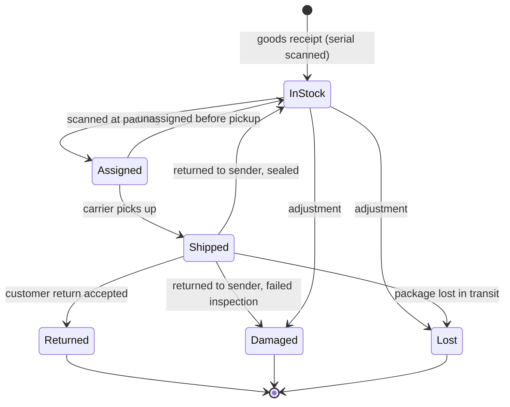

# 03 — Inventory

[Docs](../README.md) › [Product design](00-overview.md)

| | |
|---|---|
| **Status** | Approved (2026-10-31) |
| **Last updated** | 2026-10-31 |
| **Related ADRs** | [PD-ADR-001](adr/PD-ADR-001-single-vendor-b2c-single-warehouse.md), [PD-ADR-004](adr/PD-ADR-004-reserve-stock-at-checkout.md), [PD-ADR-006](adr/PD-ADR-006-per-product-serial-tracking.md) |

## 1. Purpose and scope

Inventory tracks how much of each SKU Bloom has, which physical units exist, and every change to them.

**In scope:** one warehouse, stock quantities per SKU, serial units, reservations at checkout, goods receipt, stock adjustments, serial assignment at packing, returned units, the stock ledger.

**Out of scope:** multiple warehouses, store pickup, purchase orders, supplier management, open-box resale.

## 2. Business rules

### Stock quantities

| ID | Rule |
|---|---|
| INV-R01 | Bloom has exactly one warehouse. |
| INV-R02 | Stock is tracked per SKU as **on-hand**, **reserved** and **available** (= on-hand − reserved). |
| INV-R03 | Available stock for a regular SKU never goes below zero (BI-02). |

### Reservations

| ID | Rule |
|---|---|
| INV-R04 | Stock is reserved when a customer starts checkout, never when they add to cart. |
| INV-R05 | A reservation lasts 15 minutes. If payment doesn't succeed in time, the reservation is released. |
| INV-R06 | When payment succeeds, the reservation becomes a sale. |
| INV-R07 | Launch SKUs are reserved against their pre-order allocation, not against on-hand stock (see LCH-R03). |

### Receiving and adjusting

| ID | Rule |
|---|---|
| INV-R08 | Stock enters through a **goods receipt** recorded by Warehouse: SKU and quantity for non-serialized SKUs, or a list of scanned serials for serialized SKUs. |
| INV-R09 | A serial number exists only once in the system. |
| INV-R10 | When stock for a launch SKU arrives, it fills pre-orders in *Awaiting stock* first, oldest order first, before any regular sale. |
| INV-R11 | If fewer units arrive than pre-orders waiting, unfilled pre-orders stay in *Awaiting stock* and are filled from later receipts. Customers are notified of the delay. |
| INV-R12 | Warehouse and Admin can adjust stock, or mark a serial unit as damaged or lost. Each adjustment requires a reason code and a note, and is recorded in the stock ledger and the audit log. |

### Serial units

| ID | Rule |
|---|---|
| INV-R13 | Serial units are assigned to order lines at packing, when Warehouse scans them. Reservations are quantity-based. |
| INV-R14 | A scanned serial must belong to the order line's SKU and be *In stock*. |
| INV-R15 | Every shipped serial unit is linked to exactly one order line (BI-07). |
| INV-R16 | Every accepted unit returned **by a customer** becomes *Returned*: non-sellable, held, never resold. This applies to non-serialized items too, tracked as a *Returned* quantity of the SKU. |
| INV-R20 | Units from a package **returned to sender** (never delivered) are inspected. If they pass with packaging intact, they go back to on-hand stock (serials back to *In stock*). Otherwise they become *Damaged*. |
| INV-R19 | Before carrier pickup, Warehouse can unassign a scanned serial (it goes back to *In stock*) or replace it with another. Each change is recorded in the audit log. |

### Stock ledger

| ID | Rule |
|---|---|
| INV-R17 | Every stock change writes a ledger entry: received, reserved, reservation released, sold, returned, adjusted. |
| INV-R18 | Ledger entries are never edited or deleted. A correction is a new entry. |

## 3. Serial unit states

State names are indicative. The exact model is specified in the LLD.

## 4. Roles

| Action | Role |
|---|---|
| Record goods receipt | Warehouse, Admin |
| Adjust stock, mark units damaged or lost | Warehouse, Admin |
| Scan serials at packing | Warehouse |
| Unassign or replace a scanned serial (before pickup) | Warehouse |
| View stock levels | Warehouse, Catalog manager, Support, Admin |
| View stock ledger | Warehouse, Admin |

## 5. Open questions

| ID | Question |
|---|---|
| — | OQ-03-2 resolved 2026-10-31 in [02-inventory §4.4](../low-level-design/02-inventory.md#44-receipts-adjustments-ledger). |
