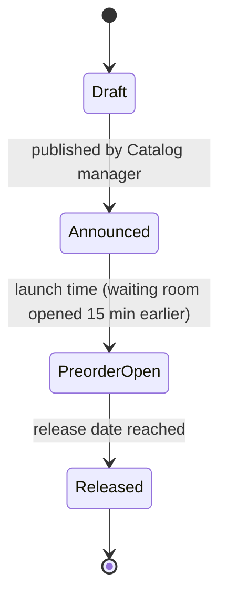
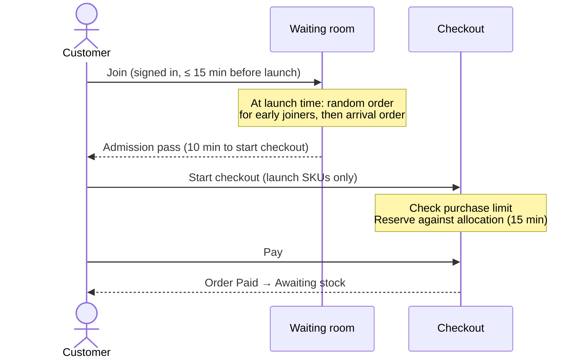

# 04 — Launch Pre-orders

[Docs](../README.md) › [Product design](00-overview.md)

| | |
|---|---|
| **Status** | Approved (2026-10-31) |
| **Last updated** | 2026-10-31 |
| **Related ADRs** | [PD-ADR-005](adr/PD-ADR-005-launch-allocation-waiting-room.md), [PD-ADR-004](adr/PD-ADR-004-reserve-stock-at-checkout.md), [PD-ADR-003](adr/PD-ADR-003-charge-at-checkout-online-only.md) |

## 1. Purpose and scope

A launch sells a limited number of new devices on a set date to many buyers at once, fairly and without overselling.

**In scope:** launch events, launch stages, fixed pre-order allocation per launch SKU, the waiting room, admission passes, per-account purchase limits, pre-order fulfillment.

**Out of scope:** unlimited pre-orders with ship-date waves, waitlists for released units, coupons on launch items.

## 2. Business rules

### Launch setup

| ID | Rule |
|---|---|
| LCH-R01 | A launch groups one or more launch SKUs (for example every color and storage of "iPhone 17 Pro"). |
| LCH-R02 | Catalog manager sets the launch time, the release date, each launch SKU's pre-order allocation, and each launch product's purchase limit. |
| LCH-R03 | Units sold or held for a launch SKU never exceed its pre-order allocation (BI-01). The allocation is a sales cap and doesn't depend on stock already received. |

### Waiting room

| ID | Rule |
|---|---|
| LCH-R04 | Each launch has one waiting room. |
| LCH-R05 | The waiting room opens **15 minutes before launch time**. |
| LCH-R06 | Only signed-in accounts with a verified email can join. Each account holds at most one position. |
| LCH-R07 | Everyone who joins before launch time gets a **random position** at launch time. Anyone joining after launch time goes to the back of the queue in arrival order. |
| LCH-R08 | From launch time, customers are admitted in queue order at a rate the system controls. |
| LCH-R09 | An admitted customer gets an **admission pass** and has **10 minutes to start checkout**, or the pass expires. |
| LCH-R22 | A pass allows **one checkout**. It is used up when that checkout starts. If the checkout expires, the customer must queue again. |
| LCH-R10 | An admitted customer can buy any launch SKU in that launch that still has allocation left, within the purchase limit. |

### Purchase limits

| ID | Rule |
|---|---|
| LCH-R11 | The purchase limit is the maximum units of a launch product (across all its SKUs) one account may buy (BI-03). |
| LCH-R12 | The limit counts units in the account's paid orders and checkouts in progress. Cancelled orders don't count. |

### Launch checkout

| ID | Rule |
|---|---|
| LCH-R13 | A launch order contains only items from that launch plus their warranty plans. Regular items need a separate order. |
| LCH-R14 | Coupons can't be applied to launch items. |
| LCH-R15 | Checkout follows the standard rules: 15-minute reservation (against allocation) and full charge at checkout. |
| LCH-R16 | When a launch checkout expires or a launch order is cancelled, its units go **straight back to the allocation pool** for the next buyer. |

### Sold out

| ID | Rule |
|---|---|
| LCH-R17 | When every launch SKU's allocation is fully held or sold, admission pauses and waiting customers are told the launch is sold out. Checkouts in progress continue until they finish or expire. |
| LCH-R18 | If held units are released (LCH-R16) while customers are still in the queue, admission resumes. |
| LCH-R23 | The waiting room **closes for good** when every launch SKU's allocation is sold and no checkouts are in progress. Everyone still queued is told the launch is sold out. |

### Live changes

| ID | Rule |
|---|---|
| LCH-R24 | From *Announced* onward, a launch SKU's allocation can only be **increased**, never reduced. |
| LCH-R25 | Purchase limits are **locked** once the launch reaches *Pre-order open*. |
| LCH-R26 | Every change to launch settings is recorded in the audit log (ACC-R11). |

### Release

| ID | Rule |
|---|---|
| LCH-R27 | The launch moves to *Released* automatically at its release date. Catalog manager can move the release date before it's reached. |
| LCH-R28 | At release, the waiting room closes if it's still open, purchase limits stop applying, and the SKUs follow the regular rules (on-hand stock, maximum 10 per line). |

### Fulfillment

| ID | Rule |
|---|---|
| LCH-R19 | A paid pre-order waits in *Awaiting stock* until stock is allocated to it **and** the release date is reached. Stock that arrives early is allocated to it (so no one else can take it) but doesn't ship before the release date. |
| LCH-R20 | Arriving stock fills pre-orders oldest first, before any regular sale (INV-R10). If too few units arrive, the rest keep waiting, and customers are notified of the delay (INV-R11). |
| LCH-R21 | Customers can cancel a pre-order for a full refund until packing starts (ORD-R05). |

## 3. Launch stages

| Stage | Visible to customers | Buyable | Waiting room |
|---|---|---|---|
| Draft | No | No | — |
| Announced | Yes | No | Opens 15 min before launch time |
| Pre-order open | Yes | Yes, through the waiting room, against allocation | Active |
| Released | Yes | Yes, as regular SKUs against on-hand stock, no purchase limit | Closed |

## 4. Customer flow

## 5. Roles

| Action | Role |
|---|---|
| Create launches, set launch time, allocation and purchase limits | Catalog manager, Admin |
| Join waiting room, buy | Customer |

## 6. Open questions

| ID | Question |
|---|---|
| — | None open. OQ-04-1 to OQ-04-5 resolved 2026-10-31 (LCH-R22 to LCH-R28). |
