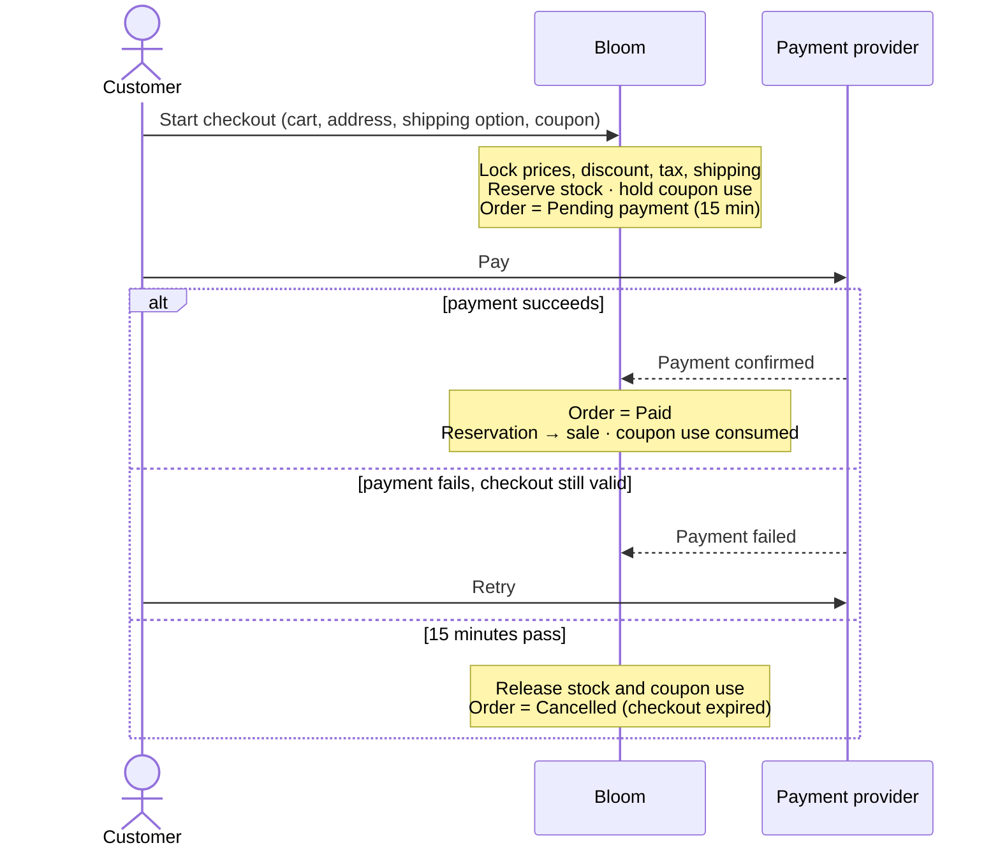

# 05 — Checkout and Payment

| | |
|---|---|
| **Status** | Approved (2026-10-31) |
| **Last updated** | 2026-10-31 |
| **Related ADRs** | [PD-ADR-002](adr/PD-ADR-002-us-market-flat-sales-tax.md), [PD-ADR-003](adr/PD-ADR-003-charge-at-checkout-online-only.md), [PD-ADR-004](adr/PD-ADR-004-reserve-stock-at-checkout.md), [PD-ADR-007](adr/PD-ADR-007-coupon-allocation-and-holding.md), [PD-ADR-008](adr/PD-ADR-008-account-required-staff-mfa.md) |

## 1. Purpose and scope

Checkout turns a cart into a paid order: it locks the price, reserves stock, holds the coupon use and takes payment once.

**In scope:** cart, checkout, shipping options, flat sales tax, online payment, payment retry, refunds to the original method.

**Out of scope:** guest checkout, cash on delivery, store credit, gift cards, split payments, multi-currency, real tax calculation, live carrier rates.

## 2. Business rules

### Cart

| ID | Rule |
|---|---|
| CHK-R01 | Buying requires a signed-in customer account with a verified email. |
| CHK-R02 | The cart is saved per account, holds no stock, and shows current prices. |
| CHK-R03 | A regular SKU line can have at most 10 units. |
| CHK-R18 | When the cart is shown, each line displays its current price and flags items that are out of stock or have changed price. These flags are informational. The binding check is at checkout start (CHK-R04). |

### Checkout start

| ID | Rule |
|---|---|
| CHK-R04 | When checkout starts, Bloom locks prices, the discount, tax and the shipping fee, reserves stock (INV-R04), holds the coupon use (PRM-R08) and creates the order in *Pending payment*. |
| CHK-R05 | The checkout is valid for 15 minutes. |
| CHK-R06 | Shipping addresses must be in the US. |
| CHK-R07 | Shipping options: **Standard** (free) or **Express** (flat fee set by Admin). |
| CHK-R08 | Sales tax is one flat rate, set in configuration, applied to physical product lines only, on the price **after** the line's discount share. Shipping fees and warranty plans are not taxed. |
| CHK-R09 | At most one coupon per order. Its discount is split across eligible lines (PRM-R06). |

### Payment

| ID | Rule |
|---|---|
| CHK-R10 | Payment is online only, through the payment provider (card and wallets). Bloom never stores card data. |
| CHK-R11 | The full order total is charged at checkout, including for pre-orders. An order is charged at most once (BI-05). |
| CHK-R12 | When payment succeeds, the order becomes *Paid*, reservations become sales, and the coupon use is consumed. |
| CHK-R13 | If payment fails, the customer can retry while the checkout is still valid. |
| CHK-R14 | When the checkout expires without successful payment, stock and the coupon use are released, and the order becomes *Cancelled* (reason: checkout expired). |

### Amounts and refunds

| ID | Rule |
|---|---|
| CHK-R15 | Each order line stores its **paid amount**: unit price × quantity − its share of the discount, plus its tax. |
| CHK-R16 | Refunds always go to the original payment method. |
| CHK-R17 | Total refunds on an order line never exceed its paid amount (BI-05). |

## 3. Checkout flow

## 4. Roles

| Action | Role |
|---|---|
| Check out, pay | Customer |
| Set the Express shipping fee | Admin |

## 5. Open questions

| ID | Question |
|---|---|
| OQ-05-4 | Rounding rule when the flat tax rate produces fractions of a cent. (Can be set in the LLD.) |
