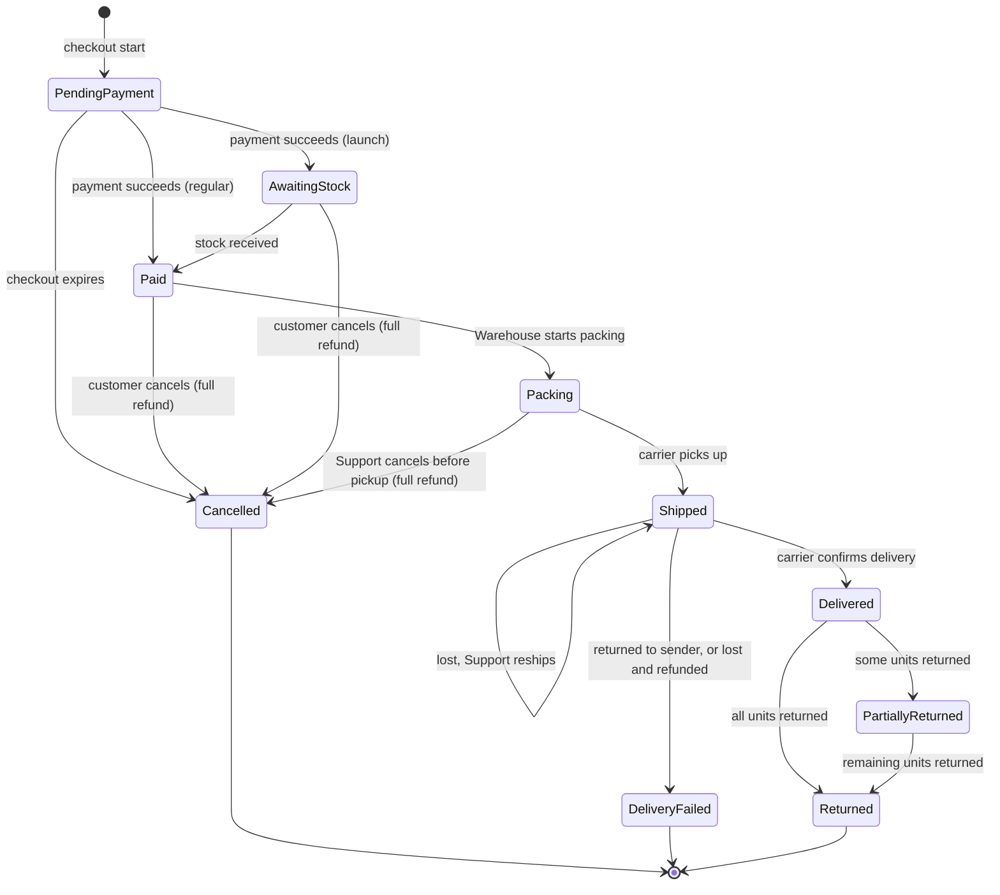

# 06 — Orders and Fulfillment

| | |
|---|---|
| **Status** | Approved (2026-10-31) |
| **Last updated** | 2026-10-31 |
| **Related ADRs** | [PD-ADR-003](adr/PD-ADR-003-charge-at-checkout-online-only.md), [PD-ADR-006](adr/PD-ADR-006-per-product-serial-tracking.md) |

## 1. Purpose and scope

An order records what a customer bought, and moves from payment through packing and shipping to delivery.

**In scope:** order lifecycle, customer and staff cancellation, picking and packing with serial scanning, carrier shipments, tracking updates, delivery failures, order history.

**Out of scope:** multiple warehouses, store pickup, split shipments between launch and regular items (they can't share an order, LCH-R13).

## 2. Business rules

### Order lifecycle

| ID | Rule |
|---|---|
| ORD-R01 | An order is created at checkout start in *Pending payment* (CHK-R04). |
| ORD-R02 | A paid regular order moves to *Paid*. A paid launch order moves to *Awaiting stock* until stock is received for its lines (LCH-R19). |
| ORD-R03 | Order statuses: *Pending payment*, *Paid*, *Awaiting stock*, *Packing*, *Shipped*, *Delivered*, *Cancelled*, *Delivery failed*, *Partially returned*, *Returned*. |
| ORD-R16 | When stock is allocated to a pre-order in *Awaiting stock*, it moves to *Paid* (ready to pack), the same as a regular order. |
| ORD-R04 | Every status change is recorded with time and actor (customer, staff member or system). |

### Cancellation

| ID | Rule |
|---|---|
| ORD-R05 | A customer can cancel their own order **until packing starts** (statuses *Paid* or *Awaiting stock*). |
| ORD-R06 | Cancellation triggers an automatic **full refund**, releases stock (or returns launch units to the allocation pool), and restores the coupon use. |
| ORD-R07 | After packing starts, customers can't cancel. Their route is a return once delivered (see [07-returns-refunds](07-returns-refunds.md)). |
| ORD-R14 | Support can cancel an order on the customer's behalf **until carrier pickup**, including during *Packing* (Warehouse unassigns scanned serials, INV-R19). The effects are the same as ORD-R06. |

### Fulfillment

| ID | Rule |
|---|---|
| ORD-R08 | Warehouse picks and packs orders. For serialized lines, Warehouse scans each unit's serial (INV-R13, INV-R14). |
| ORD-R09 | Bloom creates the shipment through the carrier API: label, tracking number, and Standard or Express service as ordered. |
| ORD-R15 | An order ships as **one shipment**. The only additional shipment is a replacement for a lost package (ORD-R13). |
| ORD-R10 | Shipment status updates (in transit, delivered, failed) come from the carrier and update the order. |
| ORD-R11 | Warranty coverage starts when the order is *Delivered* (WAR rules in [07-returns-refunds](07-returns-refunds.md) §2.4). |

### Delivery failures

| ID | Rule |
|---|---|
| ORD-R12 | **Returned to sender:** when the package comes back, it is inspected and then refunded automatically. The order ends in *Delivery failed*. Units go back to stock if sealed, otherwise become *Damaged* (INV-R20). |
| ORD-R13 | **Lost in transit:** Support chooses to refund or reship. A reship is a replacement shipment from stock (new serial units for serialized lines), and the order stays *Shipped* until the replacement is delivered. A refund ends the order in *Delivery failed*. |
| ORD-R17 | When an order ends in *Delivery failed*, the customer gets the **full order total** back, including the Express fee, whatever the inspection finds. The coupon use is restored. |

## 3. Order states

## 4. Roles

| Action | Role |
|---|---|
| Cancel own order (before packing) | Customer |
| View order history | Customer (own orders), Support, Admin |
| Pick, pack, scan serials | Warehouse |
| Cancel orders, decide refund or reship for lost packages | Support, Admin |

## 5. Open questions

| ID | Question |
|---|---|
| — | None open. OQ-06-1 to OQ-06-7 resolved 2026-10-31 (ORD-R12 to ORD-R17). |
