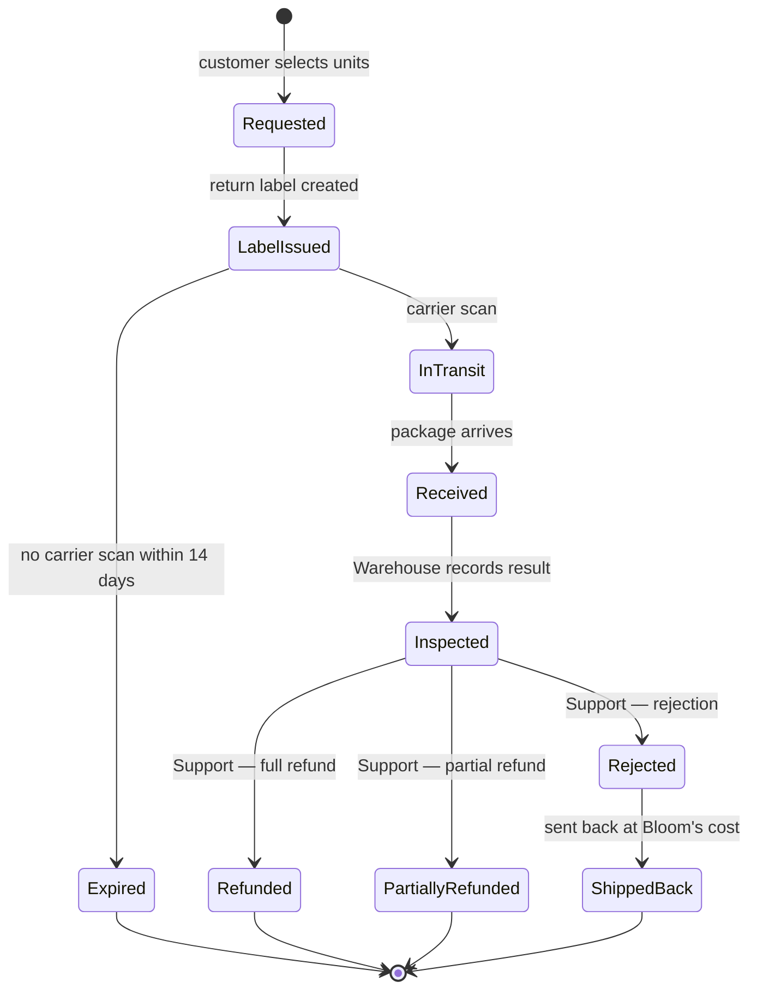

# 07 — Returns, Refunds and Warranty

[Docs](../README.md) › [Product design](00-overview.md)

| | |
|---|---|
| **Status** | Approved (2026-10-31) |
| **Last updated** | 2026-10-31 |
| **Related ADRs** | [PD-ADR-006](adr/PD-ADR-006-per-product-serial-tracking.md), [PD-ADR-007](adr/PD-ADR-007-coupon-allocation-and-holding.md), [PD-ADR-003](adr/PD-ADR-003-charge-at-checkout-online-only.md) |

## 1. Purpose and scope

Customers can return delivered units within 14 days. Bloom inspects each returned unit and refunds what the customer actually paid. Warranty plans are sold with devices and linked to their serial numbers.

**In scope:** return requests, prepaid return labels, inspection, return decisions (full refund, partial refund, rejection), refunds, warranty plan sale, coverage and lookup.

**Out of scope:** warranty claims and repairs, exchanges, open-box resale, store credit refunds.

## 2. Business rules

### 2.1 Return requests

| ID | Rule |
|---|---|
| RET-R01 | A customer can return units of a *Delivered* order within **14 days of delivery**, for any reason. |
| RET-R02 | Returns are per unit. An order can be partly returned. |
| RET-R03 | Bloom issues a **prepaid return label** through the carrier API. |
| RET-R15 | If the carrier hasn't scanned the return label within **14 days of the request**, the request expires and the units stay with the customer. A new request is only possible while the 14-day return window is still open. |

### 2.2 Inspection and decision

| ID | Rule |
|---|---|
| RET-R04 | Warehouse receives the package and inspects each unit (by serial for serialized units), recording a result and notes. |
| RET-R05 | Support makes the return decision for each unit: **full refund**, **partial refund** or **rejection**. |
| RET-R06 | A full refund returns the unit's share of the line's paid amount (CHK-R15). |
| RET-R07 | A partial refund amount is entered by Support and never exceeds the unit's share of the paid amount. |
| RET-R14 | A partial refund is split between price and tax **in the same proportion** as the unit's paid amount. Support enters one amount, and the system splits it. |
| RET-R08 | A rejected unit is shipped back to the customer at Bloom's cost. |
| RET-R09 | Accepted returned units, serialized or not, become *Returned*: held and never resold (INV-R16). |
| RET-R10 | Returns don't restore coupon uses (PRM-R10). |

### 2.3 Refunds

| ID | Rule |
|---|---|
| RET-R11 | Refunds go to the original payment method (CHK-R16). |
| RET-R12 | Total refunds on an order line never exceed its paid amount (BI-05). |
| RET-R13 | The Express shipping fee is refunded only when **every unit** of the order is returned and accepted (full or partial refund). Partial returns and rejected units don't refund it. |

### 2.4 Warranty plans

| ID | Rule |
|---|---|
| WAR-R01 | A warranty plan can only be bought **in the same order** as an eligible device (CAT-R07). |
| WAR-R02 | When the device ships, the plan is linked to that unit's serial number. |
| WAR-R03 | Coverage starts at delivery and lasts the plan's coverage length. |
| WAR-R04 | Customers and staff can look up coverage by serial number. |
| WAR-R05 | When the covered device is returned and refunded (fully or partly), its plan is refunded in full automatically. |
| WAR-R06 | A plan can also be returned on its own within the 14-day return window, for a full refund of its paid amount. |

## 3. Return request states

State names are indicative. The exact model is specified in the LLD.

## 4. Roles

| Action | Role |
|---|---|
| Request a return, look up coverage | Customer |
| Receive and inspect returns | Warehouse |
| Decide outcome, enter partial refund amount | Support, Admin |
| Look up coverage | Support, Admin |

## 5. Open questions

| ID | Question |
|---|---|
| — | None open. OQ-07-1 to OQ-07-4 resolved 2026-10-31 (RET-R09, RET-R13 to RET-R15). |
