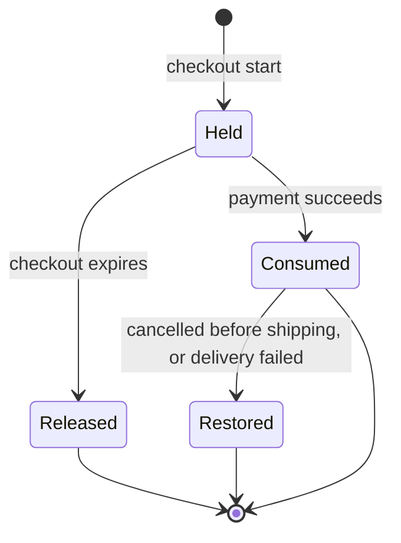

# 08 — Promotions

| | |
|---|---|
| **Status** | Approved (2026-10-31) |
| **Last updated** | 2026-10-31 |
| **Related ADRs** | [PD-ADR-007](adr/PD-ADR-007-coupon-allocation-and-holding.md) |

## 1. Purpose and scope

Staff create coupon codes that customers enter at checkout for a discount.

**In scope:** coupon codes, percent and fixed-amount discounts, scope, minimum spend, expiry, usage limits, discount allocation per line, the coupon use lifecycle.

**Out of scope:** automatic sale prices, bundles, buy-X-get-Y, coupon stacking, coupons on launch items.

## 2. Business rules

### Coupon definition

| ID | Rule |
|---|---|
| PRM-R01 | Discounts are coupon codes only. There are no automatic sales. |
| PRM-R02 | A coupon has: a code, a type (**percent** or **fixed amount**), a scope (**whole order** or **selected products / categories**), and optionally a minimum spend, a start date, an expiry, a total usage limit and a per-customer usage limit. |
| PRM-R12 | Codes are **case-insensitive** and unique ignoring case. |
| PRM-R13 | Staff can deactivate a coupon before expiry. New checkouts can no longer apply it. Checkouts already holding a use can still pay within their 15 minutes. |
| PRM-R03 | At most one coupon per order. |

### Eligibility and allocation

| ID | Rule |
|---|---|
| PRM-R04 | A coupon only discounts **eligible lines**: physical products, within its scope. Launch items, warranty plans and shipping fees are never discounted. |
| PRM-R05 | The discount never exceeds the total of the eligible lines. |
| PRM-R11 | A coupon's minimum spend is measured on **eligible lines only**. |
| PRM-R06 | At checkout start the discount is **split across eligible lines in proportion to their price**, and each line stores its paid amount (CHK-R15). |

### Coupon use lifecycle

| ID | Rule |
|---|---|
| PRM-R07 | Uses that are *held* or *consumed* count against both the total and the per-customer limit (BI-04). |
| PRM-R08 | A use is **held** at checkout start, together with the stock reservation and for the same 15 minutes. |
| PRM-R09 | It is **consumed** when payment succeeds, and **released** if the checkout expires. |
| PRM-R10 | If the order is cancelled before shipping or ends in *Delivery failed*, the use is **restored** (no longer counts). After a return, it isn't restored. |

## 3. Roles

| Action | Role |
|---|---|
| Create and edit coupons | Catalog manager, Admin |
| Apply a coupon | Customer |

## 4. Open questions

| ID | Question |
|---|---|
| — | OQ-08-3 resolved 2026-10-31 in [03-order §6.3](../low-level-design/03-order.md#63-pricing) (largest remainder). |